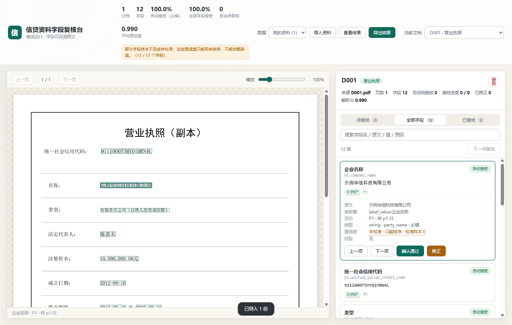

# 信贷资料字段复核台

在 Windows 上本地抽取信贷资料里的字段。点击字段可以定位到原文，逐项确认或修正，再下载包含结果表、离线查看页和复核流水的 ZIP。

## 快速体验

安装 [Python 3.11](https://www.python.org/downloads/) 后，在项目根目录打开终端。

```bat
py -3.11 -m venv .venv
.venv\Scripts\python.exe -m pip install -r requirements.txt
.venv\Scripts\python.exe -m docpipe.synth --out samples
```

双击 `打开复核台.bat`。在「导入资料」中选择 `samples/dev/D001.pdf`，点击任意字段查看原文位置，完成修正后点「导出结果」。将 ZIP 解压后可直接打开 `查看结果.html`。



## 公开状态与许可

本项目按 [AGPL-3.0-only](LICENSE) 发布，使用 [第三方组件](THIRD_PARTY_NOTICES.md)。依赖安装需要联网，导入、识别、复核和导出在本机运行。

- 本机单用户预览版。复核台默认仅监听回环地址，面向本机操作。请勿对局域网或公网开放。
- 公开版默认使用未校准的启发式评分，分数用于排序。评估使用虚构的合成样本，进入真实信贷业务前仍需批量验证脱敏材料。
- 尽量先用合成样本试用。`inbox/` 保存原件，`out/` 与 `work/` 保存结果、缓存及复核记录。导出包可能内嵌原文页，只与有权限的接收人共享。上述目录、本地交接文档及常见资料格式均由 Git 忽略。

## 当前支持

| 文档类型 | 字段 | 载体 |
| --- | --- | --- |
| 营业执照 BUSINESS_LICENSE | 名称、USCC、法人、地址、经营范围、期限等 12 项 | 文本层 PDF / 扫描图 PDF / 图片 |
| 企业信用报告 CREDIT_REPORT_ENTERPRISE | 主体信息、查询信息、贷款账户统计等 15 项 | 文本层 PDF / 扫描图 PDF / 图片 |
| 银行流水 BANK_STATEMENT | 户名/账号/开户行/期间/期初期末余额 + 逐笔交易（支持「收支方向 + 交易金额」与「借方发生额 / 贷方发生额」两种版式） | 文本层 PDF / 扫描图 PDF（3 页）/ 图片（多页 TIFF 按页处理） |
| 利润表 INCOME_STATEMENT | 期间、营业收入、成本、利润、信用/资产减值损失、资产处置与公允价值变动收益、综合收益总额等 26 项 | 文本层 PDF（含年报「无项目表头、无框线、人民币百万元」版式）/ 扫描图 PDF / 图片 |
| 增值税发票 VAT_INVOICE | 发票号码、开票日期、购销方名称/税号、合计、税额、价税合计、合同、开票人 + 逐项明细 19 项 | 文本层 PDF / 扫描图 PDF / 图片（含二维码核对） |
| 海关进口增值税专用缴款书 CUSTOMS_VAT_PAYMENT | 缴款书号、填发日期、缴款单位、开户银行、收入机关、预算级次、收款国库、金额、报关单编号、完税价格/税率/税款明细等 25 项 | 文本层 PDF / 扫描图 PDF / 图片 |

脚本可以生成 20 份基础合成样本（dev 和 holdout 各 10 份）与 30 份可选诊断难例。样本中的企业、人名和账号均为虚构，每份 PDF 配有字段坐标标注。

能力清单：

- 解析：PyMuPDF 文本层 → 字符级坐标；扫描页与导入的图片整页走 OCR（CPU，默认后端 RapidOCR/onnxruntime，引擎名由 `parsing.ocr_engine` 选，注册表在 `docpipe/ocr.py`）；表格文本层用 pdfplumber，扫描表格用"表头锚点 + 行重建"；续页没有表头时按上一页的列中心自动续接（`engine: continuation`，记录 `continued_from`）。可选开启 `parsing.layout`，用 PyMuPDF 自带版面模型（离线，约 0.3 秒/页）把"表格块"先圈出来再找表头，一页两张表时互不污染；模型找不到表格块时整块回退到整页行为。表格可声明 `header_row_slack`（首行数据与表头框的印刷重叠容差）与 `column_patterns`：无竖线导致 OCR 把两列数字并成一框时，只有两侧都**完整匹配**各自模式才按比例拆开，否则保留原框并进复核。
- 发票二维码：`parsing.qr` 开启后用 OpenCV 本地解码（不联网），按 `doc_types.<TYPE>.qr.fields` 的索引从载荷取字段。二维码只做**补空与核对**：OCR 缺失时填入并标 `meta.source: qr`；与 OCR 不一致时保留 OCR 值、记录 `qr_conflict`，由 `V-QR-01` + `QR_CONFLICT` 强制复核。海关缴款书暂未声明二维码字段映射。
- 表格异常检测：跨行合并单元格、列错位片段、横向并框（一个框越过相邻声明列的中心而那一列在本行是空的）只检测、标记、进复核，绝不自动还原或按比例拆值。受影响行的字段带 `TABLE_ANOMALY` 原因码强制复核，异常没碰到的行不受影响；并框行还带 `meta.table_anomaly_columns`（被吃掉的是哪几列），复核界面直接写出「「对方户名」+「收支方向」被读成同一个框」。`parsing.table_anomaly` 控制三类信号的阈值与开关（`detect_column_merge` / `column_merge_slack`），`validation.review_on_table_anomaly` 控制是否强制复核。
- 页级分辨率门：解析时量出每页**实际带了多少像素**——PDF 页按嵌入图相对页面物理尺寸（1pt = 1/72 英寸）换算，图片导入的页面没有可靠纸张尺寸，按归一化后的像素数折算成 A4 上的等效 dpi。低于 `parsing.page_quality.min_effective_dpi` 的整页打 `LOW_RESOLUTION`，该页所有字段强制复核（开关 `validation.review_on_low_resolution`）。这条专门堵难例集暴露的失效模式：120dpi 的糊字放大到 300dpi 再 OCR，读错了照样给 0.99 置信度，字段级特征看不见。
- 抽取：配置驱动，支持 `label_value`、`label_region`、`regex`、`period_range`、`unit`、`header_matrix`、`table_cell`、`table_row`。`regex` 配了 `label` / `aliases` 时**只在包含该标签的行上匹配**，标签缺失就留空进复核，不会退化成"页面上任何一个同形字符串都算这个字段"；只有模式自身带锚点（例如价税合计的「（小写）￥」）的字段才写 `allow_unlabeled: true` 显式放行整页匹配。`label_region` 面向表格化票据：标签可跨框拆分、无冒号；`value_index` 取同一视觉行第 n 个值（合计/税额两列）；`allow_below` 取标签正下方堆叠的单元格值；`preserve_spaces` 保留分框间的空格（运输工具名）；`value_strip_prefix` / `strip_pattern` 去掉 No.、行号等前缀。表格列可声明 `optional_headers`（如流水的借方发生额/贷方发生额）：只参与表头识别与取数，不计入 `min_columns`，也不拉低模板覆盖率；`column_enum` 从「哪一列有金额」推出方向，`fallback_columns` + `signed_by_direction` 从同一列取金额并按方向补负号，符号是推出来的就带 `SIGN_INFERRED` 强制复核。两列同时有值时整行留空进复核，不猜。
- 年报版式利润表：公开年报的合并利润表常常没有「项目 / 本期金额 / 上期金额」表头，列头直接写「2024 年度 / 2023 年度」，整页无框线、金额右对齐、单位「人民币百万元」。`table.line_fallback` 先按年度列头找到金额列右边缘（被拆开的「2024」「年度」会按配置间距合并），再按行标签（保留「一、」「减：」「其中：」等前缀语义）取对齐的金额，单位按 1,000,000 折算成元。**这类行没有表头覆盖和框线证据，命中的字段一律带 `LINE_FALLBACK` 进复核，不自动接受**；扫描/拍照页不走这条路。
- 征信概要矩阵：官方企业信用报告的「未结清信贷及授信信息概要」没有框线，表头是「正常类 / 关注类 / 不良类 / 合计」四组重复的「账户数 / 余额」。`header_matrix` 按「区段标题 + 表头序列 + 子表头精确重复 + 行标签 + 单元格数正好等于列数」定位，一条证据不全就整行弃权；金额只认报告正文里的单位说明（「金额类数据项单位均为万元」），没有单位就保留原数并带 `AMBIGUOUS_UNIT`。这条路取到的字段带 `MATRIX_FALLBACK` 强制复核（开关 `validation.review_on_matrix_fallback`），配置在字段的 `fallback:` 下，标签行能取到时优先走标签，不受影响。
- 版式别名：营业执照的负责人栏按主体类型认「法定代表人 / 负责人 / 执行事务合伙人 / 经营者 / 投资人」，地址认「住所 / 经营场所 / 营业场所」，类型认「类型 / 企业类型 / 组成形式」——个体户与合伙企业的执照不会再整份判负责人缺失。
- 溯源：每个字段带页码与 bbox；坐标缺失、退化或越出页面时不会被自动接受。
- 校验：USCC 校验位、银行流水余额连续性（V-BS-01…07）、利润表恒等式（V-IS-01…04）、跨文档名称/USCC 一致性（V-X-01/02）；发票价税勾稽（V-VI-01…04：金额+税额=价税合计、行金额×税率=行税额、单价×数量=金额、明细合计=票面合计）；海关缴款书勾稽（V-CV-01…03：完税价格×税率=税款、行税款合计=票面合计、缴款书号与报关单编号一致）。通用编码格式由 `validation.code_patterns` 统一校验（`V-ID-08`）。
- 信任决策：logistic + isotonic 校准（`sample_grouping: field_auto`，字段样本 ≥30 按字段分层，不足回退文档类型），输出 `accept` / `review`，并给出结构化复核原因；硬性弃权原因码由 `hard_abstain_reasons` 配置。每个字段同时记录 `confidence_basis`（`calibrated` / `calibrated_low_samples` / `heuristic`）与样本数，界面、网页版、CSV、`summary.json` 都写清"这个数能不能当概率读"，样本不够的置信度一律带 `*` 只用于排序。
- 拍照资料预处理（`preprocess` 配置块，全部阈值可改）：投影profile 去倾斜 + 文档轮廓透视拉正（矫正只在生成"流水线用副本"时做一次，OCR、复核界面原文页、网页版看到的是同一张图，坐标不用重算）；送 OCR 前先用形态学定位的**局部印章掩码**淡化红/蓝印章——只改章体及压章笔画，章外的红色印字（如销售方税号）保留，不再整页通道取最大；跨页骑缝章只有半边或一角入画时整页彩色占比会掉到主门之下，另用「贴边残片门」只认贴到画幅边缘的色块（页内彩色小块照旧被拒），并把这条弱证据记成 `seal_edge_fragment`；CLAHE 补低对比度、gamma 提亮逆光（这两件整页改写各记 `contrast_lifted` / `brightness_lifted` 并随出参发到复核台与网页版——送去 OCR 的像素和页面上看到的原样不是同一张图，必须说一句话），并把成片反光带压回可读（判据是"局部对比度塌陷 + 该处纸面仍够亮且不带色"，按塌陷程度算增益，只拉伸被冲淡的像素，均匀打光的页面像素不动）；成像质量不过关（糊、暗、反光、倾斜超上限、至少两条边出框的"只拍到半页"、OCR 置信度低）打 `PHOTO_*` 标记，手指/物体挡住一块时打 `PHOTO_OCCLUSION`——遮挡只标记、不猜像素，界面与网页版显示"建议重拍"，印章压住字段直接进「待复核」。`inbox/` 里的原始照片不被改写。
- 批处理：逐文档 JSON + `summary.json` + `fields.csv` + 复核流水 JSONL，附解析/抽取耗时。
- 复核界面：零框架前端，缩放/翻页/字段搜索，上一项/下一项与方向键切换，点字段高亮原图位置，接受或修正后即时写盘。`TABLE_ANOMALY` 的原因码标签悬停会写出具体是哪几列被并成一框，字段详情里另有一行「并框：「甲列」+「乙列」被读成同一个框，值没有拆，请人工分列」。
- 自助导入：界面右上角「导入资料」支持多选/拖拽 PDF、图片（PNG / JPG / BMP / TIFF / GIF / WEBP）和 ZIP 压缩包，也可以点「选择整个文件夹」或直接把文件夹拖进来——浏览器递归展开后按 `ui.max_import_files` 限量，超出只跳过、不报错；原始文件只留在本机 `inbox/`，按 SHA-256 去重，处理结果写入 `out/user/`；顶栏「数据」下拉在「我的资料 / 示例数据 / 验收数据」之间切换。上传的文件类型按**文件头字节**判定，不看扩展名也不信任浏览器给的 MIME。
- 资料下架：「我的资料」里打开任意一份，标题右侧有「删除」按钮。原件、输出目录、解析缓存、渲染缓存和复核流水**一起移入 `work/trash/时间戳/`**（不做物理删除，误删把文件移回去即可），然后自动用剩下的资料重建 `out/user/`；收件箱空了则清空该数据区索引。回收目录按 `ui.trash_prune` / `trash_keep_runs` / `trash_keep_days` 自动保留最近若干次、若干天，清理了几个会在删除的提示里写明。示例数据与验收数据区由样本目录生成，界面拒绝在那里删除。
- 复核结果导出：`docpipe.export` 把人工修正合并成 `effective_value + review_status` 的最终 JSON/CSV，不覆盖自动决策；`docpipe.report` 另生成单文件离线网页 `查看结果.html`（按资料类型分类 + 风险小节 + 内嵌原文页 + 点字段定位坐标）；`export_zip` 把网页版、`怎么看.txt`、`final/`、`review/`、`export_manifest.json` 打成一个包，界面「导出结果」直接下载。
- 一键验收：`docpipe.acceptance` 校验输出契约、阶段门槛和复核 API 闭环，输出 PASS/FAIL 与 JSON 报告。

## 环境

- Windows 10/11（已验证 Windows 10.0.26300）
- Python 3.11（已验证 3.11.9）
- 首次运行会加载 RapidOCR 自带的 ONNX 模型，全程不联网

```bat
cd /d <你的项目目录>\提取文字工具
pip install -r requirements.txt
set PYTHONIOENCODING=utf-8
```

`PYTHONIOENCODING=utf-8` 用于避免 Windows 控制台把中文指标打成乱码；结果以写出的 JSON 为准。

推荐使用独立环境：`py -3.11 -m venv .venv`，再执行 `.venv\Scripts\python.exe -m pip install -r requirements.txt`。安装依赖需要联网，安装完成后识别与复核全程离线。双击根目录的 `打开复核台.bat`，优先使用 `.venv`，按实际空闲端口打开浏览器；缺少依赖时显示安装命令。关闭服务窗口会停止复核台。已有主交付数据时仍打开原数据区，首次使用进入「我的资料」。

### 本地复核快捷操作

- `↑ / ↓` 切换可见字段，`N` 或「下一待复核」跳过已复核字段；有搜索条件时只在匹配项中导航。
- `E` 打开修正，`Enter` 保存修正，`Ctrl+Enter`（macOS 为 `Cmd+Enter`）保存修正或确认当前字段，`Esc` 取消修正，`/` 聚焦搜索。输入文字、输入法组合与导入弹窗不会触发导航快捷键。
- 搜索支持字段名、路径、原文、原值、人工修正值及中文复核原因，并显示匹配数量；修正时搜索不会清空未保存草稿或抢走搜索框焦点。
- 导入按文件显示上传状态；单个文件失败不阻断其余文件，成功文件照常解析，失败项保留供移除或重试。解析失败时保留已上传状态，重试不重复上传；解析阶段显示不定进度，不伪造 OCR 百分比。
- 保存复核时锁定重复提交及文档切换，每次确认仍独立写入原有审计台账，不改变自动判决和置信度。

## 快速开始

以下命令从项目根目录执行。已创建虚拟环境时，可先在命令提示符运行一行以使用其中的 Python。

```bat
call .venv\Scripts\activate.bat
set PYTHONIOENCODING=utf-8
```

### 重建合成语料并验收

```bat
python -m docpipe.synth --out samples
python -m docpipe.samplefreeze
python -m docpipe.run --input samples/dev --out out/dev
python -m docpipe.run --input samples/holdout --out out/holdout
python -m docpipe.acceptance --out out/holdout --labels labels/holdout
python -m unittest discover -s tests -q
```

样本生成会写入 `samples/` 和 `labels/`。默认使用 Windows 的宋体和黑体生成固定种子样本。冻结检查会校验 PDF、标注和版本摘要。当前合成开发集只有正例，公开版验收会逐字段核对启发式评分、评分来源和样本数。已有校准产物时，验收会核对该产物与交付评分。

如需单独生成评估报告，运行 `python -m docpipe.evaluate --pred out/holdout --labels labels/holdout`。难例诊断可另行运行 `python -m docpipe.hardset generate` 和 `python -m docpipe.hardset eval`。

### 只处理自己的资料（不跑示例数据）

```bat
cd /d <你的项目目录>\提取文字工具
set PYTHONIOENCODING=utf-8
python -m docpipe.serve --out out/user
```

打开终端打印的复核台地址 → 右上角「导入资料」→ 拖入或选择 PDF / 图片（可多选）→「开始导入」。原始文件保存在 `inbox/`，结果写入 `out/user/`，完成后界面自动打开第一份文档并开始复核。复核完点「导出结果」下载 ZIP；点「查看结果」直接在本机浏览器打开离线网页版结果（当前数据区还没有资料时，它会先告诉你下一步该做什么）。

命令行等价操作：

```bat
:: 把 PDF / 图片 放进 inbox\ 后直接跑批
python -m docpipe.run --input inbox --out out/user
:: 只生成离线网页版结果（out\user\final\查看结果.html）
python -m docpipe.report --out out/user
:: 复核结束后打包导出（查看结果.html + 怎么看.txt + final + review 流水 + manifest）
python -m docpipe.export --out out/user --zip
```

上传限制、工作区与数据目录都在 `config/scenario.yaml`：`ui.max_upload_mb`（默认 60 MB，仅本机回环地址可达）、`ui.workspaces`、`paths.inbox`、`paths.user_out`、`ingest.allowed_suffixes`、`ingest.image_max_side`。同名不同内容的文件自动改名为 `xxx-2.pdf`，内容完全相同的重复上传会被识别为 `duplicate` 并复用已有文件；文件名会被清洗掉路径穿越字符，中文文件名可用。

### 导出与接口

「导出结果」调用 `POST /api/export`，浏览器自动下载 `work/exports/<数据区>_<时间戳>.zip`，提示里同时给出网页版与压缩包的完整路径。ZIP 结构（前两项在第一层，双击即开）：

```text
查看结果.html              单文件离线网页版：分类、搜索、点字段定位原文、可打印成 PDF
怎么看.txt                 给非技术同事的一页说明（UTF-8 BOM，记事本直接可读）
final/<文档>/<文档>.json    应用人工修正后的最终结果（value + effective_value）
final/final_fields.csv      含 effective_value、review_status 的扁平表
final/final_summary.json    复核数、修正数、待复核数汇总
review/<文档>.review.jsonl   人工复核审计流水
export_manifest.json        来源目录、导出时间、文档数、字段数，外加成员清单：
                            member_count 声明条数 + members 逐条 name/bytes/sha256 + skipped_members 拒收原因
```

本地 HTTP 接口（只监听 `127.0.0.1`，非本机 Origin 的写请求一律 403）：

| 方法 | 路径 | 用途 |
| --- | --- | --- |
| GET | `/api/summary` | 当前数据区汇总 |
| GET / POST | `/api/workspaces`、`/api/workspace` | 列出/切换数据区 |
| POST | `/api/import?filename=x.png` | 上传单个文件（请求体为原始字节；类型按文件头判定，扩展名只作参考；`.zip` 解包后逐个入库） |
| POST | `/api/import/run` | 对 `inbox/` 跑完整流水线并切到「我的资料」 |
| POST | `/api/document/<id>/remove` | 下架一份资料（移入 `work/trash/`，返回回收路径与本次清理的旧回收目录） |
| POST | `/api/export` | 生成网页版 + ZIP，返回 `download` 与 `report` 路径 |
| GET | `/api/export/download/<name>.zip` | 下载 ZIP |
| GET | `/report`、`/api/report` | 直接打开网页版结果 / 返回结果文件信息（`?refresh=1` 强制重建） |
| GET | `/api/document/<id>`、`/api/page/<id>/<n>.png` | 文档 JSON 与页面渲染 |
| POST | `/api/review/<id>` | 追加一条接受/修正记录 |

复核完成后也可以在命令行单独生成最终交付物（不打包）：

```bat
python -m docpipe.export --out out/dev
:: 产物：out/dev/final/<文档>/<文档>.json、final_fields.csv、final_summary.json
```

### 常用参数与调试

```bat
python -m docpipe.serve --out out/holdout --port 8766
python -m docpipe.run --input samples/dev --out out/dev --force
python -m docpipe.export --out out/user --zip
python -m docpipe.report --out out/user
python -m docpipe.synth --out samples --seed 7
python -m docpipe.calibrate --split dev --probe
python -m docpipe.calibrate --split dev --augment --out work/calibration_augmented.json   # 探针对照用，必须自己指产物路径：不带 --out 会覆盖线上 work/calibration.json
python -m docpipe.hardset generate --per-kind 5
python -m docpipe.hardset eval --no-force
python -m docpipe.hardset sweep
python -m docpipe.hardset signals
python -m docpipe.parse --input samples/dev --out work/parsed --force
python -m unittest tests.test_core -q
```

## 复核界面

- 顶栏：数据区下拉（我的资料 / 示例数据 / 验收数据，带文档数）、「导入资料」（可选文件，也可「选择整个文件夹」或把文件夹直接拖进来）、「查看结果」、「导出结果」、当前文档下拉。
- 左侧：页面渲染（150 DPI），上一页/下一页、缩放、当前字段高亮框。
- 右侧：待复核 / 全部字段 / 已复核三个标签，支持按字段名、路径、值、原因码搜索。
- 交互：点字段跳页并居中高亮；点页面方框反查字段；上一项/下一项或 ↑↓ 切换；`确认通过` / `修正`；修正保存后自动跳到下一条待复核。有印章的页面会把章的位置用红色虚线圈出来（不吃点击、字段框照常压在上面），不用再在整页里凭肉眼找那枚章。
- 文档头显示自动待复核数、复核进度和已修正数；拍照资料额外给出「已自动拉正 N 页 / 透视拉平 N 页 / 印章淡化 N 页」和「照片偏糊、光线偏暗、只拍到部分页面…」等建议重拍标签。「我的资料」里还有一个「删除」按钮，把这份资料的原件与全部产物移进 `work/trash/`。
- 置信度后面带 `*` 的字段，数值只有排序意义（`confidence_basis` 不是 `calibrated`），悬浮与详情里写明来自校准还是启发式、校准样本多少条；跑批统计下方常驻一行置信度口径说明。
- 修正记录追加到 `out/<run>/review/<文档>.review.jsonl`，包含原值、修正值、复核人、时间戳和自动决策。
- 空数据区会显示导入引导，页面区不再占位；已复核但本次自动接受的历史记录仍保留在「已复核」标签里，作为审计痕迹。

## 结果网页版（给不看 JSON 的人）

`python -m docpipe.report --out out/dev` 或在界面点「查看结果」，都会在 `out/<数据区>/final/查看结果.html` 生成一个**自包含单文件**：CSS/JS 全内联，原文页以 JPEG 内嵌，双击就能看，断网也能看。

- 分类：左侧按资料类型分组（银行流水 / 营业执照 / 企业征信报告 / 利润表 / 增值税发票 / 海关缴款书），文档条目直接显示「待复核 N」或「已完成」。
- 分组：每份文档的字段按风险归入中文小节（主体与证件 / 日期与期间 / 金额与统计 / 其他信息），交易、利润与票据明细单独成表。
- 最终值优先：人工修正过的字段显示修正值，自动识别值以删除线保留在旁边；状态标签是「自动接受 / 待复核 / 人工确认 / 人工修正」。
- 可溯源：点任意字段行，右侧原文页会框出它的 bbox 并打上字段名标签。
- 可交付：顶部搜索 + 只看待复核/人工修正/人工已复核，右上角「打印 / 存 PDF」直接出纸质版。
- 体积自控：`report.max_size_mb` 是「双击即开」的上限。超了按 `report.degrade_ladder` 从轻到重逐级降级——先压 JPEG 质量，再减每份内嵌页数，最后才整个去掉原文页（字段与坐标一个不少），页面顶部会写明降到了哪一档。
- 全部规则来自 `config/scenario.yaml` 的 `report:`（文件名、标题、分组顺序、风险→分组映射、表格标题、内嵌 DPI/JPEG 质量/每文档页数上限、体积上限与降级阶梯），代码里不写死。`embed_pages: false` 可直接关掉内嵌页面把体积降到几十 KB。

## 图片资料导入

手机拍的照片、截图、扫描图都能直接导：一张图片 = 一份单页文档，整页走 RapidOCR，字段 bbox 来自 OCR 行框，与 PDF 共用同一套溯源、置信度、复核与导出逻辑。

- 类型按**文件头字节**判定，不信扩展名也不信浏览器给的 MIME：PNG 改名成 `x.pdf` 会以 `x.png` 落盘；不在 `ingest.allowed_suffixes` 里的（如 `.heic`）和认不出文件头的（纯文本、只传了一半）都会被拒并给出中文提示。
- 图片先按 EXIF 转正，再等比缩到 `ingest.image_max_side`（默认 2600 px）以内，缓存成 `work/render/images/<sha256>.png` 交给解析层；WEBP / GIF 这类 MuPDF 读不动的格式靠这一步归一化，同一张图重复导入不会重复缩放。
- 多页文档：`ingest.multiframe_suffixes`（默认 `tif / tiff`）里的格式把每一帧当作一页 —— 扫描仪出的两页 TIFF 就是两份字段齐全的第 1 页 / 第 2 页，缓存改成多页 PDF；动图（gif / webp）的后续帧是动画不是续页，只取第一帧。
- 渲染与解析共用同一个入口 `docpipe.parse.open_document`，因此复核界面、结果网页内嵌页、坐标换算看到的是同一套几何，不会出现「框偏了」。
- 拍照矫正（`preprocess.geometry`）：先去倾斜——对二值化页面做行文投影 profile 方差搜索（`search_range_degrees` / `search_step_degrees`），峰值必须同时打赢「不旋转」(`min_skew_gain`) 和「中位数」(`min_projection_contrast`) 才转，超过 `max_deskew_degrees` 的属于「对着斜页拍」而不是「拍歪了」，只标记不硬转；再做透视拉正——Canny + 轮廓找到接近矩形的文档轮廓（`min_quad_area_ratio`、`min_corner_deviation_degrees`）且四角没贴边时用 `getPerspectiveTransform` 拉平，输出边长按 `warp_output_scale` 放大以免缩小重采样丢小字。矫正只发生在生成流水线副本这一步，OCR / 复核界面 / 网页版共用同一张图，坐标不需要重映射，`inbox/` 里的原件也不会被改写。
- 印章与光线（`preprocess.enhance`）：只有送 OCR 的那份像素会被改写——通道极差超过 `seal_chroma_threshold` 判为有色像素，占比落在 `min/max_colored_ratio` 之间才做「取通道最大值」，红公章 / 蓝转章变纸、深色墨迹保持不动，同时把色块连通域归并成 `seal_regions` 框；**跨页骑缝章只拍到半边或一角**时整页占比会掉到主门之下（实测四分之一章 ≈ 0.0028），此时走另一道门：占比在 `edge_seal_min_colored_ratio` 与 `min_colored_ratio` 之间只认**贴到画幅边缘**（`edge_seal_margin_ratio` 以内）的色块，页内彩色小块照旧被拒，认出来的这类残片额外记 `seal_edge_fragment`；页面翻拍偏暗（`min_median_brightness`）用 gamma 提亮，对比不足（`min_luma_range`）用 CLAHE 拉开——这两件是**整页**改写（CLAHE 还会把彩色并成灰度），所以各记 `contrast_lifted` / `brightness_lifted` 随文档出参发出：复核台页眉挂「对比度拉伸 / 暗页提亮 N 页」、单文件网页版有同名角标，说的是"送去 OCR 的那一份被拉过，你在页面上看到的仍是拍摄原样"。复核界面与网页版仍然显示原始照片，`seal_regions`（归一化框）随文档出参一起发给复核台，在那个页面上以红色虚线叠出章的位置，`seal_edge_fragment` 也一起发出——这类页的页眉挂「骑缝章残片 N 页」，贴边的章框角上写「骑缝残片」，让复核员一眼分清是残片还是整枚章；被印章压住的字段直接进「待复核」（`validation.review_on_seal_overlap` + `seal_overlap_ratio`）。
- 反光带压制（`highlight_suppression`）：闪光灯在纸上打出一片高光时，像素本身接近纸白，光靠亮度阈值分不出"纸"和"被冲淡的笔画"。这里的判据是**同一页内的局部对比度**：以 `highlight_local_window` 为窗口算灰度极差，极差塌到 `highlight_max_local_range` 以内、而该处纸面仍够亮（`highlight_min_luma`）且不带颜色（`highlight_max_chroma`）的像素才进候选，连通成面积在 `min/max_highlight_area_ratio` 之间的成片区域后，再按「本页纸面跨度 ÷ 该区域残余跨度」算出增益，只有 `highlight_min_gain` 以上的才当作反光带。压制方式是把该区域按 `gain`（上限 `highlight_max_gain`）往纸面拉回，用 `highlight_blur_sigma` 平滑的纸面基准做参照，只作用于候选像素；均匀打光的页面算出的残余跨度接近本页跨度，增益不够，一个像素都不会动。验收夹具里，同一条带子的 OCR 文本从 143 字恢复到 229 字（未被遮的原图 248 字），USCC、名称、法定代表人都能抽出来；页面只标 `highlight_suppressed` + 面积/增益，界面显示「反光压制 N 页」。
- 手指与遮挡标记（`preprocess.quality.occlusion_*`）：有色（色度 ≥ `occlusion_min_chroma`）、比本页纸面暗（`occlusion_min_darker`）、面积占比在 `occlusion_min/max_area_ratio`、按 `cv2.minAreaRect` 量最长边/最短边 ≥ `occlusion_min_aspect`（斜插进画面的手指用外接矩形量会量成方的）、且贴到画幅边缘 `occlusion_border_ratio` 以内的连通块，判定为遮挡并打 `PHOTO_OCCLUSION`。**只标记、不修补**：被挡住的那块像素本来就没有信息，猜出来比留白更危险，所以原图字节不变，只提示重拍。圆形红色印章不会被误判（长宽比不够），干净页与反光页也不会。
- 质量判废（`preprocess.quality`）：清晰度（拉直直方图后的 Laplacian 方差，避免用亮度冒充清晰度）、中位亮度、墨迹/纸张灰度区间、倾斜是否超出可修范围、文档轮廓是否贴边，产出 `PHOTO_BLUR / PHOTO_DARK / PHOTO_WASHED / PHOTO_SKEW_UNCORRECTED / PHOTO_PARTIAL`，再叠加 OCR 平均置信度下限的 `PHOTO_LOW_OCR`、上面的 `PHOTO_OCCLUSION`，以及页级分辨率门的 `LOW_RESOLUTION`（扫描件/照片导入都算，见「当前支持」）。这些标记写进 `document_quality.photo_flags`，复核界面文档头和网页版显示成「照片偏糊 / 光线偏暗 / 疑似手指或物体遮挡 / 页面分辨率偏低 / 建议重拍」等中文提示，只提示不静默丢弃；`preprocess.enabled: false` 可整块关掉。
- 加新类型只改两处配置：`ingest.allowed_suffixes` 和 `docpipe.importer.SIGNATURES`；前端的文件选择过滤用的是服务端下发的同一份列表。

## 压缩包导入与回收目录

**ZIP 直接导入。** 「导入资料」支持 `.zip`（按文件头判定，不看扩展名）。压缩包解开后逐个成员按自己的文件头识别类型，认不出的（`.xlsx`、纯文本、隐藏文件 `._xxx`）跳过并计数；成功后提示里写明解出几份、跳过几份、重复几份。压缩包本身不留进 `inbox/`。

- 只保留成员的**文件名本身**（`Path(name).name`），`../`、绝对路径、多层目录在解压时就已经被拍平，写不到 `inbox/` 以外——验收里放了一个 `越界.png` 成员，落盘后仍只在收件箱里。
- 三道闸：`ingest.zip_max_entries`（默认 200 个条目，超了整包拒绝）、`ingest.zip_max_total_mb`（默认 500 MB 声明总量）、`ingest.zip_max_ratio`（默认 40 倍膨胀比，超过即判定为异常压缩包并中止）；单个条目超过 `ui.max_upload_mb` 只跳过。`ingest.zip_allowed: false` 可整块关掉。
- 空压缩包、坏压缩包、全是不可导入文件的压缩包都会给出中文原因，不会留下半份数据。

**回收目录的保留策略。** 删除资料时，原件、输出目录、解析/渲染缓存、复核流水一起移进 `work/trash/<时间戳>/`。每次删除后按 `ui.trash_keep_runs`（默认保留最近 20 次）和 `ui.trash_keep_days`（默认 30 天）清理更早的回收目录——两个条件都要满足才留，清理了几个会写在删除成功的提示里（`pruned` 字段也在 `POST /api/document/<id>/remove` 的返回里）。`ui.trash_prune: false` 可完全关闭自动清理，那就需要自己定期清空；无论开不开自动清理，移回去都是撤销删除的方式。

## 输出

CSV 会将可能被电子表格当成公式执行的文本写为纯文本。完整字段值可在 JSON 中读取。

```text
inbox/                        界面上传的原始 PDF 与图片（按 SHA-256 去重，同名自动加 -2）
out/dev/                      示例数据（结构同下）
out/user/                     「我的资料」：界面导入后跑批的结果，document_id 取文件名
out/holdout/                  验收数据
  <文档>/<文档>.json          单文档结果（自动决策，保持不可变）
  summary.json                批量汇总（总体 / 按类型 / 按字段 / 人工复核统计 / 置信度口径 calibration）
  fields.csv                  全部字段扁平表，utf-8-sig，直接 Excel 打开
  review/<文档>.review.jsonl  人工复核流水（初始为空，随手工操作追加）
  final/<文档>/<文档>.json    应用复核后的最终结果
  final/final_fields.csv      含 effective_value、review_status、confidence_basis 的最终字段表
  final/final_summary.json    最终汇总（复核数、修正数、待复核数、置信度口径）
  final/查看结果.html         单文件离线网页版（`docpipe.report` 或 `--zip` 生成）
work/exports/<数据区>_<时间戳>.zip   界面「导出结果」或 `--zip` 生成的交付包
work/trash/<时间戳>/           界面「删除」退下来的原件 / 输出目录 / 解析与渲染缓存 / 复核流水，手工移回即可撤销
```

单文档 JSON 的关键结构：

```json
{
  "schema_version": "1.0",
  "document_id": "D005",
  "doc_type": "BANK_STATEMENT",
  "doc_type_confidence": 0.99,
  "source": {"file_name": "D005.scan.pdf", "sha256": "...", "page_count": 3},
  "document_quality": {"parse_score": 0.9936, "ocr_mean_confidence": 0.9936, "photo_flags": [], "rectified_pages": 0, "preprocess": [], "warnings": []},
  "timing": {"parse_seconds": 2.14, "extract_seconds": 0.03, "total_seconds": 2.17, "seconds_per_page": 0.72},
  "fields": {
    "bs.account_name": {
      "value": "示例恒达商贸有限公司",
      "raw_text": "示例恒达商贸有限公司",
      "value_type": "string",
      "confidence": 0.99,
      "confidence_basis": "calibrated",
      "calibration_samples": 36,
      "decision": "accept",
      "extractor_id": "label_value:户名",
      "grounding": {
        "page": 1,
        "bbox": [119.68, 102.71, 219.91, 114.17],
        "bbox_norm": [0.201, 0.122, 0.3694, 0.1356],
        "block_id": "p1-l3",
        "char_span": [3, 13]
      },
      "validators": [],
      "review_reasons": []
    }
  },
  "validation_summary": {"hard_fail_count": 0, "warn_count": 0, "rules": []},
  "summary": {"field_count": 467, "accept_count": 467, "review_count": 0},
  "review_summary": {
    "auto_review_count": 0, "reviewed_count": 0, "reviewed_accept_count": 0,
    "reviewed_corrected_count": 0, "pending_review_count": 0, "correction_rate": 0.0
  }
}
```

`fields` 是路径到字段对象的映射。进入 `accept` 的前提是：置信度达到阈值、没有硬失败、有有效溯源坐标。

复核 JSONL 每条记录：

```json
{"document_id":"D001","field_path":"bl.company_name","original_value":"...","corrected_value":"...","action":"correct","reviewer":"local","timestamp":"2026-10-24T14:20:00+08:00","auto_decision":"review"}
```

自动决策与人工复核分开保存：单文档 JSON 和 `fields.csv` 只反映自动决策；`final/` 才包含 `review_status`（`reviewed_accept` / `reviewed_corrected`）与 `effective_value`，便于审计和下游消费。

## 配置

所有 schema、阈值和规则都在 `config/scenario.yaml`，代码里没有硬编码的业务阈值。

主要小节：

- `parsing`：渲染 DPI、`ocr_engine`（OCR 后端名，取值必须是 `docpipe/ocr.py` 注册表里的键：出厂 `rapidocr`；`null` 是「这一页故意不跑 OCR」的**诊断基线**，用来看交付物里有多少取数来自 OCR，不许当出厂值；写一个没注册的名字会直接报错，不悄悄退回默认引擎——悄悄退回会让指标看着正常、实际读的是别的东西。加新引擎只需在 `docpipe/ocr.py` 注册一个类，`parse.py` 不用改，也不用升 `PARSER_VERSION`）、文本密度阈值，跨页表格续接的三个阈值（`continuation_min_bottom_ratio`、`continuation_row_tolerance` / `continuation_row_min_tolerance`、`continuation_column_slack`），`qr`（发票二维码：`enabled`、`dpi`、`delimiter`），`page_quality`（页级分辨率门：`enabled`、`min_coverage`、`min_effective_dpi`、折算用的 `a4_short_inches` / `a4_long_inches`，以及默认关闭的按字段风险分级档位 `risk_min_dpi`：`enabled` 关掉就是整页一刀切，打开后每个风险档读自己要求的最低有效 dpi；10×2 配对扫描（120 份退化件）显示门槛以下没有任何一档能零错值放行，所以出厂状态是关），以及 `layout`（版面块辅助表格定位：`enabled` 默认关闭、`block_overlap_ratio`、`block_merge_gap`）和 `table_anomaly`（跨行合并 / 列错位 / 横向并框检测：`enabled`、`min_height_ratio`、`vertical_slack`、`min_confidence`、`detect_column_merge`、`column_merge_slack`）。表格 schema 内的 `header_row_slack`、`column_patterns`、`stop_labels`、`row_required` 也在这里被消费；`line_fallback`（`enabled`、`engines`、`header_pattern`、`header_merge`、`header_merge_gap`、`columns`、`column_tolerance`、`label_prefixes`、`label_aliases`、`stop_labels`、`structural_score`）是无表头年报利润表的文本层行回落，只证明「行名 + 金额列对齐」，因此给较低结构分并由信任层强制复核。
- `doc_types`：类型关键词与权重、表格结构、行标签，以及每类票据的 `qr.fields`（载荷下标 → 字段名，可配 `delimiter`）。
- `fields`：字段路径、标签、类型、是否必填、风险分组、抽取方式、`label_region` 选项（`occurrence` / `value_index` / `allow_below` / `preserve_spaces` / `value_strip_prefix` / `strip_pattern`）、枚举映射、`qr_field` 绑定。
- **已发布的字段路径只许追加**（SCENARIO 第 102 行「路径一经发布不得随实现变化」）：路径是复核台账、校准池、交付审计三处共用的名字，改名后折池侧 `if not field` 直接跳过、导出侧 `records.get(path)` 取不到记录就按机器值交付，两处都不会报错。`config/schema_paths.json` 冻结了 116 条已发布路径，`docpipe/schemapaths.py` 拿它与出厂配置比：`missing` 是改名或删除（硬失败），`added` 是未登记的新增（加完字段跑 `python -m docpipe.schemapaths --write` 登记），配置里的 `bs.transactions[i]` 与产物里的 `[0]` 比之前归一成同一个名字。验收 `schema.field_paths_append_only` 与反向证明 `schema.field_paths_rename_is_named`，单测 `SchemaPathTests` 6 项；CLI 退出码 0 / 1 / 2 分别对应一致、有差异、基线缺失。
- **留出集标签只许评估脚本读**：`paths.evaluation_only_splits` 点名 `holdout`，`docpipe.calibrate` 在黑名单上直接拒训（`build_samples` 抛 `SystemExit` 并指路 `docpipe.evaluate`）；验收有正向、改配置反向、源码无 `"holdout"` 字面量三项，单测 6 条。标注目录根也从配置读，不再硬写 `ROOT / "labels"`。
- **样本清单冻结**：`samples/*/manifest.json` 的 sha256 与磁盘逐份对账，内容变了 `version` 必须升（基线 `config/sample_freeze.json`）；验收正向 + 篡改哈希反向，单测 5 条。改样本的正确姿势：升 version → `python -m docpipe.samplefreeze --write`。
- **评估来源与结论范围**（SCENARIO §9.3/§9.4）：`docpipe.evaluate` 每次评估把三枚 sha256（`docpipe/*.py` 代码、整份配置、`samples/manifest.json` 样本清单）连同 `claim_scope` / `production_ready` 与合成集局限一起写进报告产物；真实脱敏样本不足 `evaluation.provenance.min_real_samples`（出厂 20）时只能报 `synthetic_only`，`--real-samples` 默认 0（评估脚本不扫用户目录）；局限文案逐条来自配置 `evaluation.provenance.limitations`，代码里不留第二份。验收 3 项（含门槛翻面与哨兵反向）+ 单测 5 条。
- `validation`：余额容差、会计恒等式容差、票据税额容差 `tax_tolerance`、万元舍入补偿、未来日期白名单、推理符号是否强制复核、印章压住字段是否强制复核（`review_on_seal_overlap` + `seal_overlap_ratio`）、表格异常行是否强制复核（`review_on_table_anomaly`）、二维码冲突是否强制复核（`review_on_qr_conflict`）、低分辨率页整页字段是否强制复核（`review_on_low_resolution`）、年报行回落字段是否强制复核（`review_on_line_fallback`，默认开）、缴款书号与报关单号是否必须一致（`customs_number_match`），以及通用编码格式 `code_patterns`（`TAX_ID` / `INVOICE_NO` / `PAYMENT_NO` / `DECLARATION_NO` / `APPLICATION_NO` / `BILL_NO` / `HS_CODE`）、双通路作证的对与容差 `extractor_crosscheck`、编造率回查 `raw_text_audit`、以及拒绝契约文案表 `review_actions`（原因码 → 「该去核对什么」，同时出口在复核台、两份 CSV、两份 summary 与单文件网页版；漏写某个硬性原因会被验收 `review_contract.*` 判失败，默认必须 21 个硬性原因全覆盖）。
- `thresholds`：各风险分组的接受阈值与全局最低置信度。
- `calibration`：校准方式、样本分组（`field` / `doc_type` / `field_auto`）、每字段最少样本、低样本置信度上限、低 OCR 阈值、`reliability_bins`（可靠性曲线分箱）、`synthetic_negatives`（P0-2 探针的三类合成负例：占比、上限、seed；只在训练/评估校准器时使用，不写进业务数据），`reliability_notes`（界面/网页版/`怎么看.txt` 里那句"这个置信度能不能当概率读"的文案），以及主动学习回路的三个开关：`learn_from_review`（默认 `false`——折回人工判决必须显式打开或传 `--review`，不允许静默改变线上产物）、`review_dirs`（从哪些结果目录读 `<id>.review.jsonl`，默认 `[out/user]`）、`review_min_samples`（整批判决条数门槛，不足则整批不接并在产物里记 `review_loop.enabled=false`；默认 20，为的是几十条手写判决不至于把全局模型掀翻）。样本池只有一个类别时 `_require_two_classes` 直接拒训并点名唯一合法的补法（`--review` 补真实判决 / `--augment` 只跑探针），不许用编造正样本或调阈值蒙过去。
- `hard_abstain_reasons`：会强制进入复核的原因码清单（含 `SEAL_OVERLAP`、`QR_CONFLICT`、`LOW_RESOLUTION`、`LINE_FALLBACK`）。
- `diagnostics`：只用于测量的参数，生产链路一行代码都不读它。`resolution_sweep` 是 `python -m docpipe.hardset sweep` 的扫描网格（`dpis` × `jpeg_qualities`、`documents_per_cell`、`angle`、`doc_types`），输出 `work/eval/resolution_sweep.json`；分级分辨率档位的数字只能在这张表面前定。`python -m docpipe.hardset signals` 在同一批页面上量三个整页信号（Laplacian 方差、8×8 块效应、高频占比），写 `work/eval/sweep_signals.json`，用来判断第二根轴是否存在——它是诊断，不参与任何决策。`python -m docpipe.hardset linesignals [--space ocr|native]` 按字段行裁片量笔画宽度/边缘锐度，分别写 `work/eval/line_signals.json` / `line_signals_native.json`；两种像素空间的错值/正确 AUC 都到不了 0.8，结论是这条路不通，同样不参与决策。
- `preprocess`：拍照资料三段处理，整块可用 `enabled: false` 关掉。`geometry` 是去倾斜与透视拉正（搜索范围/步长/最小可修角度、投影峰值增益 `min_skew_gain`、最大硬转角度 `max_deskew_degrees`、文档轮廓面积与四角偏离、`warp_output_scale` 输出放大倍数、`partial_min_border_sides` 至少几条边出框才判「只拍到部分页面」）；`enhance` 是送 OCR 前的局部印章抑制（`seal_chroma_threshold`、占比上下限、开运算核 `seal_open_kernel`、长宽比 `seal_min_aspect` / `seal_max_aspect`、包围盒上限 `max_seal_bbox_ratio`、掩码膨胀 `seal_mask_dilate`）、反光带压制（`highlight_min_luma` / `highlight_max_chroma` / `highlight_local_window` / `highlight_max_local_range` 决定候选，`highlight_min_gain` / `highlight_max_gain` 决定拉回强度，`highlight_blur_sigma` 是纸面基准的平滑半径，`highlight_suppression: false` 可单独关掉）、CLAHE 对比度与 gamma 提亮阈值；`quality` 是清晰度/亮度/对比/OCR 置信度判废线，外加手指遮挡的 `occlusion_min_chroma` / `occlusion_min_darker` / `occlusion_min_area_ratio` / `occlusion_max_area_ratio` / `occlusion_min_aspect` / `occlusion_border_ratio`（`occlusion_check: false` 关掉）。
- `acceptance`：一键验收的各项门槛，含拍照夹具的 `photo_skew_degrees` / `photo_deskew_tolerance` / `photo_blur_radius` / `photo_expected_flags` / `photo_glare_field_share`、表格异常夹具的 `require_table_anomaly`（含横向并框）、页级分辨率夹具的 `require_page_quality_gate` / `page_quality_fixture_dpi`、与各回路开关 `require_review_flow` / `require_image_ingest` / `require_photo_preprocess` / `require_ingest_flow`，以及 `http_timeout_seconds`（验收脚本请求本机临时复核服务的等待上限；`/api/import/run` 会当场跑完整流水线，冷启动约 7.5 秒，所以这个值不能写死在代码里）；另有 SCENARIO §6.5 小样本说明的两条 `min_accept_for_claim`（已接受字段少于这个数只算「暂定结论」，不许宣称达标）与 `claim_confidence`（Wilson 区间的置信水平，z 由它换算，代码里不再另写 1.96）。达标门槛连同这两条由 `docpipe.evaluate.claim_targets` 一处读齐，判决（`not_met / no_sample / provisional / met / not_applicable`）按**每个指标自己的分母**随每一级统计一起发出。
- `paths`：样本、标注、工作目录、输出目录，以及 `inbox`（上传落盘）与 `user_out`（我的资料输出）。
- `ui`：监听地址、端口及扫描范围、渲染 DPI、`max_upload_mb` 单文件上限、`max_import_files` 单次整目录导入上限、`workspaces`（界面可切换的数据区列表）、回收目录保留策略 `trash_prune` / `trash_keep_runs` / `trash_keep_days`。
- `ingest`：允许导入的类型 `allowed_suffixes`（服务端按文件头复核，前端下拉/拖拽过滤用同一份列表）、`image_max_side`（图片入库前的最长边像素，0 为不缩放）、`multiframe_suffixes`（哪些多帧格式的每一帧算一页）、ZIP 的三道闸 `zip_allowed` / `zip_max_entries` / `zip_max_total_mb` / `zip_max_ratio`。
- `report`：结果网页版 —— `file_name`、`title`、`group_order`/`fallback_group`/`risk_groups`（字段风险→中文小节）、`table_titles`（明细表标题）、`embed_pages` 与 `page_dpi`/`page_jpeg_quality`/`max_pages_per_document`（内嵌原文页的开关与体积控制）、`max_size_mb` 与 `degrade_ladder`（单文件体积上限及超限后的逐级降级方案）。

改过阈值后重跑 `docpipe.run` 和 `docpipe.serve`；改过校准参数后先重跑 `docpipe.calibrate`。

## 评估结果（公开版合成样本）

默认配置、无校准产物。开发集和验收集各 10 份，涵盖营业执照、银行流水、利润表和企业征信报告。全部评分为启发式。

| 指标 | 开发集 | 验收集 |
| --- | --- | --- |
| 字段总数 | 1,495 | 1,367 |
| 自动接受 | 1,487（99.46%） | 1,362（99.63%） |
| 必填字段自动接受 | 927 / 934（99.25%） | 849 / 854（99.41%） |
| 送复核 | 8 | 5 |
| 已观察到的错接受 | 0 | 0 |
| 交易行内容匹配 | 168 / 168 | 152 / 152 |

结果只适用于上述合成样本。业务版式、真实扫描和拍照质量的覆盖仍需用脱敏材料验证。

### 难例集（P0-1，诊断口径，不是验收门槛）

以下难例和后续调试记录保留早期开发环境的结果。公开版的评估口径见上表。

`samples/hard` 由 `docpipe.hardset` 从干净样本可控退化而来：6 类 × 5 份 = 30 份，每份保留字段级标注。栅格退化（复印噪点、JPEG 重度压缩、折痕阴影、低分辨率）先把原页栅格化，再用与 OCR 相同的 bbox 变换矩阵把标注搬到图上；矢量退化（表格线断裂、双栏排版）保留文本层，只改版式。

| 退化 | 文档 | 字段 | 自动接受 | 已接受错误 | 溯源命中 |
| --- | --- | --- | --- | --- | --- |
| 复印噪点 copier_noise | 5 | 172 | 96.51% | 1.20% | 100% |
| JPEG 重度压缩 jpeg_heavy | 5 | 186 | 89.78% | 0.60% | 99.46% |
| 表格线断裂 broken_lines | 5 | 323 | 100% | 0% | 100% |
| 折痕阴影 crease | 5 | 283 | 96.47% | 0% | 100% |
| 低分辨率 low_resolution | 5 | 299 | 0% | 0% | 67.89% |
| 双栏排版 two_column | 5 | 69 | 100% | 0% | 100% |
| 合计 | 30 | 1,332 | 74.92% | 0.30% | 92.72% |

结论：

- **表格线断裂与双栏排版没有掉分**：扫描表格靠"表头锚点 + 行重建"，不依赖框线；双栏靠 label/value 列锚点，不依赖阅读顺序。
- **横向并框检测（`column_merge`）在难例集上零触发**：30 份难例、1332 个字段的 `TABLE_ANOMALY` 计数为 0，所以加上这一路证据后难例各项指标与合计完全没动。它目前只在两处起作用——真实数电发票明细首行（「项目名称」把「规格型号」整列并进同一个框）和验收/单测的并框夹具。带表格线的扫描件本来由 pdfplumber 逐格切分，并框在这类材料上的收益还**没有被验证过**。
- **噪声、JPEG、折痕基本守住**：错误集中在自由文本（经营范围标点漂移），金额与日期仍为 0。
- **低分辨率整组改为全量复核**：接入门之前的同一批难例是自动接受 62.93%、已接受错误 21.62%（金额接受错误 30.77%，8/26）——120 DPI 页上 OCR 把形近字读错仍给 0.99 置信度，字段级特征看不见图像质量。现在这 299 个字段全部落进「待复核」，其中 121 个确实是错值、178 个其实读对了：这 178 项是为"不再静默出错"付出的复核成本，不是漏检。整体难例接受率因此从 89.25% 降到 75.04%，已接受错误从 3.70% 降到 0.31%（本轮难例行数从 1302 增到 1332，是因为修好了下面这条夹具不一致，利润表多印了新准则四行）。
- **难例利润表曾印得比数据少四行，测出来的是夹具问题不是退化**：`hardset._build_base` 调 `build_income_statement` 时没传 `extra_rows=True`，而 `make_income_data` 的营业利润已经把新准则四行算进去——页面上「营业利润」和可见行恒差那四行的和，V-IS-01 就把一份读对了的表判成跨字段失败，难例合计一度从 75.04% 掉到 71.97%（表格线断裂那一档从 100% 掉到 96.86% 是最明显的信号：矢量退化根本不影响文本层）。改成与 `synth` 一致后回到 74.92%、已接受错误 0.30%、金额 0 错值。**教训**：夹具的"页面内容"和"页面背后的数据"必须同源，否则评估数字会随排版漂移；难例与干净集用同一套 builder 参数是硬要求。
- **补读（`LOCAL_RECROP`）在难例上的净效果**：30 份难例里补读到 13 个字段，12 个与标注逐字一致、1 个没补出值，全部进复核、已接受错误 0——它把"检测器整块丢掉单字"造成的静默缺失换成了看得见的一次确认，代价是每页最多 `max_per_page` 次小图 OCR（实测单份 +0.6 秒）。
- **这笔复核成本试过按字段风险分级放回去，测下来放不了**：`python -m docpipe.hardset sweep` 用配对设计把同一批 6 份基文档栅格化进 dpi{90,110,120,130,140,150,180,220,260,300} × JPEG{55,85} 共 20 格（120 份退化件），关掉页级分辨率门跑真实链路，再按 (dpi, JPEG, 风险档) 归因（`work/eval/resolution_sweep.json`）。门槛以下没有一格安全：120q55 放回自动化会新增 48 个静默错误（date 8、enum 5、free_text 18、identity 8、optional 9），140q55 38 个，110q55 26 个；唯一零错值的 `monetary` 在门槛以下最多只有 20 个接受样本（Wilson 下界 0.83）。dpi 轴本身也不单调：同为 q55，130 只有 2 个错误而 140 有 38 个——**任何按 dpi 放行的档位都不可靠，而门看不出压缩痕迹**。分级机制 `parsing.page_quality.risk_min_dpi` 保留并有单测与验收双向覆盖，出厂状态 `enabled: false`。150q55 恰好不被 `<150` 拦住，仍剩 2 个 free_text 静默错误；把门抬到 180 要额外复核约 650 个正确字段，实测不值得。
- **第二根轴（整页清晰度/压缩痕迹）也没找到可用的门**：`python -m docpipe.hardset signals` 在同一批 120 个页面上离线量三个信号（`work/eval/sweep_signals.json`，不重跑 OCR）。8×8 块效应稳定区分压缩强度（10/10 个 dpi 上 q55 > q85），但绝对量与错误数不单调（110q55 1.307 错 26、120q55 1.118 错 48、130q55 1.155 错 2、150q55 1.178 错 2）；Laplacian 方差混入笔画密度，同 dpi 的 JPEG 差异只有约 2–4%；高频占比随 dpi 上升但 q55/q85 几乎同值。因此没有把任何整页信号接进信任决策。
- **把信号移到行级也没救（P0-5c-2，两种像素空间都测了）**：`python -m docpipe.hardset linesignals` 按字段 bbox 在 OCR 实际输入上裁片（`work/eval/line_signals.json`），`--space native` 直接裁嵌入扫描原件、绕开 300 dpi 重渲染（`line_signals_native.json`）。四个指标（笔画宽度/字高、边缘锐度、Laplacian、纸面噪声）在同格内排序"错值行 vs 正确行"，OCR 空间最高分离度 0.582、原生空间 0.602，都远低于预设的 0.80 门槛；OCR 空间里 120q55 与 120q85 的行均值几乎相同（笔画 0.105 vs 0.101、锐度 3.04 vs 3.09），说明误读不是整行更糊，而是个别字符形状被读错。结论是**这条路不走**：不加线级质量特征、不加新阈值，也不再拿图像质量解释这一档的残余错误。
- 报告写入 `work/eval/hard_set.json`，按退化归因，便于以后对比新版本是"整体变好"还是"某一类退化变差"。

### 双通路作证与编造率回查（P0-10 / P0-11）

两条都是"不需要标注也能长期监控"的质量口径，都只记证据、不改值。

- **双通路作证（`EXTRACTOR_CONFLICT`）**：`validation.extractor_crosscheck` 声明三对来源互不依赖的通路（`table_row`↔`line_cell`、`table_row`↔`statement_line`、`label_value`↔字段自己声明的 `fallback`）。`line_cell` 不看框格，只按「行名片段之后、列 x 窗口内唯一数字」取数，所以列错归属、串行、漏格在两条通路之间必然对不上。数值型按 `tolerance_absolute: 0.01` / `tolerance_relative: 0.0001` 比，避免格式化尾差冒充冲突；主通路本身是回落取来的值跳过（自己不能给自己作证）。对不上记 `meta.extractor_conflict`（含备选通路读到的原文 `alt_raw`）并打硬性原因，一致则记 `meta.extractor_alternates` 并把 `signals.extractor_agreement` 取最小值。实测作证 dev 43 / holdout 44 / hard 128 = **215 个可比字段全部一致、0 冲突**，三套指标逐字不变；真咬人的证据是 180dpi 退化件上 2 行「`823.69 228,` 被读成一个值、按列窗口读到 `228,`」——`TABLE_ANOMALY` 没报、这条报了。这个原因码在 SCENARIO 里早就列着，此前没有任何代码能触发它。
- **编造率回查（`RAW_UNVERIFIED`）**：`_page_alphabet` 把解析层在该页**已经见过**的字符全部折成一个字母表（行文本 + 片段 + 表头与单元格 + 二维码原文），字段声称的 `raw_text` 去空白（NFKC）后必须逐字连续命中本页，命中同文档邻页算 `other_page`（跨页续表合法），两边都没有才记 `meta.raw_unverified`。它回答的是风控第一问「有没有凭空造字」，与「标注对不上」是两套独立证据。实测 dev 1477 / holdout 1348 / hard 1213**零命中**。铁律审计 XXIII 之后 `review_on_raw_unverified` 出厂**打开**、`RAW_UNVERIFIED` 进 `hard_abstain_reasons`：理由不是它常见，而是这条信号一旦出现就代表「声称读到的字在页面上找不到」，没有任何阈值能把它降级；出厂语料 0 命中，所以指标一个字不变。指标仍写 `summary.overall.raw_audited_count` / `raw_unverified_count` / `raw_unverified_rate`；验收用「把原文换成页面没有的串」证明它会报，并另有一条钉住「出厂配置下这条命中必须强制复核」（不再手改配置）。
- **通路记账（`summary.by_extractor`）**：每条通路扛了多少字段、自动接受率多少、多少靠兜底（`fallback_count`）或补读（`recrop_count`）救回来。难例集立刻看出结构：`table_cell` 864 / `label_value` 246（含 13 个补读）/ `table_row` 132 / `period_range` 52 / `regex` 24 / `unit` 6——一批件里若兜底占比突然升高，就是"这个版式不该自动接受"的批次级信号。

### 表格结构独立度量（P1-6，只诊断）

值读对不代表格子取对——取到相邻列的金额一样能过格式校验，而「余额串进交易金额位」正是复核台上最常见的一类错。`docpipe.tablescore` 回答的就是这一维：把标注里的每个单元格还原成逻辑坐标 (行, 列)，与解析检出的网格配对，看**取的是不是同一格**。

```bat
:: 只读 labels/ 与 work/parsed 的解析缓存，不重跑解析、不写 out/；产物 work/eval/table_structure_<分片>.json
python -m docpipe.tablescore --labels labels/dev
python -m docpipe.tablescore --labels labels/hard --manifest samples/hard/manifest.json
```

| 分片 | 标注格 | 结构分 | 平均 IoU | 说明 |
| --- | --- | --- | --- | --- |
| dev | 1,344 | 1.000 | 0.743 | 干净合成集，网格全对 |
| holdout | 1,216 | 1.000 | 0.776 | 同上 |
| 难例集 | 872 | 0.923 | 0.479 | 只有低分辨率那一档坏：224 格 → align 111 / 错格 63 / 漏格 50 = **0.638**；其余四族 1.000 |

读这几个数要知道的三件事：

- **配对不用 IoU 而用「嵌套度」**。同一格，pdfplumber 交整列带、OCR 版式分析交贴着字的框，IoU 只有 0.2 上下；按 IoU 配会在 dev 上少配 455/1344 格，把「找到了、只是框更紧」误判成漏检。IoU 仍然按引擎单独报（`mean_iou` / `strict_iou_rate`），当框的贴合度看，不进结构判定。
- **结构分的分母是「找到的格」**（docTR 同口径）：掉一整行落在 `missed_cell` 与 `cell_found_rate` 上，结构分照样可以是 1.0。看网格掉没掉要两个一起看——难例集的紧框件掉一行就是 missed 8 而结构分不动。
- **列号按配置里的 `tables.<name>.headers` 数**，不用解析记录自己那份表头；否则解析把表头读串了也照样「对得上」。按行标签取数的字段（利润表 `is.*`）没有行号真值，只计数、不参与结构分；检出侧没有标注的列不算多检。

它**只做诊断**：不给任何字段放行，也不拦下任何字段。验收用两条硬检查守住这件事——`trust.py / extract.py / run.py / evaluate.py / serve.py` 都不许引用它，且跑完度量后 `out/` 每个文件的 sha256 必须逐字节不变。阈值在 `evaluation.table_structure`（`cover_threshold` / `strict_iou` / `max_examples`），开关 `acceptance.require_table_structure`。第一轮就量出了过去看不见的东西：低分辨率对表格的伤害不止「字糊」，它会把列拆掉、把两列并成一列——而这一档已由页级分辨率门整页送复核，抽样的 33 个错格字段无一被自动接受。

顺带把「那能不能在运行时也测出来」问完了，答案是现在不能：失效机理是 120dpi 上整行表头少读两个词，列锚点根本不存在。两条免标注判据都实测过——「检出列数 < schema 声明列数」在难例集 2/2 命中、其余 48 份 0 误报，但它与「这一版式本来就只有 7 列」在证据上同形，真实件上必然成批误报；「相邻列中心间隙异常」分不出家（结构错件 1.59 / 1.26，健康件 1.31~1.33，三列的利润表天然 1.48）。还有第三条省事的诱惑——度量本来就在发的 `header_order_matches_schema` 标记：续页的表头清单和列几何是整套从上一页搬来的（`_continued_table`），换位置的是列框而不是表头清单，所以那一页结构分 0.3333、两格记 `align_col_off`，标记却仍是 True（单测 `TableStructureScoreTests` 第 12 项 `test_reordered_columns_on_continuation_page_are_blamed_on_columns` 就是这条反证，它同时把「跨页换列序仍会漏」这条限制的归因钉住：按引擎能看出坏在 `continuation` 那一页）。看不见的是标记，不是度量；结论是别拿标记当门。所以这一维留在离线，运行时不猜锚点。

### 拒绝契约：每个原因码都带一句「该怎么办」（P1-7）

字段被拦下时，光有 `EXTRACTOR_CONFLICT` 这样的码只够机器分流；复核员和下游审计真正需要的是"那我去核什么"。

- **一处配置**：`validation.review_actions` 给每个原因码配一句可执行的核对指引（现 24 条 = 23 个硬性复核码 + 1 个自弃权码 `LOW_CONFIDENCE`），文案是配置不是代码，改文案不用动流水线。
- **四个出口同源**：复核台详情卡多一行「怎么办」（多个原因按原因顺序去重、用「；」连）；`out/fields.csv` 与 `final/final_fields.csv` 多一列 `review_actions`；`summary.json` / `final_summary.json` 多一个 `review_actions.by_reason`（每个码的文案 + 命中字段数 + `unmapped`）；单文件网页版（`查看结果.html`）在每个被拦字段下面、以及交易明细表每一行下面插一行「怎么办」。**只加文案，值与判定一律不动**。
- **漏写会被当场抓住**：验收 `review_contract.*` 共 13 项——23 个硬性复核码必须都有非空文案、两份 CSV 每一行的文案要与配置逐字一致、`unmapped` 必须为空、网页版与复核台都接线。网页版那两条单独守：静态检查 `report.py` 里有 `field_actions` + `class="hint"` + 「怎么办」；另一条从交付 ZIP 里解出 `查看结果.html`，把 CSV 每个被拦字段的文案逐条对着 HTML 查在不在（holdout 唯一被拦的是交易明细里的一格，只核标量字段这条检查就会空跑）。单测反向钉住：把 `LOW_OCR` 的文案删掉，`review_actions.unmapped` 就必须出现 `LOW_OCR`；改配置里 `LOW_OCR` 的句子，网页版必须跟着换成新句、旧句消失——证明文案是从配置来的，不是硬编码。实测 dev 3 / holdout 1 / 难例集 326 个被拦字段全部带出文案。
- **顺带修掉一个交付层的真 bug**：`report.py` 的 `_split_arrays` 原先拿 `doc_types.*.tables[*].headers`（印在纸上的中文表头「交易金额」）当键去取数据，而结果里的列键是英文（`amount`），一格都取不到——已交付的 `查看结果.html` 里**每一张交易明细表都是全空表格**，VAT/报关单表头还直接显示英文键名。现在列序与中文名都从 schema 的 `fields` 路径推（schema 写 `[i]`、结果写 `[0]`，两种下标各一条正则），实测 dev 成品 D004 55 行 × 8 列逐格有值。

### 原因码三张表必须同源（铁律审计 XXIII）

SCENARIO §8.1（line 393 起）要求被拦字段带 `review_reasons`、码取自 §6.4；可这三件事此前各写各的：会发出的码（`docpipe/trust.py`）、会强制复核的码（`hard_abstain_reasons`）、拦下后给复核员的「怎么办」（`validation.review_actions`）。两处已经漂开——`LOW_CONFIDENCE` 会发出、却既没有文案也不强制复核；`RAW_UNVERIFIED` 有文案，但开关默认关、码也不在强制表里，两条保险同时断。

- **一个注册表**：`trust.REVIEW_REASON_CODES` 是全部会被发出的码（§6.4 的 13 个 + 实现扩展的 10 个），`SELF_ABSTAIN_CODES` 只装 `LOW_CONFIDENCE`（它是「置信度没过这一档」的自弃权，不该进坏证据清单）。不变量：**发出 − 强制 = 自弃权**；§6.4 的每个码必须在强制表里；文案表与发出表逐字相等。
- **原文回查默认上膛**：`review_on_raw_unverified` 出厂 `true`、`RAW_UNVERIFIED` 进 `hard_abstain_reasons`。出厂语料 0 命中，所以指标不变；真实件上命中一次就该有一次人工确认。
- **复查工具**：`python -m docpipe.doccontract --out out/dev --min-documents 5` 做两件事——三张表六类打架逐个点名；产物逐格对 §8.1 的形状（顶层键、来源/质量/摘要/字段键、`grounding` 四元、时间戳与版本号）。文档数低于下限以退出码 1 收尾，不会把空树当通过。实测 dev 10 份 / 1495 格 / 2 个原因码 / 0 条问题，holdout 10 份 / 1367 格 / 1 个原因码 / 0 条问题。
- **验收**：`contract.*` 5 项（三张表同源、产物对 §8.1、样张可得、带原文的样张、自弃权与编造信号必须带着文案到人眼前），`raw_audit.*` 两项改写成「出厂开关必须是开」+「命中真的强制复核」；单测 `DocContractTests` 10 项，六类表打架与 §8.1 每个形状违规各有分项夹具。
- **已知偏差（XXXIX 已关闭）**：§8.1 的样例把空值写成 `null`，旧实现写 `""`；抽取层现在把空白串统一折成 `None`（见下文「铁律审计 XXXIX」），`doccontract` 对空值格仍跳过坐标四键要求，但产物里不再出现空串。
### 占位符不是值（铁律审计 XXIV）

SCENARIO §4.1 规则 2（line 124）写「必填字段为空、为 `--`、`***`、`无` 等占位符，判错」；§6.4 的码表（line 350）把它并进 `REQUIRED_EMPTY` 的释义。代码里却只有 `value in (None, "")` 一条判据——占位符是**普通字符串**：字符串/长文本/代码类字段印 `--` 会被自动接受，值与原文一起交付；数字类型只是靠解析失败 `FORMAT_FAIL` 偶然落进复核。dev 1495 / holdout 1367 个字段里占位符命中 0，所以这不是正在发生的错值，而是「下一张纸上印 `--` 就会错」。

- **整格相等才折**：`validation.placeholders`（[config/scenario.yaml:302](config/scenario.yaml#L302)）是唯一清单（`-`、`--`、`—`、`***`、`无`、`不适用`、`/`、`空`），`extract.placeholders`（[docpipe/extract.py:102](docpipe/extract.py#L102)）读它，`_normalize` 在类型解析**之前**做整格相等比较：命中就返回 `None` + `status="placeholder"` + `meta.placeholder`（原符号进 meta，界面点名用）。词内符号不动——`生产--销售` 仍是字符串。
- **不按类型各判一遍**：日期/金额/整数/枚举/字符串五个分支共用同一条短路，`PlaceholderTests` 逐类型钉住「符号留不住」。
- **机器折出来的空也是空**：信任层见 `meta.placeholder` 就发新码 `PLACEHOLDER_EMPTY`（[docpipe/trust.py:1202](docpipe/trust.py#L1202)），进强制复核表；必填格子照旧再叠 `REQUIRED_EMPTY`。§6.4 把占位符写在 `REQUIRED_EMPTY` 里，可选格子不在那张表的语义范围内，所以另起一个扩展码——可选格子被折成空同样要人看一眼。
- **三张表继续同源**：发射 24 / 强制 23 / 文案 24，`doccontract` 0 条问题；复核台 `REASON_LABELS` 也补了中文（[docpipe/web/app.js:21](docpipe/web/app.js#L21)）——漏了它会当场红，这是 XXIII 留下的灯。
- **验收**：`placeholder.*` 4 项（[docpipe/acceptance.py:3625](docpipe/acceptance.py#L3625)）——交付物全树没有占位符值、五种值类型逐个都留不住符号、把清单换成 `["NIL"]` 后 `--` 立刻变回普通字符串（清单是配置不是代码）、被拦的格子带着配置里的文案走到复核员手里。
- **实测数字**：单测 +6 项 `PlaceholderTests`（[tests/test_core.py:7115](tests/test_core.py#L7115)）、验收各 276 项、交付与契约审计 0 问题；dev/holdout 字段数与判决一字未动（1495 / 1367、待复核 3 / 1、已接受错误 0）——零语料影响，买到的是「占位符不许当值」第一次有执行点。
- **残留**：只认整格（`无，另有说明` 不折，宁可漏折不误折）；`review_on_placeholder` 是独立开关，关掉后必填格子仍以 `REQUIRED_EMPTY` 进复核、可选格子保持空值，不会静默变回原符号。

### 枚举只认配置里的词（铁律审计 XXV）

SCENARIO §4.2 的枚举行（line 138）写「只接受配置中的枚举；同义写法按配置映射，映射不唯一则复核」，§5.3 的 `V-ID-07`（line 252）把「值在配置枚举内；未知写法映射不唯一」定成 `fail → 复核`。这两句以前都只有一半落在代码里：`normalize_enum` 拿规范值与别名整值比较，取不到就把原文原样返回；信任层从不读 payload 的 `status` / `meta.parse_error`。于是词表外的写法（比如币种格印「或许」）拿到的判决是 `accept`、`reasons=[]`、值原样交付——`status="unmapped"` 写了，却没有一条判决读它。同一别名若被配置挂到两个规范值，旧实现按字典序挑第一个，也不复核。出厂词表 5 组 54 条别名 0 撞名、语料 181 / 165 个枚举格全是 `ok`，所以这不是正在发生的错值，而是「真实材料里出现词表外写法就会错」。

- **映射先算全，再决定信不信**：`enum_matches`（[docpipe/extract.py:70](docpipe/extract.py#L70)）返回原文能落到的**全部**规范值，`normalize_enum`（[docpipe/extract.py:85](docpipe/extract.py#L85)）只在恰好 1 条时给值，0 条或 2 条以上都返回 `None`——不猜第一个，也不把原文当规范值交出去。
- **词表优先于符号折叠**：`_normalize` 的枚举分支移到占位符折叠之前（[docpipe/extract.py:123](docpipe/extract.py#L123)）。§4.2 的别名映射是文档自己的词汇（`flag` 把 `-` 映射成 `unknown`、把 `无` 映射成 `no`），§4.1 的占位符清单管的是没有词表可归的自由文本格；`--` / `/\` / `***` 仍然折成 `status=placeholder`。
- **两种失败分开说**：信任层见 `type == "enum"` 且 `status` 不是 `ok`（含缺失）就发 `V-ID-07` fail（[docpipe/trust.py:138](docpipe/trust.py#L138)），detail 区分「enum alias maps to more than one value: CNY/USD」与「value not in the configured enum」。码复用既有的硬性 `FORMAT_FAIL`（§6.4 line 342），原因码四张表仍是 24/23/24/24——没有为这件事新增一个码。
- **验收**：`normalization.*` 4 项（[docpipe/acceptance.py:3690](docpipe/acceptance.py#L3690)）——静态扫五组词表有没有同一别名挂两个规范值（detail `enums=5 aliases=54 collisions=[]`）、扫已交付的枚举格是否全在配置里（分母 `documents=10 enum_fields=181`，holdout `165`）、撞名必须进复核、词表外原文不许自动接受。反向各自只咬一项：改配置造撞名只翻第一项，把 `enum_matches` 改成只取第一个只翻第三项，摘掉 `validate_document_fields` 才同时翻两项。
- **实测数字**：单测 +6 项 `EnumContractTests`（[tests/test_core.py:7184](tests/test_core.py#L7184)）、验收各 280 项、离线 30 文件 0 违规、兜底 225 / 0 / 0 / 2、交付与契约审计 0 问题。字段数、判决分布与指标一字未动（1495 / 1492 / 3、1367 / 1366 / 1）——零语料影响，买到的是「词表外写法不许自动接受」第一次有执行点。
- **残留**：映射不唯一从此一律进复核（若真有一别名挂两值，旧行为是猜、新行为是拦，这是有意的行为改变）；四种交叉写法（`-`、`无`、`--`、词表外）只有合成夹具，真实材料里的枚举变体分布仍等 P0-6 的脱敏件。


### 匹配与判定三条规则（铁律审计 XXVI）

SCENARIO §10.1 用三行写死了评估口径：值正确＝按 §4.2 归一化后**完全相等**；溯源正确＝预测 bbox **中心点在标注框内**，或与标注框的 **IoU ≥ 0.5**；交易行「内容一致」的键是 `(txn_date, amount, balance)`。此前代码在三处各按各的：金额判等留了 ±0.01 容差、溯源只要「有任何正重叠」就算命中、交易行内容键还带 `direction`。

- **口径只有配置一个出处**：`evaluation.match`（[config/scenario.yaml:1147](config/scenario.yaml#L1147)）的四个键——`decimal_tolerance`（出厂 0）、`min_iou`（0.5）、`center_inside`（true）、`transaction_keys`（三列）；`match_options`（[docpipe/evaluate.py:31](docpipe/evaluate.py#L31)）读一次往下传，`transaction_keys`（[docpipe/evaluate.py:36](docpipe/evaluate.py#L36)）对未知列名当场 `ValueError`。
- **中心点先于 IoU**：`grounding_ok`（[docpipe/evaluate.py:108](docpipe/evaluate.py#L108)）先看中心点，不在框内才退回 IoU。顺序有后果——紧贴的偏移框 IoU 0.68 也会被中心点救回，把 `min_iou` 抬到 0.8 不会让它失败，除非同时关掉 `center_inside`；验收里那两条检查就是这么分开写的。
- **归一化之后再判等**：`parse_decimal` 本来就把金额量化到分，所以 `"100.00"` 与 `"100"` 相等，旧容差真正放行的是**差一分**（`100.01`）。现在容差默认 0，见 `values_match`（[docpipe/evaluate.py:57](docpipe/evaluate.py#L57)）。
- **交易行内容键**：`transaction_comparison`（[docpipe/evaluate.py:173](docpipe/evaluate.py#L173)）按配置的键判等并报告顺序无关命中；`direction` 不进内容键（它走字段级判等）。
- **校准同一口径**：`_synthetic_negatives`（[docpipe/calibrate.py:216](docpipe/calibrate.py#L216)）与 `build_samples`（[docpipe/calibrate.py:262](docpipe/calibrate.py#L262)）都吃 `match_options`，避免评估说错、校准说对。
- **验收**：`evaluation.*` 6 项（[docpipe/acceptance.py:3930](docpipe/acceptance.py#L3930)），每条只差一个变量：IoU 0.1111 但居中 → 命中；关掉中心点 → 不命中；IoU 0.6807 且 `min_iou=0.8` → 不命中；擦边 0.0087 → 不命中；`100.00` vs `100` 相等、vs `100.01` 不等；内容键加 `direction` 后同一行从 1 变 0。
- **实测数字**：单测 +8 项 `MatchingContractTests`（[tests/test_core.py:7275](tests/test_core.py#L7275)），401 单测；验收各 291 项；离线 31 文件 0 违规；兜底 225 / 0 / 0 / 2；交付审计两出口退 0、`--zip` 25 / 25 / 20；`doccontract` 两区 0 问题。**产物与指标逐字不变**（dev 1495/1492/3、holdout 1367/1366/1）。
- **残留**：`calibrate.review_samples` 的 `grounded` 仍只表示「有坐标」，不是「坐标正确」——它只读结果目录、没有标注可比；真实材料里中心点规则救回了多少格，等 #48 的脱敏样本。

### 语料形状（铁律审计 XXVII）

SCENARIO §9.1 把合成语料写死了：每 split 10 份、四类 3/3/2/2、5 份文本层 + 5 份扫描件、每类至少 1 份扫描件、每份流水 45～60 笔且 3～4 页、每 split 至少 120 笔交易。这张表是**所有指标的共同分母**——少两格或整个 split 全用文本层，指标会在更小的分母上照常算完，而验收里只有「交付了多少格」与「别宣称达标」两条，都管不到语料设计。

- **诊断模块**：[docpipe/corpusaudit.py:32](docpipe/corpusaudit.py#L32) 只读 `samples/manifest.json` 与标注里的 `bs.transactions[i].*` 行号（不读值、不参与判决、不写文件），`python -m docpipe.corpusaudit` 逐 split 打印文档数、类型分布、文本/扫描配额、扫描覆盖与流水笔数；问题码 `document_count` / `doc_type_count` / `undeclared_doc_type` / `format_count` / `scan_coverage` / `statement_rows` / `statement_pages` / `transaction_floor` / `label_missing`。
- **判据只有配置一个出处**：`evaluation.corpus`（[config/scenario.yaml:1174](config/scenario.yaml#L1174)），八项配额与区间；代码兜底与出厂值逐字一致（`corpus.defaults_match_shipped_config` 守着）。
- **验收**：`corpus.*` 5 项（[docpipe/acceptance.py:4450](docpipe/acceptance.py#L4450)），两条隔离证明分开种：压紧流水笔数只许 `statement_rows` 红、抬高成交下限只许 `transaction_floor` 红；单测 6 项 `CorpusShapeTests`（[tests/test_core.py:7363](tests/test_core.py#L7363)）。
- **实测**：dev / holdout 各自 10 份、3/3/2/2、text 5 + scan 5、扫描覆盖四类各 ≥1，流水 168 / 152 笔，`problems=0`——买到的是「以后有人改薄语料会当场红」，不是修复；产物与指标逐字不变（dev 1495/1492/3、holdout 1367/1366/1）。
- **口径说窄**：只数清单里的样本与标注行号，不读标注值、不验证样本内容；`samples/hard` 不在清单里、故意不参与；真实批次到位后配额要按真实分布改配置。

### 值改写披露：屏幕上的数与纸上印的数不是同一个时，要说清是谁改的（P1-4f）
### 行账：交易笔数与页面行数（铁律审计 XXVIII）

SCENARIO §5.2 的 `V-BS-07` 写着「交易笔数与页面行数一致；重复表头/页脚行不得计入；无法确认时该页全部交易字段复核」。这条此前只是 `CROSS_FIELD_IDS` 里的一行声明：解析层丢行不留痕，信任层也没有任何地方去数行。语料上看不出差别——被丢的都是页脚——但「这一页到底少没少一笔」过去谁也答不上来。

- **丢行必须留名**：`_rows_from_cells`（[docpipe/parse.py:1056](docpipe/parse.py#L1056)）为每张表带出 `skipped_rows`，逐行记 `{row_index, reason, text}`，理由词表 `ROW_SKIP_REASONS`（[docpipe/parse.py:35](docpipe/parse.py#L35)）——空行、重复表头、页脚、缺必填格、词表外标签、无法归类、续接窄行。
- **三种账要同时对得上**：`_statement_row_accounting`（[docpipe/trust.py:204](docpipe/trust.py#L204)）数「留下的行」「抽出的笔数」「丢掉的行」；只有 `validation.row_accounting.benign_skip_reasons`（[config/scenario.yaml::194](config/scenario.yaml#L194)）里的理由算无害，其余按页点名，留下的行数与抽出笔数对不上也按页点名。
- **页脚要自己证明**：`footer_rule`（[docpipe/parse.py:1043](docpipe/parse.py#L1043)）要求「关键字命中」且「非空格数 ≤ `footer_max_cells`（默认 2）」——摘要里带「合计」的正常交易不会被当成页脚放过。
- **判决落点**：`V-BS-07`（[docpipe/trust.py:353](docpipe/trust.py#L353)）进字段 `validators` 与 `validation_summary.rules`；整页一笔都没抽出来时，该页所有交易字段一起复核。解析产物形状变了，`PARSER_VERSION`（[docpipe/parse.py:30](docpipe/parse.py#L30)）升到 0.6.1，缓存按版本 + SHA 自动重建。
- **验收**：`statement_rows.*` 8 项（[docpipe/acceptance.py:4519](docpipe/acceptance.py#L4519)），把页脚阈值归零后同一行立刻变 `unaccounted`（证明证据来自配置）、整行提到「合计」也不算页脚、未知丢弃只点自己那页、整页丢失把该页交易全带上、缓存里每张流水表都带着丢弃清单；单测 8 项 `StatementRowAccountingTests`（[tests/test_core.py:7425](tests/test_core.py#L7425)）。
- **实测**：dev / holdout 各 3 份流水，只有扫描件 D005 / H005 各丢 7 行且全是 `footer`，`V-BS-07` 在语料上零命中——产物与指标逐字不变（dev 1495/1492/3、holdout 1367/1366/1）。买到的是「丢行第一次有名有姓、页脚第一次要自证」，不是修复。
- **口径说窄**：只记账不判内容（留下那些行的值对不对归 §10.1）；续接行没有行号，只能以 `narrow` 进页级清单；「关键字 + 稀疏」是合取判据，一条真的只有两格有字又含「合计」的交易行仍会被当页脚——这条取舍写在配置注释里。
### 报表期间与征信查询日（铁律审计 XXIX）

SCENARIO §5.3 的 `V-IS-05` 与 §5.4 的 `V-X-04` 比的是同一对日期：利润表期末 vs 征信查询日。过去 `V-IS-05` 在代码里完全没有对应物，`V-X-04` 在规则表里登记成 `enforced: false`（理由写的是「多主体批次无法归组」，可归组口径就是 V-X-01 的名称归一化）。

- **配对只认看得见的标识符**：`_statement_recency`（[docpipe/trust.py:760](docpipe/trust.py#L760)）沿用 `CROSS_DOC_NAME_PATHS` 的名称归组，配不上对或任一侧没有日期就不判。
- **两个日期，两条判决**：查询日早于期末 → `V-X-04` 打在 `cross_document.rules.V-X-04.paths`（[docpipe/trust.py:734](docpipe/trust.py#L734)）点名的 `is.statement_period_end` 与 `cr.query_date` 上；相差超过 `stale_months` → `V-IS-05` 只降级 `degraded_paths` 点名的期间起止与净利润。
- **阈值与对象只读配置**：`validation.statement_recency`（[config/scenario.yaml:204](config/scenario.yaml#L204)）缺一个键就抛错，代码里不写第二个 18；`statement_recency_options`（[docpipe/trust.py:738](docpipe/trust.py#L738)）统一取值。
- **warn 的语义照 §6.1**：两条规则都不加复核门槛（契约没写「复核」），只把 `cross_field_score` 压到 0.3；会不会掉出自动接受由阈值表与风险档决定（当前校准在 0.99 饱和，因而判决不变）。
- **验收**：`statement_recency.*` 7 项（[docpipe/acceptance.py:4543](docpipe/acceptance.py#L4543)），含「契约表格的月份数/严重度词/降级对象等于配置」与「18 与 19 个月分界」两条闸。
- **实测**：dev D007～D010 / holdout H007～H010 各 4 份文档发 `V-X-04/warn`（期末 2025-12-31 晚于查询日 4～18 天），`V-IS-05` 零命中（相差 0 个月）；判决与指标逐字不变（1495/1492/3、1367/1366/1）。
- **口径说窄**：合成语料自己就有「利润表期末晚于征信查询日」的瑕疵，`synth.py` 同时喂 hardset，本轮不改夹具（`hardset eval` 未获许可）；`V-IS-05` 的「置信度降级」当前落在交叉分信号上，不新写决策字段。


抽取会对值做两类改写：**单位折算**（正文写「万元」，`1.2` 存成 `12000.00`）与**正负号**（纸上这一格没有负号，负号是按列印的「支出」或这笔落在「借方发生额」列判出来的）。屏幕上只剩结果，人看不到依据时就会拿「值抄错了」去复核一次本来正确的折算——这是系统自己造的假阳性。

- **一句话，四个出口同源**：文案由 `docpipe/review_actions.py` 的 `value_rewrite_note` 从字段 `meta` 现算，随 payload 的 `rewrite` 键走，`out/fields.csv` 与 `final/final_fields.csv` 各多一列 `value_rewrite`，复核台详情卡多一行「值改写」，单文件网页版在字段行与明细表行下面各插一行。界面只负责摆，不再各自措辞（P1-7 已经证明文案一处生成才改得动）。
- **三条不让提示失真的纪律**：**倍率是 1 就不叫改写**——印「元」的格子一律不提，否则每笔金额都挂着"折算过"，这句提示当天就废；**按哪一列判出的负号不许引用纸上没有的词**——`direction_column` 与 `direction_text` 是分叉的两条句子；`unit_unknown`（要求按正文单位折算但正文里没找到单位）必须承认"值就是纸面上的原数"，不能含糊成"系统处理过"。纸上有负号而方向读成收入时，值按纸上的负号保留并说明冲突。
- **和配置表的区别**：拒绝契约那句「怎么办」是配置（`validation.review_actions`），这一句是**证据的转述**——它只能由已经算出的 `unit_factor` / `unit_text` / `sign_source` / `direction_text` / `direction_column` 推出来，配置里没有对应表，所以也改不出没有依据的句子。
- **验收会现算一遍**：`value_rewrite.*` 共 3 项（门 `acceptance.require_value_rewrite_disclosure`）。第一项拿 `meta` 重算并逐条核对 payload 带没带这句话，反向规定没有依据的字段不许凭空带；第二项要求折算句必须同时给出倍率与「纸上」、负号句必须点明纸上没有这个符号；第三项查四个出口的接线并要求 `out/fields.csv` 非空行数与 payload 条数相等。单测 10 项，含"两个改写同时发生只用一个「；」连接"与"干净字段返回空串"。
- **实测数字（合成集）**：dev 24 条 = 22 折算 + 2 负号，holdout 23 条 = 22 + 1；两份各另有 22 格印「元」被**故意**保持沉默。字段数与判决数字一字未动（1495 / 1367、待复核 3 / 1、已接受错误 0、溯源 1.000），**一个新阈值都没加**。**没被语料跑到的**：`direction_column`、`unit_unknown`、`sign_conflict` 三种句子在 dev/holdout 命中 0，只有单测驱动过，要等真实材料才算验证。
- **口径边界**：单位是**文档级**取的（正文里第一个命中的单位串），一张纸上半写「元」、下半写「万元」时这句话跟着第一个走。它说的是"抽取按什么折算"，不是"纸上处处如此"，因此不能反过来当单位正确性的证明。

### 本期列与上期列不得混列（铁律审计 XXX）

SCENARIO 第 277 行的 `V-IS-04` 有两句：所有金额使用同一 `currency_unit`；本期列与上期列不得混列。第一句前几轮已经落地（币种未定 → 全部金额复核），第二句在流水线上没有执行点——上期列的框格把本期的数接走，判决照旧 `accept`。

- **列身份只认版面几何**：`_income_column_mix`（[docpipe/trust.py:417](docpipe/trust.py#L417)）按页把金额字段按声明列聚中位 x，两列中位线相距不足 `min_column_gap` 判「分不开」，某格离邻列中位线比离自己列近出 `assignment_margin` 判「混列」；两种都按契约兜底——该利润表每个 decimal 字段各记一条 `V-IS-04/fail`，`CROSS_FIELD_FAIL` 强制复核。
- **为什么不用第二条通路作证**：87/88 格已有 `line_cell` 一致读数，再要求一条独立一致会把 D008「1. 13」这种分词问题（与列无关）连坐成 22 个金额全部复核；量过之后放弃。
- **阈值只读配置**：`validation.income_columns`（[config/scenario.yaml:213](config/scenario.yaml#L213)）缺一个键就抛错，`income_column_options`（[docpipe/trust.py:394](docpipe/trust.py#L394)）统一取值。
- **验收**：`income_columns.*` 7 项（[docpipe/acceptance.py:4777](docpipe/acceptance.py#L4777)），含「契约表格的列名等于配置」「换列后每个金额都 fail」「两列重叠判无法确认」「开关关掉就沉默」。单测 `IncomeColumnTests`（[tests/test_core.py:7661](tests/test_core.py#L7661)）11 条，含按页聚中位线、阈值/边距来自配置、缺键报错。
- **实测**：语料 D007/D008/H007/H008 的两列中位线相距 124–130 点，混合 0、无法确认 0——这条门在合成集上一次都不响，买的是「版面把列挤到一起时不许静默」，不是指标修复；判决与指标逐字不变（1495/1492/3、1367/1366/1）。
- **口径说窄**：整列塌成一列（上期列抽不出任何字段）时不进聚类，看不出来；同页只有一列金额时条款自然满足，不做判断。

### 新增一类文档要动五处，一处都没对过账（铁律审计 XLVII）

`doc_types` 下加一个类型，真正要动的地方分散在五处：检测关键词、字段 schema、表格模板、抽取器名字、合成构建器与样本清单，外加 `cross_document.rules.*.paths` 里对它的引用。漏掉任何一处，流水线都不报错——最坏的情况是整份文档被悄悄按另一种类型处理。这一轮先把两处静默兜底修掉，再把这张清单做成可复查的账。

- **两处静默兜底**：`synth` 的分派以前是 `if/else` 链，最后一支是征信报告——任何没有构建器的类型都会被悄悄按征信版式生成；现在 `SYNTH_BUILDERS`（[docpipe/synth.py:941](docpipe/synth.py#L941)）查不到就抛 `ValueError`（[docpipe/synth.py:953](docpipe/synth.py#L953)），连 PDF 都不会打开。`extractor: table_cell` 这个名字此前**没有任何代码读**，派发靠路径里有没有 `[i]` 猜：写了 `table_cell` 却漏 `[i]` 的字段会被当成标量路径静默抽空。现在抽取器名字有了登记表 `KNOWN_EXTRACTORS`（[docpipe/extract.py:35](docpipe/extract.py#L35)），派发改成声明优先、只有完全没写 `extractor` 的数组路径才按形状兜底（[docpipe/extract.py:934](docpipe/extract.py#L934)）。
- **一张账逐类型对 22 种问题码**：`audit_type`（[docpipe/doctypeaudit.py:157](docpipe/doctypeaudit.py#L157)）对每个类型核对关键词权重和、字段路径前缀、风险档与枚举是否存在、抽取器名字在不在登记表、`table_cell` 有没有 `[i]`、表格与列名在不在模板里、必填字段够不够、构建器与样本有没有；问题码全在 `DECLARED_PROBLEMS`（[docpipe/doctypeaudit.py:56](docpipe/doctypeaudit.py#L56)）里，未登记的码直接抛错（[docpipe/doctypeaudit.py:282](docpipe/doctypeaudit.py#L282)）。每个问题一个独立码，互不连坐。
- **样本承诺写进配置**：只对 `evaluation.doc_type_contract.require_synth` 点名的类型强制「至少 1 份清单样本」（[config/scenario.yaml:1196](config/scenario.yaml#L1196)）。发票与缴款书只有 schema、抽取与单测夹具，没有合成版面，如实记成跳过类型，既不凭空判红，也不假装它们跑过端到端；`min_required_fields`（出厂 3）同样来自这里。
- **只读对账**：`main`（[docpipe/doctypeaudit.py:304](docpipe/doctypeaudit.py#L304)）不解析 PDF、不读 `out/`，结果写 `work/eval/doctype_contract.json`。
- **验收 +5 项**：`_check_doc_type_contract`（[docpipe/acceptance.py:6098](docpipe/acceptance.py#L6098)，注册于 [docpipe/acceptance.py:3853](docpipe/acceptance.py#L3853)）发 `doctype.shipped_contract_is_clean`、`doctype.bites_on_a_thin_declaration`（造一个六处全坏的类型，七类码必须全部命中）、`doctype.extractor_declaration_must_match_path_shape`（给 `bs.designation` 硬写 `table_cell`，四种对不上必须逐一报出）、`doctype.threshold_follows_config`（下限抬到 99 → 6/6 全红，降到 1 → 0 红）、`doctype.unknown_manifest_type_is_named`。
- **单测 11 项** `DocTypeContractTests`（[tests/test_core.py:9385](tests/test_core.py#L9385)）：出厂契约干净（6 类型 / 116 字段 / 0 问题 / 9 条跨文档路径）、薄声明逐码命中、未登记抽取器、`table_cell` 缺 `[i]`、数组前缀不符、阈值随配置、清单缺失与未知类型、构建器集合与配置承诺相等、未知类型抛错而不是变成征信报告、声明优先于路径形状。
- **实测**：单测 576、验收 dev/holdout 各 378 项全绿，判决与指标逐字不变（1495/1492/3、1367/1366/1）；离线审计 39 个文件 0 违规；配置兜底审计 242 处 0 冲突。
- **口径说窄**：它只证「声明之间自洽」，不证检测权重好不好用（那是评估的事）；`rules:` 列表里的名字（`NON_EMPTY` 等）只有 `trust.py` 认其中一部分，其余是文档，**故意不进这一问**，免得把说明文字当缺陷报；发票/缴款书没有合成样本是已知取舍，被记成跳过而不是通过。
- **借用来源**：registry-vs-schema 一致性检查是 OpenAPI lint / protobuf 描述符校验的常规做法（声明写在一个地方、使用方在另一个地方，中间必须有人对账），只借思路，没有复制任何项目源码。

### 解析层输出与 §12.1 差三处形状，一处都没登记（铁律审计 XLVIII）

SCENARIO 第 662 行起用一段 JSON 把「统一解析输出」写死，实现与文档在三处不同：文档的正文在 `pages[].blocks[]`（带 `block_id` / `type` / `lines`），实现是 `pages[].lines[]` 逐行；文档的表格是 `tables[].cells[]` 扁平数组（`cell_id` / `row` / `col`），实现是 `tables[].rows[].cells{}`（键=表头）；文档的 `engine` 是对象（`name` / `version` / `text_layer` / `ocr`），实现是文档级与页级各一个引擎名字符串。差异本身都有理由，但此前没有任何东西说得清哪些是刻意的：照文档读产物的人找不到 `blocks`，改产物的人不知道 `cells` 的形状能不能动。新增只读诊断 `docpipe/parseaudit.py`，把差异登记成数据，把不变量做成逐条出码。

- **刻意不同写成注册表**：`DEVIATIONS`（[docpipe/parseaudit.py:48](docpipe/parseaudit.py#L48)）15 条，每条写清 `implemented`（实现里的替代形状）、`doc_type`（文档那一头期望的类型）与 `reason`。这不是关掉检查，三个方向都咬人：`deviation_stale`（实现追上了文档，条目该删）、`deviation_broken`（声明的替代形状在语料里根本不出现）、`deviation_unlisted`（键名打错就是假豁免）；没登记又找不到的键记 `missing_contract_key`。
- **父子认领与适用性**：`blocks[].text` 这类子路径随父级一起认领（`ancestors` [:213](docpipe/parseaudit.py#L213)），但父级到底在不在要看语料有没有它的容器（`_applicable` [:301](docpipe/parseaudit.py#L301)）——否则一份没有表格的夹具会凭空报「`cells` 消失了」。路径走法在 `values_at`（[:248](docpipe/parseaudit.py#L248)）：中间层列表摊平（`pages[].tables[].table_id` 里 `tables` 的值本身是列表），末段原样返回，形状证据不被抹掉。
- **不变量逐条出码**：`audit_invariants`（[:365](docpipe/parseaudit.py#L365)）核 `page_count` 与页数、页码连续、页宽高为正、引擎串在、行的文本/框/置信度域、行框在页内、表格的 `table_id`/`columns`/`rows` 形状、列锚点、表框在页内、`row_index` 等于位置、行页码、`cells` 是字典、格三键齐、格键 ⊆ 声明列、格框 ⊆ 表框。24 个问题码全在 `DECLARED_PROBLEMS`（[:150](docpipe/parseaudit.py#L150)）里，未登记的码直接抛错。
- **覆盖下限防「0 违规其实是 0 文件」**：`DEFAULTS`（[:37](docpipe/parseaudit.py#L37)）三个数（5 文档 / 20 页 / 100 行）与出厂 `parse_contract`（[config/scenario.yaml:1203](config/scenario.yaml#L1203)）逐字相同，不够就记 `thin_corpus`；`bbox_tolerance` 1.0 是浮点坐标的唯一松紧带。
- **版本偏斜只报告不定罪**：缓存 87 份分属 0.2.2 / 0.5.2 / 0.5.3 / 0.6.1 四个版本，旧记录是按旧形状写的，拿现行规则判它们等于事后立法——只列分布与现行版本，不记问题。
- **契约从文档现读**：`section121_spec`（[:169](docpipe/parseaudit.py#L169)）取 §12.1 的 json 代码块并解析，`contract_paths`（[:188](docpipe/parseaudit.py#L188)）摊出 29 条路径；文档一改，判据跟着改。
- **只读诊断**：`main`（[:520](docpipe/parseaudit.py#L520)）只读 `work/parsed` 与 SCENARIO，结果写 `work/eval/parse_contract.json`，不碰 `out/`。
- **验收 +5 项**：`_check_parse_contract`（[docpipe/acceptance.py:5641](docpipe/acceptance.py#L5641)，注册于 [docpipe/acceptance.py:3854](docpipe/acceptance.py#L3854)）发 `parse_contract.shipped_cache_is_clean`（出厂缓存 0 问题、路径 ≥25、命中 ≥5、偏差 ≥10、文档 ≥5、行 ≥100）、`parse_contract.bites_on_a_drifted_record`（三处独立篡改：文档形状回来 → stale，替代形状清空 → broken，摘掉 `table_id` → `bad_table` 加 `missing_contract_key`）、`parse_contract.invariants_bite`（页数 / 行框越界 / 行号各只翻一个码）、`parse_contract.threshold_follows_config`（三个下限一起抬高 → 恰好 3 条 `thin_corpus`）、`parse_contract.is_diagnostic_only`（判决路径源码无 `parseaudit`、`out/` 的 sha256 快照前后一致）。
- **单测 11 项** `ParseContractTests`（[tests/test_core.py:9523](tests/test_core.py#L9523)）：契约从文档读出 29 条路径、出厂 15 条偏差条条有理由、干净夹具 0 问题且直接命中 9 条、文档形状回来即 stale、替代形状消失即 broken、没人登记即 `missing_contract_key`、打错键名即 unlisted、三条不变量各咬一次、下限抬高即 `thin_corpus`、旧版本只报告不定罪、审计不写 `out/`。
- **实测**：契约键 29 / 直接命中 9 / 已认领偏差 15 / 随父级继承 6 / 问题 0，扫的是 87 份缓存、134 页、2872 行、55 张表、885 条行记录、5315 个单元格——**这轮买到的是闸门，不是修事故**；判决与指标逐字不变（1495/1492/3、1367/1366/1）。四条腿：单测 587 / 验收 dev/holdout 各 383 项全绿 / 离线 40 文件 0 违规 / 兜底 246·0·0·2。
- **口径说窄**：只核「文档写的形状有没有人认领、产物自己的形状自不自洽」，不核坐标画得准不准（那是交付侧第六问）、不核取值对不对（那是 §10.1）；`pages[].lines` 以下挂着的行内证据不进契约；三个覆盖下限是给合成集的，真实批次到位后要按真实件改配置。
- **借用来源**：契约与实现分叉时必须留一张「已签名差异表」而不是偷偷改文档，做法借自 protobuf / OpenAPI 一类描述符体系的兼容性声明（字段保留号、`x-` 扩展接 lint），只借思路与判据方向，没有复制任何项目源码。

### 交付出去的置信度没人回算：§6.2 后两条只有一处执行点（铁律审计 XLIX）

SCENARIO §6.2 的六条规则里，后两条约束的是**每一个交付出去的数**：字段有效样本 < 30 就把置信度压到 0.94 以下（豁免要两条抽取通路一致），以及禁止把原始 softmax / OCR 置信度当最终 `confidence`。这两条在代码里只有一个执行点——`trust.decide_field` 算完就把数写进产物，之后没有任何东西回看它是不是那个模型给的。换一个出口覆写 `confidence`、把交付的 `calibration_samples` 换成组样本数、拿未校准分数冒充概率，产物上都只留下一个 0～0.99 的小数，既有八问全绿。新增只读诊断 `docpipe/modelaudit.py`，按产物自带的 coef / intercept / isotonic / 样本数把每一格**独立重算一遍**再对账。

- **模型运算独立重写**：`predict`（[docpipe/modelaudit.py:123](docpipe/modelaudit.py#L123)）与 `expected_confidence`（[docpipe/modelaudit.py:161](docpipe/modelaudit.py#L161)）自己实现 sigmoid → isotonic 线性插值 → 夹在 [0, 0.99]，**不复用** `Calibrator.predict` / `samples_for`——自己跟自己算永远对得上，那条审计等于没做。特征向量仍复用 `trust.field_features`，那是「特征怎么定义」的唯一出处。
- **样本口径按产物复算**：`sample_count`（[docpipe/modelaudit.py:138](docpipe/modelaudit.py#L138)）按产物记的 `sample_grouping` 重走 `field_auto` / `doc_type` / `field` 三条分支，算出这一格到底用了多少条样本、走的是哪个口径。
- **硬判据与如实报分开**：12 个 `PROBLEMS`（重算值与交付值对不上、特征向量不同形同序、`coef` 宽度不对、isotonic 不单调、basis 不在词表、交付样本数与产物对不上、`confidence` 缺失、语料太薄）全在 `DECLARED_PROBLEMS`（[docpipe/modelaudit.py:66](docpipe/modelaudit.py#L66)）；5 个 `NOTES`（版本偏斜、方法名偏斜、折数不足 5、折外覆盖不满、字段级样本走了组样本兜底）在 `DECLARED_NOTES`（[docpipe/modelaudit.py:71](docpipe/modelaudit.py#L71)），两组都认未登记的码会直接抛错。版本与方法名偏斜只解释来源、不追责：`calibrate._artifact` 把方法名原样抄配置写回，对不上只可能是别的版本写下的产物。
- **修掉 `zip()` 的静默截断**：`Calibrator` 的 `predict()` 用 `zip(coef, features)` 点乘，旧产物遇上新配置（多一个风险档或文档类型）不报错，只会少算最后几维——置信度悄悄变了，产物上只留下一个数。新增 `_require_matching_features`（[docpipe/trust.py:900](docpipe/trust.py#L900)）在加载时逐名比对 `features` 与当前 `feature_names`，顺序或尺寸不同直接 `ValueError` 并提示重跑 `python -m docpipe.calibrate`；没有 `features` 的老产物无从比对，放行并交给审计记 `features_missing`。
- **样本口径的边界如实报**：出厂 `field_auto` 在字段级样本 < 30 时换用组样本数，于是 0.94 上限那条分支走不到——实测 64 条字段路径、151 格如此。这不是缺陷而是刻意的冷启动取舍（否则新字段全被压进复核队列），所以记 `sample_counting_gap` 说明来源；把口径换成 `field` 重算，这三类码（`basis_mismatch` / `samples_mismatch` / `confidence_unexplained`）当场翻出来，证明差异是真的而不是措辞。
- **门槛全在配置**：`calibration.artifact_contract`（[config/scenario.yaml:507](config/scenario.yaml#L507)）四个键——`confidence_tolerance` 0.0005、`min_isotonic_points` 2、`oof_coverage_target` 1.0、`min_delivered_fields` 100——与 `DEFAULTS`（[docpipe/modelaudit.py:40](docpipe/modelaudit.py#L40)）逐字相同，`options`（[docpipe/modelaudit.py:93](docpipe/modelaudit.py#L93)）缺键才退回同一个字面量。
- **只读诊断**：`main`（[docpipe/modelaudit.py:412](docpipe/modelaudit.py#L412)）只读校准产物与结果目录，`artifact_path`（[docpipe/modelaudit.py:397](docpipe/modelaudit.py#L397)）与 `Calibrator` 读同一个文件，结果写 `work/eval/model_contract.json`，不碰 `out/`。
- **验收 +5 项**：`_check_model_contract`（[docpipe/acceptance.py:5752](docpipe/acceptance.py#L5752)，注册于 [docpipe/acceptance.py:3856](docpipe/acceptance.py#L3856)）发 `model.shipped_artifact_is_clean`（出厂产物 0 问题、文档 ≥5、字段 ≥100、如实报的码都在登记表里）、`model.confidence_is_recomputable`（改一格 confidence → 恰好一条 `confidence_unexplained`）、`model.feature_contract_bites`（砍一维 coef 只报 `coef_shape`、换两个特征名只报 `feature_order`、砍一维特征两者齐报，且 `Calibrator` 对后两种当场拒收——这就是本轮修掉的那条）、`model.cap_and_sample_gap_are_reported`（151 格 / 64 条路径的组样本顶替如实报，换成 `field` 口径立刻翻 `basis_mismatch`）、`model.is_diagnostic_only`（判决路径只认真的 import、`out/` 的 sha256 快照前后一致）。
- **单测 13 项** `ModelContractTests`（[tests/test_core.py:9659](tests/test_core.py#L9659)）：判决写进产物的数能被独立重算、改一格 / 摘掉 confidence 各只翻自己的码、砍 coef / 换名 / 砍特征各报其形、`Calibrator` 拒收两类错产物、无 `features` 的老产物放行但被点名、isotonic 倒序即 `isotonic_not_monotone`、版本与方法偏斜只记说明、折数与折外覆盖不足只记说明、小样本走组样本口径与换口径后翻码、审计不写 `out/`。
- **实测**：dev 10 份文档 / 1495 格、holdout 10 份 / 1367 格，**重算与交付的差全部为 0**，问题 0；如实报 5 条（版本 0.2.0 vs 0.3.0、方法名偏斜、4 折、折外覆盖 6/10、组样本顶替 151 格 / 64 条路径）。四条腿：单测 600 / 验收 dev/holdout 各 388 项全绿 / 离线 41 文件 0 违规 / 兜底 249·0·0·2。**这轮买到的是闸门，判决与指标逐字不变**（1495/1492/3、1367/1366/1）。
- **口径说窄**：只证「交付的数能由这份产物重算出来、产物自身的形状自洽」，不证这个模型的区分度好不好（那是可靠性曲线与 §6.5 的事），也不判组样本兜底该不该留着（那要真实批次说话，`field_auto` 本轮没有改动）；`trust.decide_field` 之外若将来出现第二个写 `confidence` 的出口，`basis_unknown` 会咬住，但本模块只对账、不改判决。
- **借用来源**：模型产物与推理代码之间的「descriptor 对账」是 ONNX Runtime / TF SavedModel 一类推理栈的常规做法（保存时的输入签名必须与加载时逐名同序，否则拒绝加载而不是静默截断），只借判据方向，没有复制任何项目源码。

### 风险档阈值这张表，配置跟文档都是八档，却从没逐条对过（铁律审计 LI）

SCENARIO §6.3 是一张表：八个风险档、每档一个接受阈值、`包含字段` 一列点名哪类字段归这一档（identity 0.95、party_name 0.96、date 0.95、monetary 0.97、count 0.95、enum_flag 0.95、free_text 0.95、optional_low_risk 0.93），外加一句全局下限（任何字段 < 0.90 一律复核）。这张表是**判决的输入**：`trust.decide_field` 只读 `thresholds.risk_tiers`。把 `monetary` 从 0.97 压到 0.90、把某个字段从 `party_name` 挪到 `free_text`，产物里只留下一个「符合门槛」的 accept——第十二问（`deliveryaudit.gates`）拿的还是同一份配置，照样解释得通；`configaudit` 只比「代码兜底 == 出厂 YAML」；§13 的键表只管到 `global_min_confidence` 一个数，八档之间与「哪个字段归哪一档」这一列从来没被读过一遍。新增只读诊断 `docpipe/riskcontract.py`，把文档那一头与配置 / 字段 schema 这头逐条对齐。

- **契约从文档现读**：`section63_spec`（[docpipe/riskcontract.py:79](docpipe/riskcontract.py#L79)）在 `### 6.3` 与 `### 6.4` 之间按行正则取档名、`包含字段`、阈值，再用 `全局下限` 那一句取 0.90；SCENARIO 一改，判据跟着改。
- **名字解析分三级**：`resolve`（[docpipe/riskcontract.py:118](docpipe/riskcontract.py#L118)）先别名、再精确 label、最后才互相包含。顺序不是洁癖：「户名」若先走包含匹配会被「对方户名」（free_text）牵走，把 party_name 的字段判成「够严」。
- **阈值必须逐字相等**：契约写 0.97、配置写 0.98 同样算偏航（复核量与指标都跟着这个数走）；`包含字段` 找到的字段所在档**只许更严**，更松就记 `member_weaker`——更高档是更严，允许；更低就是「契约要求 0.96 的字段被当 0.95 放行」。`包含字段` 写「所有日期字段」时改判类型：每个 `type=date` 的字段都必须落在 date 档。11 个码全在 `DECLARED_PROBLEMS`（[docpipe/riskcontract.py:48](docpipe/riskcontract.py#L48)），未登记的码直接抛错（[docpipe/riskcontract.py:213](docpipe/riskcontract.py#L213)）。
- **两处「契约点名、实现确实没有」写成数据**：渠道（在被截断的摘要里，§4.4 也不要求单列）与上期数（利润表上期列按列下标承载），登记在 `UNRESOLVED_OK` 里各带一句理由；哪天 schema 真长出同义字段，`member_stale_exception` 提醒删登记，而不是让豁免永远躺着。
- **门槛只在配置**：`evaluation.threshold_contract.min_tiers`（[config/scenario.yaml:1213](config/scenario.yaml#L1213)）只放一个覆盖下限（0 违规不许其实是 0 行表），八档阈值与全局下限本身在 `thresholds`（[config/scenario.yaml:146](config/scenario.yaml#L146)）。
- **只读诊断**：`main`（[docpipe/riskcontract.py:235](docpipe/riskcontract.py#L235)）只读 SCENARIO 与配置，不解析 PDF、不读 `out/`，结果写 `work/eval/threshold_contract.json`。
- **验收 +8 项**：`_check_threshold_contract`（[docpipe/acceptance.py:5878](docpipe/acceptance.py#L5878)，注册于 [docpipe/acceptance.py:3857](docpipe/acceptance.py#L3857)）发 `thresholds.shipped_config_matches_section63`（出厂 0 问题、8 档、下限两处相等、解析到的契约字段 ≥20、受检字段 ≥40）、`thresholds.tier_values_are_checked`（monetary 0.97→0.98 只报一个 `threshold_mismatch`）、`thresholds.demoted_field_bites`（企业名称 party_name→free_text 只报 `member_weaker`）、`thresholds.tier_set_is_checked`（契约多/少一档各只翻自己的码）、`thresholds.floor_is_checked`、`thresholds.date_universality_bites`、`thresholds.stale_exception_bites`、`thresholds.is_diagnostic_only`（判决路径源码没有 import 它）。
- **单测 11 项** `ThresholdContractTests`（[tests/test_core.py:9999](tests/test_core.py#L9999)）：契约可读、出厂干净、登记机关的档位、压阈值 / 降档 / 空档 / 越界风险 / 下限 / 日期普遍性各咬一次、别名与精确名优先、过期登记会被点名、未登记码抛错。
- **本轮抓到的一处真偏航**：`bl.registration_authority`（登记机关）在 `optional_low_risk` 0.93 上放行，而 §6.3 把登记机关算进 `free_text` 0.95——已改 `risk: free_text`。改之前先量：这一格在校准器里两种风险 one-hot 下的预测都是 0.9882（dev/holdout 各 3 格，全部远高于两档阈值），所以判决与指标不动（1495/1492/3、1367/1366/1）；产物重新生成过一遍，让交付物里存的 `risk` 标签跟着换新。**这轮买到的仍是闸门**：八档数字与归字段这一列从此有人对账。
- **口径说窄**：只证「文档这张表 == 配置 + 字段 schema」，不证 0.97 这个数本身标定得好（那是可靠性曲线与 §6.5 的事）；名字解析靠别名表兜住契约写法与 schema label 的差异，别名表本身不在这一问里；渠道 / 上期数两处是登记过的「实现里没有」，不是违规。

### §1.3 的五个数写在文档里，配置改松了没人说话（铁律审计 LII）

SCENARIO §1.3 用五个数定义「成功」：自动接受字段错误率 ≤ 2%、金额类 ≤ 1%、100% 带可用溯源坐标、整体溯源命中率 ≥ 98%、阶段 4 自动接受率 ≥ 60%；§10.3 又用逐阶段表格把这几个数重说一遍。可这五个数只有「写」没有「读」：`acceptance` 与 `evaluate` 读的是 `acceptance.*` 里的同名配置，`configaudit` 只比「代码兜底 == 出厂 YAML」，§13 的键表也管不到它们——把 `acceptance.min_auto_accept_rate` 从 0.60 压到 0.50，407 项验收照样全绿，项目自己的成功定义被悄悄放松也没有一处出声。新增只读诊断 `docpipe/gatecontract.py`，把文档这头与配置那头逐值对账。

- **契约从文档现读**：`success_spec`（[docpipe/gatecontract.py:86](docpipe/gatecontract.py#L86)）在 `### 1.3` 与 `## 2.` 之间按行取五个数（「100% 有可用坐标」翻译成配置侧的「缺失数 = 0」，不是 100 就不翻译、交给人看）；`stage_spec`（[docpipe/gatecontract.py:129](docpipe/gatecontract.py#L129)）在 `### 10.3` 与 `## 11.` 之间只认 `| 阶段 N | … |` 两列行，`已接受错误率` / `金额…` / `溯源缺失` / `自动接受率` 四种写法各有一条正则。SCENARIO 改字，判据跟着改。
- **五个键逐字相等**：`GATES`（[docpipe/gatecontract.py:48](docpipe/gatecontract.py#L48)）把五个配置键映射到文档里的中文说法，比较用 `_same`（[docpipe/gatecontract.py:146](docpipe/gatecontract.py#L146)）按 1e-9 判等（0.6001 对 0.60 也算偏航）；配置少一个键记 `gate_missing`，值不同记 `gate_mismatch` 并点名 `acceptance.<key>`。九个码全在 `DECLARED_PROBLEMS`（[docpipe/gatecontract.py:42](docpipe/gatecontract.py#L42)），未登记的码直接抛错（[docpipe/gatecontract.py:218](docpipe/gatecontract.py#L218)）。
- **两节必须互相说得通**：`audit`（[docpipe/gatecontract.py:164](docpipe/gatecontract.py#L164)）把 §1.3 与 §10.3 各自写下的同一个指标逐项比较，不同就记 `doc_conflict`，`where` 写成 `§10.3 阶段 4 vs §1.3`——两处都写了这个数，就不该各留各的口径；阶段表读出少于 `min_stages` 记 `stage_section_thin`，阶段 3/4 缺行记 `stage_missing`。
- **有人读才算门槛**：`readers`（[docpipe/gatecontract.py:150](docpipe/gatecontract.py#L150)）按 `READERS`（[docpipe/gatecontract.py:57](docpipe/gatecontract.py#L57)）点名的 `evaluate.py` / `acceptance.py` 静态扫源码文本，五个键里有一个没人读就记 `gate_unread`——只写进 YAML、没人读的键等于没有门槛。
- **下限只在配置**：`evaluation.gate_contract.min_stages`（[config/scenario.yaml:1217](config/scenario.yaml#L1217)）只放一个覆盖下限（0 违规不许其实是 0 行表）；五个门槛本身在 `acceptance`（[config/scenario.yaml:1221](config/scenario.yaml#L1221)），例如 `min_auto_accept_rate`（[config/scenario.yaml:1222](config/scenario.yaml#L1222)）0.60。
- **只读诊断**：`main`（[docpipe/gatecontract.py:239](docpipe/gatecontract.py#L239)）只读 SCENARIO 与配置，不解析 PDF、不读 `out/`，结果写 `work/eval/gate_contract.json`。
- **验收 +8 项**：`_check_gate_contract`（[docpipe/acceptance.py:5990](docpipe/acceptance.py#L5990)，注册于 [docpipe/acceptance.py:3858](docpipe/acceptance.py#L3858)）发 `gates.shipped_config_matches_success_definition`（出厂 0 问题、五个数、五阶段、五个对账）、`gates.a_relaxed_auto_accept_gate_is_named`（0.60→0.50 只报一个 `gate_mismatch`）、`gates.a_missing_gate_key_is_named`、`gates.doc_sections_must_agree`（只把 §10.3 阶段 4 抄成 0.61 → `doc_conflict` 与 `gate_mismatch` 同时出现，`where[0]` 指向 `§10.3 阶段 4 vs §1.3`）、`gates.a_missing_stage_row_is_named`、`gates.a_thin_stage_section_is_named`、`gates.a_gate_nobody_reads_is_named`（清空 `READERS` 后五个键一起翻）、`gates.is_diagnostic_only`（判决路径源码没有 import 它）。
- **单测 11 项** `GateContractTests`（[tests/test_core.py:10099](tests/test_core.py#L10099)）：§1.3 五个数逐值、§10.3 五行与阶段 3/4 的数、出厂干净、压门槛 / 摘键 / 两节打架 / 少一行 / 薄表 / 无人读 / 0.6001 不四舍五入 / 未登记码抛错；每条夹具都先 `copy.deepcopy(load_config())` 再改（`@lru_cache` 返回的是同一个 dict）。
- **实测**：`门槛=5 §1.3 读出=5 阶段=5 对账=5 问题=0`；单测 **629**（原 618）/ 验收 dev、holdout 各 **407** 项全绿（原 399，+8）/ 离线 43 文件 0 违规 / 兜底 252·0·0·2 / 判决与指标逐字不变（1495/1492/3、1367/1366/1）。**这轮买到的仍是闸门**：五个数与「谁在读」从此有人对账。
- **口径说窄**：只证「文档这五个数 == 配置 + 有人读」；`readers` 认的是键名字符串，模块里出现这个键名就算读（不证明读得对、读得全）；§10.3 只校与 §1.3 共有的指标（阶段 3 的三项、阶段 4 的两项），阶段 0～2 的文字门槛不在这一问里；五个数能不能达到要真实批次说话（#48），本模块不评。
- **借用来源**：契约先行（spec-first）里「规格是唯一真值、实现逐项对账」的判据方向来自 OpenAPI / JSON Schema 校验器的常规做法——规格与实现各存一份时，必须有一道比较把两边钉在一起；只借方向，没有复制任何源码。

### §6.4 十三张拒答牌，有三张从没被打出来过，其中一张根本打不出来（铁律审计 L）

§6.4 的 13 个原因码是流水线对外的「该叫人了」清单。反过来问一遍「谁发得出它、在哪条夹具上真的发过」，`AMBIGUOUS_UNIT` / `AMBIGUOUS_DATE` / `UNKNOWN_DOC_TYPE` 三个码在全部单测与验收里一次都没被点着。前两个还有执行点，只是没夹具钉住（缺单位行 → `unit_unknown`、日期写成「2026年3月」→ `parse_error=date`，本轮各补一条）；`UNKNOWN_DOC_TYPE` 则是**结构性不可达**——类型认不出就选不出 schema，`trust.assess` 的逐字段循环走 0 次，「强制复核」退化成一份零字段、零原因、看起来却正常的空文档；`report.py` 的 `visible` 过滤器还把它整份藏出 `查看结果.html`，复核员连「这份没看懂」都看不到。

- **拒答挂在文档上**：`trust.document_refusal`（[docpipe/trust.py:1246](docpipe/trust.py#L1246)）只对 `doc_type == "UNKNOWN"` 出 `{code, field_count, doc_type_confidence, action}`，「怎么办」的文案直接取 `validation.review_actions.UNKNOWN_DOC_TYPE`（[config/scenario.yaml:323](config/scenario.yaml#L323)）——代码里不另写一份话，配置改字界面跟着改；`assess` 收尾逐份挂 `doc["document_refusal"]`（[docpipe/trust.py:1289](docpipe/trust.py#L1289)）。
- **四个出口都说得出来**：单文档载荷（[docpipe/run.py:147](docpipe/run.py#L147)）→ 批量摘要 `overall.refused_document_count` 与 `documents[]` 每行（[docpipe/run.py:188](docpipe/run.py#L188)、[docpipe/run.py:297](docpipe/run.py#L297)）→ 成品 final 汇总与每行（[docpipe/export.py:133](docpipe/export.py#L133)、[docpipe/export.py:145](docpipe/export.py#L145)，`load_final_documents` 整份重读，键自然带到）→ 两个界面：网页版琥珀横幅（[docpipe/report.py:302](docpipe/report.py#L302)）、导航徽标（[docpipe/report.py:315](docpipe/report.py#L315)）、`visible` 不再藏它（[docpipe/report.py:319](docpipe/report.py#L319)）；复核台文档头横幅（[docpipe/web/app.js:390](docpipe/web/app.js#L390)）、字段表空态改成「整份没有抽取任何字段（不是『已核对』）」（[docpipe/web/app.js:645](docpipe/web/app.js#L645)）、样式在 [docpipe/web/style.css:366](docpipe/web/style.css#L366)。
- **认识类型的产物一个字节不动**：所有出口都用条件键 `**({...} if ... else {})`，`doc_type` 认得出的文档与旧版逐字相同——这不是「换个地方写空」，是把「看不懂类型」与「抽不出来」分成两件事。
- **验收 +3 项**：`_check_document_refusal`（[docpipe/acceptance.py:6178](docpipe/acceptance.py#L6178)，注册于 [docpipe/acceptance.py:3855](docpipe/acceptance.py#L3855)）发 `document_refusal.unknown_document_carries_the_code`（码、字段数、置信度、文案逐项对配置）、`document_refusal.known_type_stays_silent`（认识类型零字段也不发拒答）、`document_refusal.reaches_both_exits`（临时目录走 `load_final_documents` → `build_report`：成品行里的码、`refused_document_count`、HTML 横幅、`app.js` 空态四处必须同时在）。
- **单测 +2 类**：`DocumentRefusalTests`（[tests/test_core.py:9883](tests/test_core.py#L9883)）与 `AbstainReachabilityTests`（[tests/test_core.py:9958](tests/test_core.py#L9958)）；后者的期望值是先跑探针再写进断言的（`_normalize("2026年3月", {"type": "date"}, …)` 实测返回 `(None, "parse_failed", {"parse_error": "date"})`，缺单位行实测返回 `unit_unknown`），不手算。
- **实测**：单测 **607**（原 600）/ 验收 dev、holdout 各 **391** 项全绿（原 388）/ 离线 41 文件 0 违规 / 兜底 **250·0·0·2**（原 249，+1 是新增的 `review_actions` 兜底读取）/ 判决与指标逐字不变（1495/1492/3、1367/1366/1）。
- **口径说窄**：只补上「类型完全认不出」这一条的出口；类型认错成另一个已知类型（confidence 低但非 `UNKNOWN`）不在这一问里，那要加检测阈值门。三个码证明的是「有夹具点得着」，不证明真件上的响铃频率对——那要 #48 的真实脱敏批量件。
- **借用来源**：把「错误/拒答」升成顶层对象、并让拒绝本身带上「下一步怎么办」的措辞，是 FHIR OperationOutcome、JSON:API error objects 这类接口契约的常规形状（错误不属于任何一个字段），只借形状，没有复制任何项目源码。

### 表格只从一条通路取：第二条通路没人核过（SCENARIO §12.2 落地）

SCENARIO §12.2 要求文本层 PDF 走两条表格通路并把差异记录下来，而生产只有 pdfplumber 一条（`_pdfplumber_tables`），第二条通路从没有执行点：换一家库对同一张表给出不同的框与行数，取数侧照旧按 pdfplumber 的读数走，没有任何东西能说出「两家不一致」。新增只读诊断 `docpipe/tablecross.py`，只对账、不参与取数、不改判决。

- **只比形状，不比文字**：PyMuPDF 把 `189,588.50` 切成 `189 588 50` 几段 span，逐字比只会把分词差记成表格差；文字与原文对不对已由 `raw_audit` 守着。`compare_table`（[docpipe/tablecross.py:79](docpipe/tablecross.py#L79)）只出三码：`row_count_diff`（pdfplumber 数据行 + 表头行 vs PyMuPDF `row_count`）、`col_count_diff`（`columns` 缺失时退回最大单元格数）、`bbox_off`（两家表框 IoU 低于门槛）。
- **只扫该扫的页，跳过的理由要声明**：`measure_document`（[docpipe/tablecross.py:116](docpipe/tablecross.py#L116)）只对 `pymupdf_text` 页开第二通路，其余页按 `DECLARED_SKIPS`（[docpipe/tablecross.py:36](docpipe/tablecross.py#L36)）记「无解析缓存 / 该页不是文字层 / 第二通路在该页报错」，三张码之外算未声明；问题码同样有 `DECLARED_PROBLEMS`（[docpipe/tablecross.py:43](docpipe/tablecross.py#L43)），验收只认声明过的。
- **门槛来自配置**：`threshold_from_config`（[docpipe/tablecross.py:218](docpipe/tablecross.py#L218)）读 `parsing.table_crosspath.bbox_min_iou`（[config/scenario.yaml:34](config/scenario.yaml#L34)，出厂 0.98），缺键才退回同一个出厂字面量。
- **诊断命令不改产物**：`main`（[docpipe/tablecross.py:223](docpipe/tablecross.py#L223)）按 `--split` 现取 `samples/<split>` 与解析缓存，只读，结果写 `work/eval/table_crosspath_<split>.json`，不碰 `out/`；`measure_split`（[docpipe/tablecross.py:167](docpipe/tablecross.py#L167)）把没解析缓存的文档记成 skip 而不是问题。
- **验收 +4 项**：`_check_table_crosspath`（[docpipe/acceptance.py:5590](docpipe/acceptance.py#L5590)，注册于 [docpipe/acceptance.py:3852](docpipe/acceptance.py#L3852)）发 `parse.second_table_path_covers_text_layer`（扫到的页数 == 解析缓存里的文字层页数、表数 ≥1、无未声明 skip/problem）、`parse.second_table_path_bites_on_a_dropped_row`（清空一页第二通路行 → `row_count_diff`）、`parse.second_table_path_bites_on_a_moved_bbox`（表框整体下移 20pt → `bbox_off`，实测 IoU 0.8445）、`parse.second_table_path_threshold_follows_config`（1pt 位移在 0.98 下放行、阈值抬到 0.9999 当场翻 `bbox_off`）。
- **单测 13 项** `TableCrossPathTests`（[tests/test_core.py:9283](tests/test_core.py#L9283)）：表头行算法、列数回落、一致与三种不一致、门槛是参数不是常量、找不到表、扫描页跳过、注入假第二通路（并验证文档被关掉）、第二通路报错被记成声明的 skip、阈值随配置。
- **实测**：dev 5 份文字层文档（3 份带表）共 7 张表，7 张一致、0 问题；holdout 同样 7/7；单测 565、验收 dev/holdout 各 373 项全绿，判决与指标逐字不变（1495/1492/3、1367/1366/1）。
- **口径说窄**：只证两家在表框与行列数上说得一致，不证单元格文字一致；只覆盖文字层 PDF，扫描件的「OCR 通路 vs 文字通路」不在这一问里；两家一致的 7 张全是合成版面（生成器先排后写），真实件上没跑过。
- **借用来源**：PyMuPDF 的 `Page.find_tables()` 只按公开 API 调用（已是既有依赖），pdfplumber 侧取数逻辑未改动；没有复制任何一方源码。

### 文档里的五条命令，没有一条被执行过（铁律审计 XLV）

SCENARIO §11 的 bash 块就是交付接口本身：用户照着它从样本生成一路跑到复核界面。可它此前没有任何执行点——模块改名、`--input` 换成别的名字、带值的选项退化成开关，流水线、验收、单测全绿，文档照旧写着旧命令。

- **契约现读**：`section11()` / `documented()`（[docpipe/clispec.py:52](docpipe/clispec.py#L52)）从 §11 的 bash 块里取 `python -m docpipe.x …`，按下一个词是否 `--` 开头判定「这个选项带不带值」。
- **拦住 main 的解析，不执行命令**：`parser_for()`（[docpipe/clispec.py:72](docpipe/clispec.py#L72)）把 `ArgumentParser.parse_args` 临时换成抛异常，调 `main([])` 停在解析处，拿到**模块自己建的那个 parser**，随即复原——不另抄一份选项表，也就不会出现「审计认的那份和产品用的那份不是一份」。
- **四类判决**：`problems()`（[docpipe/clispec.py:112](docpipe/clispec.py#L112)）报 `section11_unread`（读不到命令）、`module_missing`（导入失败/没有 `main`/拦不到解析）、`flag_missing`（文档写了、实机没有）、`flag_arity`（`--port 8765` 文档里带值、实机却是开关，反方向也算）。
- **验收 +4 项**：`_check_cli_surface`（[docpipe/acceptance.py:5553](docpipe/acceptance.py#L5553)）挂 `cli.section11_commands_hold` 与三处反例 `cli.documented_flag_drop_bites` / `cli.documented_arity_bites` / `cli.documented_module_bites`，全部在内存里构造命令表，不跑任何命令。
- **实测**：§11 的 5 条命令、10 个长选项、0 问题；单测 552 / 验收各 369 项全绿。因为本来就通，这一问买到的不是修复，而是「以后改 CLI 时文档会被当场点名」。
- **口径说窄**：只证「命令在这版代码上解析得通」，不证跑出来的结果（那是每条腿自己的验收）；README 里散落的其它示例命令不在 §11 内，不受这一问约束。

### 置信度信号表从来没被核过：少写、越域、乱加都看不出来（铁律审计 XLIV）

SCENARIO §6.1 把每个字段的七个置信度信号连值域一起写死（`ocr_conf` 0～1、`rule_exact` 0/0.5/1、`format_valid` 0/1、`table_score` 0～1、`cross_field_score` 0/0.3/1、`extractor_agreement` 0/1/空、`grounding_present` 0/1）。这些信号是校准层的输入，却没有一个地方核对过它们：删掉 `table_score`、把 `format_valid` 写成 0.7、塞一个没人认识的信号，产物照样有值、有标签、有溯源、每格判决都解释得通，交付侧七问全绿——而校准模型学的正是这些数。

- **契约现读，值域从表格解析**：`signal_spec()`（[docpipe/docaudit.py:67](docpipe/docaudit.py#L67)）把每一行变成 `{values, range, null}`：`0～1` 记成区间、`0/0.5/1` 记成离散集合、「空」只出现在 `extractor_agreement` 那一行，代码里不留第二份允许值。
- **四类判决各自能单独红**：`signal_problems()`（[docpipe/docaudit.py:110](docpipe/docaudit.py#L110)）报 `signals_shape`（整个字典缺失或不是对象）、`signal_missing`（少一个信号）、`signal_out_of_domain`（值越域，含「这一格不许为空」与「JSON `true` 不是数字 1」）、`signal_extra`（多了一个没登记的信号）。
- **扩展必须登记，登记会自动过期**：产物比 §6.1 多一个 `raw_grounded`（原文回查证据），登记在 `validation.signal_extensions`（[config/scenario.yaml:168](config/scenario.yaml#L168)）；§6.1 哪天自己收录了它，`stale_signal_extensions()`（[docpipe/docaudit.py:94](docpipe/docaudit.py#L94)）立刻报 `signal_extension_stale`，不让登记表比契约宽。
- **验收 +4 项，四种错法分开种**：`output.section61_signals_hold`（七键齐、零违规）、`output.section61_signal_drop_bites`（删 `table_score` / `format_valid=0.7`）、`output.section61_signal_extra_bites`（未登记信号）、`output.section61_null_and_extension_bites`（`extractor_agreement=None` 放行而 `format_valid=None` 要红、登记过期要红），全部在内存里改产物、不落盘。
- **实测**：dev 1495 / holdout 1367 格全部七键齐全、零违规。因为本来就齐，这一问买到的不是修复，而是「以后少写一个信号、或把二值信号写成连续值会当场红」。判决与指标逐字不变（1495/1492/3、1367/1366/1、错误 0、溯源 1.000），543 单测 / 验收各 365 项。
- **口径说窄**：它只核信号**有没有、在不在域内**，不核信号值算得对不对（那是校准层与各抽取器的责任）；`raw_grounded` 这类登记名写错时，`signal_extra` 与「登记过期」两头都会露头，但登记表该不该更宽由人判断，脚本不猜。

### summary.json 的「自动接受率」与评估报告同名异义（铁律审计 XLIII）

XLII 把评估报告的自动接受率对齐了 SCENARIO §6.5（分母＝必填字段），但同一批件写给 `summary.json` 的 `auto_accept_rate` 仍是全部字段口径：复核台首页按 summary 显示 99.8%，评估报告说 99.68%，而 SCENARIO 只认后者。两个产物同一个键名、两个分母，下游拿 summary 当 §6.5 指标读就会读到一个更宽的数。

- **同一套三个数，总览与每一级都发**：`_stats`（[docpipe/run.py:166](docpipe/run.py#L166)）按字段自带的 `required` 标记数出 `required_field_count` / `required_accept_count`（[docpipe/run.py:189](docpipe/run.py#L189)），`auto_accept_rate` 改为两者之商，老口径改名 `field_accept_rate`（[docpipe/run.py:191](docpipe/run.py#L191)）继续发，与评估层同名同义。`_by_group`（[docpipe/run.py:228](docpipe/run.py#L228)）与 `_write_summary` 的文档行（[docpipe/run.py:306](docpipe/run.py#L306)）逐行带同样的四个键——只看总数不看分组，照样不知道是哪个字段路径把必填率拉下来的。
- **审计跟着改，四层各自对账**：`_required_row_problems`（[docpipe/summaryaudit.py:103](docpipe/summaryaudit.py#L103)）要求每个分组行/文档行都写必填分母、加总等于总览、每行的两个率各自等于自己的分子除分母；`count_problems`（[docpipe/summaryaudit.py:143](docpipe/summaryaudit.py#L143)）把 `field_accept_rate` 接回全部字段口径，并拦「必填 > 全部」这类越界。少写一列不再沉默通过。
- **界面把两个数并排**：`renderRunStats`（[docpipe/web/app.js:179](docpipe/web/app.js#L179)）在有必填分母时把标签写成「自动接受（必填）」（[docpipe/web/app.js:183](docpipe/web/app.js#L183)），另加一行「全部字段接受」；旧产物没有新键时退回原标签、不加第二行。
- **验收 +1 项，两条反向腿**：`output.summary_dual_rate_bites`（[docpipe/acceptance.py:5372](docpipe/acceptance.py#L5372)）把老口径（全部字段率）冒充 `auto_accept_rate`、以及删掉 `required_field_count`，两种错法必须各被点名一次。单测 +3（[tests/test_core.py:8452](tests/test_core.py#L8452)）：老口径率被拒、缺必填分母被拒、分组行少一列被拒。
- **实测**：dev 必填 931/934=0.9968、holdout 853/854=0.9988，与评估报告逐位相同；老口径 0.9980 / 0.9993 落在 `field_accept_rate` 里。字段数与判决一字未动（1495/1492/3、1367/1366/1），验收各 361 项，summary 审计四层仍然两两对得上。
- **口径说窄**：schema 没标 `required` 的字段一律按可选计——schema 不完整时这两个数跟着不完整（与文档全自动率同一个前提）；分母为 0 时沿用评估层的 0.0 约定，靠旁边的 `required_field_count: 0` 说明「不适用」，不另造一种状态；单文档 JSON 的 `summary` 子对象没有动，§8.1 契约保持原样。

### 自动接受率的分母一直是全部字段：可选格在替必填格凑数（铁律审计 XLII）

SCENARIO §6.5 第一行写的是「自动接受率 = accept 的**必填**字段数 / 全部**必填**字段数」，而代码一直拿全部字段算：dev 1495 格里 561 格是可选格（支行名、上期数、主体类型），且全部自动接受——分母越虚胖，门槛看着越低，「阶段 4 ≥ 60%」问的其实是另一件事。

- **两个数一起发，各叫各的名字**：同一批记录现在出 `required_field_count` / `required_accept_count` / `auto_accept_rate`（[docpipe/evaluate.py:526](docpipe/evaluate.py#L526)）按必填格算，老口径改名 `field_accept_rate`（[docpipe/evaluate.py:529](docpipe/evaluate.py#L529)）继续发——它是「这批件整体放行比例」，不再冒充 §6.5 的指标。`_decision_stats`（[docpipe/evaluate.py:466](docpipe/evaluate.py#L466)）对总览、按类型、按风险、单份文档的每一级同时生效。
- **小样本判决跟着换分母**：`CLAIM_METRICS` 第一行的分母键从 `field_count` 改到 `required_field_count`（[docpipe/evaluate.py:321](docpipe/evaluate.py#L321)），所以 n、Wilson 区间、provisional/met 的判定都按必填格数走；`gate.auto_accept_rate`（[docpipe/acceptance.py:180](docpipe/acceptance.py#L180)）读的就是这个数，门槛一个字没动（仍是 `acceptance.min_auto_accept_rate: 0.60`，[config/scenario.yaml:1204](config/scenario.yaml#L1204)）。
- **分母是 0 时说「不适用」，不说 0 也不说 1**：只有可选格的分组，`auto_accept_rate` 记 `not_applicable`（分母 0、母体 0）；这是 XLI 建立的五状态阶梯第一次用来回答「这一维压根没有样本」，而不是被空位拖成 `no_sample`。
- **验收 +2 项：独立重数 + 两条反向腿**：`_required_accept_counts`（[docpipe/acceptance.py:4076](docpipe/acceptance.py#L4076)）不调评估层，按 §6.5 原文拿标签逐格判必填/可选再数一遍；`_check_section65_accept_rate`（[docpipe/acceptance.py:4118](docpipe/acceptance.py#L4118)，接线在 [docpipe/acceptance.py:3821](docpipe/acceptance.py#L3821)）发 `evaluation.section65_accept_rate_denominator`（四个数与独立重数逐项对账，[docpipe/acceptance.py:4136](docpipe/acceptance.py#L4136)）与 `evaluation.section65_accept_rate_bites`（[docpipe/acceptance.py:4153](docpipe/acceptance.py#L4153)）——把率换回老口径、把分母少算一格，两种错法必须各被点名一次。
- **实测**：dev 必填 931/934（0.9968，老口径 0.9980），holdout 必填 853/854（0.9988，老口径 0.9993）；判决与其余指标逐字不变（1495/1492/3、1367/1366/1，缺失 0，全自动 8/10 与 9/10），两份的 `claim` 仍是 met。命令行 `accept required=…/… rate=… all=…/… rate_all=…` 两个口径并排（[docpipe/evaluate.py:742](docpipe/evaluate.py#L742)）。单测 +4 `RequiredAcceptRateTests`（[tests/test_core.py:9082](tests/test_core.py#L9082)）：可选格不进分母、必填一格复核只拉低必填率、无必填组记不适用、验收检查在两种错法上真的会红。
- **口径说窄**：本轮只把**评估报告**对齐 SCENARIO；`run.py` 写给 `summary.json` 的 `auto_accept_rate` 当时仍是全部字段口径（[docpipe/run.py:191](docpipe/run.py#L191)），下游若把它当 §6.5 指标读，会读到一个更宽的数——已由下一节（XLIII）收口，summary.json 现在也是必填分母。必填与否读的是 schema 的 `required`，schema 不完整时它跟着不完整（与文档全自动率同一个前提）。


### 指标表最后两行从来没算过：溯源缺失率与文档全自动率（铁律审计 XLI）

SCENARIO §6.5 的指标表把「溯源缺失率」与「文档全自动率」逐行写死，最后一行还注明「记录，不设第一阶段门槛」。这两行此前没有任何执行点：报告里只有一个 `accepted_grounding_missing`（只数已接受字段），一份坐标全丢、整份进复核的文档在它眼里是 0% 缺失；「一份文档还要不要人从头看一遍」更是从未记录过——按字段数平摊，一份不可用的文档会被平均成一个小数点。

- **溯源缺失率的分母是全部字段**：`_grounding_present`（[docpipe/evaluate.py:128](docpipe/evaluate.py#L128)）只看产物自己有没有可用坐标（页码在、框是四个数、宽高为正），`grounding_missing_count` / `grounding_missing_rate`（[docpipe/evaluate.py:543](docpipe/evaluate.py#L543)）按全部记录数一遍；旧的 `accepted_grounding_missing`（[docpipe/evaluate.py:541](docpipe/evaluate.py#L541)）原样保留——「画不出坐标」与「已接受的格子没坐标」是两张表。
- **文档全自动率按文档算，不按字段平摊**：`required_items` / `fully_auto`（[docpipe/evaluate.py:628](docpipe/evaluate.py#L628)）取该文档全部必填项，全 `accept` 才算一份；单份 payload 多出 `required_field_count` 与 `document_fully_auto`（[docpipe/evaluate.py:643](docpipe/evaluate.py#L643)），汇总多出 `document_fully_auto_count` / `document_auto_rate`（[docpipe/evaluate.py:689](docpipe/evaluate.py#L689)）。可选格进复核不挡自动化，必填格进复核整份出局。
- **两行各有各的分母，不合并成一个门槛**：全自动率只问「必填字段是不是都 accept」，坐标能不能画是另一张表；信任层本来就会把没坐标的格子拦进复核，所以「全 accept 且坐标全丢」的组合在流水线上不会出现，这里也不另造交叉规则。
- **顺带修掉一个会崩的口子**：`grounding_ok`（[docpipe/evaluate.py:108](docpipe/evaluate.py#L108)）此前直接拿预测框喂 `_center_inside`，一个只有两个数的框会 `IndexError` 把整份评估打断；现在 `_bbox_values`（[docpipe/evaluate.py:92](docpipe/evaluate.py#L92)）先验形状，不可用的框一律记「未溯源」。
- **验收 3 项，独立重算 + 反向腿**：`_section65_counts`（[docpipe/acceptance.py:3969](docpipe/acceptance.py#L3969)）不复用评估层实现、自己按 §6.5 原文再数一遍，`_check_section65_metrics`（[docpipe/acceptance.py:4007](docpipe/acceptance.py#L4007)，接线在 [docpipe/acceptance.py:3820](docpipe/acceptance.py#L3820)）对数、对率；第三条反向腿把一份全自动文档的某个必填格改成 `review`，要求分子正好掉一份——一份全自动文档都没有时这条必须报红而不是静默通过。
- **实测**：dev 1495 格 / 缺失 0 / 全自动 8 份（0.8），holdout 1367 格 / 缺失 0 / 全自动 9 份（0.9）；判决与指标逐字不变（1495/1492/3、1367/1366/1）。命令行多一行 `grounding missing=… rate=… documents fully_auto=… rate=…`（[docpipe/evaluate.py:731](docpipe/evaluate.py#L731)）。
- **单测 6 项**（[tests/test_core.py:8879](tests/test_core.py#L8879)）：复核格也进缺失分子、四种不可用框（零面积 / 缺页码 / 两个数 / 空框）、可选复核不挡自动化、一个必填复核整份出局、两个指标各删一次必须红、反向腿不是硬编码。
- **口径说窄**：全自动率只说「要不要人看」，不说看得对不对——已接受错误 0 是另一张表；溯源缺失率按字段数算、不按页算，也不判框画得准不准（那是 `grounding_hit_rate` 的活）。


### 评估报告只报「按文档类型」，看不出是哪一类字段在拖后腿（铁律审计 XL）

SCENARIO §10.2 把评估报告要说的话逐条点名：总体指标（含平均置信度）、按文档类型与按字段路径两层拆分、五格混淆（正确接受 / 错误接受 / 正确复核 / 漏复核 / 复核后修正）、错误分类、延迟、置信区间与样本量、局限性。七类里此前两处是空的：**平均置信度**根本没算——报告只给接受率，看不出被放行的格子是不是都「很确定」；**按字段路径**也没有——只有按文档类型与按风险两刀，出问题时只知道「营业执照这类文档错得多」，不知道是 `bl.registered_capital` 还是 `bl.business_term_end` 在拖后腿。

- **平均置信度只对真有置信度的格子求均值**：`confidences`（[docpipe/evaluate.py:487](docpipe/evaluate.py#L487)）在 `_decision_stats`（[docpipe/evaluate.py:466](docpipe/evaluate.py#L466)）里按 `isinstance(..., (int, float))` 过滤（`bool` 是 `int` 的子类，要单独排掉），汇总里落成 `avg_confidence`（[docpipe/evaluate.py:547](docpipe/evaluate.py#L547)）与 `confidence_coverage`（[docpipe/evaluate.py:548](docpipe/evaluate.py#L548)）两个数。三个格子撑起来的均值与 1495 个格子的均值不是同一句话，只说均值不提覆盖率就是新的装饰性指标；一个格子都没有时给 `null`，不给 0。
- **按字段路径分组，数组下标折成 `[i]`**：`field_path`（[docpipe/evaluate.py:596](docpipe/evaluate.py#L596)）在记账时就归一好（`bs.transactions[0].amount` 与 `[168]` 归成同一组），分组结果挂在 `by_field_path`（[docpipe/evaluate.py:694](docpipe/evaluate.py#L694)）上，与 `by_doc_type` / `by_risk` 并列——否则一条流水表的 168 行交易会变成 168 个各看一眼的分组，报了等于没报。payload 里的真实路径一个字不动，归一只发生在分组这一层。
- **命令行只打有问题的路径**：`avg_confidence`（[docpipe/evaluate.py:739](docpipe/evaluate.py#L739)）那一行打均值与覆盖率，随后逐条打「有错误接受或漏复核」的字段路径——72 个分组全打出来没人看，静默又等于没加。
- **验收 1 项，复用已有的评估结果**：`_check_evaluation_report`（[docpipe/acceptance.py:3884](docpipe/acceptance.py#L3884)）直接拿 `run_acceptance` 已经算过的评估对象（接线在 [docpipe/acceptance.py:3819](docpipe/acceptance.py#L3819)），逐项核对七类内容都在：七个总体键、五格混淆、两层拆分非空且各分组字段数之和等于总字段数、错误分类、延迟、区间与样本量门槛、非空局限。单测 4 项 `EvaluationReportTests`（[tests/test_core.py:8837](tests/test_core.py#L8837)）依次删掉其中一项，检查必须当场红。
- **实测**：dev 汇总 33 个键 / 72 个字段路径分组 / 分组计数 1495=1495 / 平均置信度 0.9889、覆盖率 1.0 / 页均 3.685s / 局限 3 条；holdout 分组计数 1367=1367。**判决与指标逐字不变**（1495 / 1492 / 3、1367 / 1366 / 1），两份 `decisions_*.json` 与旧版逐键比对只多出新键与 `code_sha256`。
- **口径说窄**：平均置信度不是准确率——覆盖率不足 1 时它只代表「有置信度的那部分格子」，而且置信度本身来自校准，校准漂了它跟着漂；按字段路径分组证的是「哪一类格子错得多」，不证「错在哪个字符」。合成语料上这两项都没有反例（覆盖率 1.0、已接受错误 0），所以它们买的是「以后出问题时定位得到」，不是这一轮的指标修复。

### 「空」有四种写法，契约说只有一种（铁律审计 XXXIX）

SCENARIO 第 473 行要求「未知/可选字段为空时，仍需输出字段对象，`value` 为 `null`」，并注明 `REQUIRED_EMPTY`（必填）或空（可选）。此前的代码里「空」有四种写法：抽取层可能把空白串原样带出，JSON 出口照写，CSV 出口把 `None` 写成空单元格，网页报告把两者都渲染成「（未识别）」，而没有任何装置能说清产物里到底有没有空串——`docaudit` 也不查这一条。这轮没有外部实现可抄，判据直接来自 §8.1 原文与 JSON 的 null 惯例。

- **一处归一**：字段对象只在 `_field_payload()`（[docpipe/extract.py:231](docpipe/extract.py#L231)）里构造，空白串在那里折成 `None`（[docpipe/extract.py:237](docpipe/extract.py#L237)），下游四个出口只需要处理一种「空」：JSON 写 `null`、CSV 写空单元格、网页写「（未识别）」、必填为空照样挂 `REQUIRED_EMPTY`。
- **产物侧加码**：`field_problems()`（[docpipe/docaudit.py:177](docpipe/docaudit.py#L177)）新增 `empty_string_value`（[docpipe/docaudit.py:204](docpipe/docaudit.py#L204)）——`value` 是空白串就报，写法一退化当场可见。
- **验收 1 项 + 单测 7 项**：`_check_document_contract()` 的第 4 条是 `output.section81_empty_is_null`（[docpipe/acceptance.py:5498](docpipe/acceptance.py#L5498)）：先把 dev 全部文档扫一遍（空串必须为 0），再在内存里把 `value` 改成 `""` 与 `"   "`，两处都必须翻 `empty_string_value`；`NullSemanticsTests`（[tests/test_core.py:8752](tests/test_core.py#L8752)）7 条覆盖空白串归一（`""` / `"   "` / `"\t\n"`）、真值保留首尾空格、必填为空挂 `REQUIRED_EMPTY`、可选为空不挂、JSON 出口写 `null`、CSV 出口写空单元格、`docaudit` 两处报码。
- **先量后改**：dev 1495 / holdout 1367 个字段里 `None` 与空串都是 0，静态 schema 声明的路径在每份文档里都有字段对象（每类 12～26 个，缺 0）——这条买的是「空值只许一种写法、空串出现立刻可见」，不是指标修复；判决与指标逐字不变（1495/1492/3、1367/1366/1），产物一个字节没动。
- **口径说窄**：只保证「空」的表示唯一，不保证「该不该为空」；合成语料没有触发过空值路径，所以「缺失的可选 schema 路径也要输出字段对象」这半句在语料上量到 0 个反例，按诚实弃权原则只登记为已知未覆盖，不拿没触发的路径刷字段数。

### 单文档 JSON 的契约只是一段样例，没人核得出来（铁律审计 XXXVIII）

SCENARIO §8.1 用一段样板 JSON 把单份文档的形状写死：顶层 `document_id` / `doc_type` / `extraction_timestamp` / `source` / `summary` / `fields`，字段对象固定 6 个键加 `review_reasons`；`value_type` 决定 `value` 的类型（`decimal` 必须是字符串，防二进制浮点丢精度），`confidence` 三位小数，`decision` 只许 `accept` / `review`，`review_reasons` 只取 §6.4 的原因码，`extraction_timestamp` 必须带时区偏移。此前这段契约只是一段样例：产物里多一个未登记键、金额写成浮点、`decision` 写成 `maybe`、时间戳丢掉 `+08:00`、必填项空着却不写原因，全都没有机械装置拦得住。

- **契约从 §8.1 现读**：`section81_spec()`（[docpipe/docaudit.py:25](docpipe/docaudit.py#L25)）取 fenced JSON，`spec_leaves()`（[docpipe/docaudit.py:137](docpipe/docaudit.py#L137)）把它摊成 18 条叶子路径（`fields` 另按字段对象逐个核），`reason_codes()`（[docpipe/docaudit.py:35](docpipe/docaudit.py#L35)）从 §6.4 的表格里读 13 个原因码；§8.1 读不出来时另报 `spec_unread`，不拿代码里的键表顶替。
- **扩展必须登记，登记表不许比契约宽**：产物合法地比契约多出 `timing` / `review_summary` / `document_quality.*` 这些键，登记在 `output.document_extra_keys`（[config/scenario.yaml:524](config/scenario.yaml#L524)）；`review_reasons` 也用了 12 个 §6.4 之外的原因码（`SIGN_INFERRED` / `LOCAL_RECROP` …），登记在 `validation.review_reason_extensions`（[config/scenario.yaml:163](config/scenario.yaml#L163)）。没登记就是 `key_extra` / `reason_unknown`；登记表里写了一个后来被 §6.4 正式收录的码，`stale_reason_extensions()`（[docpipe/docaudit.py:60](docpipe/docaudit.py#L60)）报 `reason_extension_stale`，让登记自动过期。
- **类型、空值与原因**：`key_problems()`（[docpipe/docaudit.py:157](docpipe/docaudit.py#L157)）报 `key_missing` / `key_extra`；`field_problems()`（[docpipe/docaudit.py:177](docpipe/docaudit.py#L177)）报 `field_key_missing` / `field_key_extra` / `field_shape` / `grounding_key_missing` / `decimal_not_string` / `confidence_precision`（超过三位小数，容差 1e-6）/ `decision_invalid` / `reason_unknown` / `null_reason_missing`（必填项为 null 却没写原因，补 `REQUIRED_EMPTY` 才放行）；`document_problems()`（[docpipe/docaudit.py:224](docpipe/docaudit.py#L224)）再加 `bom_present`、`timestamp_offset`（值来自 `output.timestamp_offset`，[config/scenario.yaml:524](config/scenario.yaml#L524)）与 `summary_mismatch`（文档内 summary 的 field/accept/review 计数复算）。
- **验收 3 项 + 单测 14 项**：`_check_document_contract()`（[docpipe/acceptance.py:5400](docpipe/acceptance.py#L5400)，注册于 [docpipe/acceptance.py:3849](docpipe/acceptance.py#L3849)）发出 `output.section81_shape_holds` / `output.section81_type_bites` / `output.section81_null_and_reason_bites`：先让真产物过关，再对第一份文档深拷贝后一次只改一处——金额转浮点、置信度写四位、`decision=maybe`、时间戳去时区、多塞一个顶层键；再清空一个必填值（不写原因要报，补 `REQUIRED_EMPTY` 后沉默）、塞未知原因、把已收录的 `GROUNDING_MISSING` 登记成扩展看它过期。`DocumentContractTests`（[tests/test_core.py:8530](tests/test_core.py#L8530)）14 条覆盖上述每一条码与 CLI 退出码。
- **实测**：dev 10 份 / 1495 字段 / 18 个契约键 / 0 问题，holdout 10 份 / 1367 字段 / 18 个契约键 / 0 问题；这轮只加门，产物一个字节没动，判决与指标也不变（1495/1492/3、1367/1366/1）。
- **口径说窄**：只证形状、类型、原因码与登记对得上；`value` 的数值对不对、`bbox` 与页面的对应关系不在这里判（分别归业务校验与本仓库的坐标铁律 XI）。

### 交付目录说了三样东西，没有一样对得上账（铁律审计 XXXVII）

SCENARIO §8.2 把交付目录写死：`out/<id>/<id>.json` 一文档一份、`summary.json`、`fields.csv`、`review/<id>.review.jsonl`；§8.3 又规定 `summary.json`「至少包含」`run` / `overall` / `by_doc_type` / `by_field_path` / `documents` 五组键。这套形状此前没有任何机械核对：少一个 `overall.review_count`，下游取键当场 KeyError；`overall.accept_count + review_count` 与 `field_count` 对不上，接受率就是个编出来的数；盘上多一份 `<id>/<id>.json` 而 `documents` 没列、`fields.csv` 多一行，交付包看着齐整，审计时才发现账本和实物是两套。

- **键树从 §8.3 现读**：`section83_spec()`（[docpipe/summaryaudit.py:33](docpipe/summaryaudit.py#L33)）取 SCENARIO 里的 fenced JSON，`spec_paths()`（[docpipe/summaryaudit.py:54](docpipe/summaryaudit.py#L54)）把 16 个叶子键摊平成路径；`key_problems()`（[docpipe/summaryaudit.py:78](docpipe/summaryaudit.py#L78)）报 `key_missing` / `collection_shape`，§8.3 读不出来时另报 `spec_unread`，不拿代码里的键表顶替。
- **算术逐条复算**：`count_problems()`（[docpipe/summaryaudit.py:143](docpipe/summaryaudit.py#L143)）用 `field_count` 复算 `accept_count + review_count`、用 `accept_count / field_count` 复算 `auto_accept_rate` 与 `review_rate`，容差 1e-4（四舍五入的边界），报 `count_mismatch` / `rate_mismatch` 并点名键、写的值和应有的值。
- **目录、账本、CSV 三方对账**：`document_dirs()`（[docpipe/summaryaudit.py:210](docpipe/summaryaudit.py#L210)）按 §8.2 扫 `<out>/*/*.json`（`review` / `final` / `exports` 等子目录不算文档），`layout_problems()`（[docpipe/summaryaudit.py:232](docpipe/summaryaudit.py#L232)）报 `document_unlisted`（盘上有、账本没列）/ `document_missing`（账本列了、盘上没有）/ `document_path_missing`（`path` 指不到文件）/ `csv_rows_mismatch`（`fields.csv` 行数 ≠ `overall.field_count`）。
- **验收 3 项 + 单测 10 项**：`_check_summary_contract()`（[docpipe/acceptance.py:5341](docpipe/acceptance.py#L5341)，注册于 [docpipe/acceptance.py:3848](docpipe/acceptance.py#L3848)）发出 `output.section83_keys_hold` / `output.summary_key_drop_bites` / `output.summary_layout_bites`，这些检查只在内存里改 summary：删 `review_count`、`accept_count` 加一、塞一份幽灵文档、漏列一份、CSV 多一行，每处都要把对应码翻出来；`SummaryContractTests`（[tests/test_core.py:8380](tests/test_core.py#L8380)）10 条覆盖键树、两类算术、目录三方对账与 CLI 退出码。
- **实测**：dev 与 holdout 各 16 个叶子键 / 10 份文档 / 1495 与 1367 行，0 问题；这轮只加门，`summary.json` 与 `fields.csv` 一个字节没动。
- **口径说窄**：只证「键在、算术自洽、目录与账本对得上」；`by_doc_type` / `by_field_path` 的行内数字不逐条复算，`review/*.jsonl` 的每行形状不在这里判（台账归复核侧的铁律 XIII）。

### 表格列说「固定 11 列」，写出来是 14 列却没人对账（铁律审计 XXXVI）

SCENARIO §8.4 把交付表格写死：`document_id, doc_type, field_path, value, value_type, confidence, decision, page, bbox, extractor_id, review_reasons` 共 11 列、每字段一行、UTF-8 with BOM。实现侧后来又追加了三列（复核动作 / 值改写 / 流水链证据），真实产物是 14 列——追加本身合法，但从没有机械装置说得清「前 11 列还是不是契约那 11 列、顺序有没有变、BOM 还在不在、1495 个格子是不是一行一格」。谁把两列调个位置，按位置读的下游脚本就静默读错；BOM 掉了 `utf-8-sig` 照样读得动，Excel 里中文变乱码而验收全绿。

- **契约与扩展分两处登记**：`output.csv_columns`（11 列，顺序即契约）与 `output.csv_appendix`（3 列扩展）写在 [config/scenario.yaml:511](config/scenario.yaml#L511)；写出侧 `_write_csv`（[docpipe/run.py:339](docpipe/run.py#L339)）只按这两段拼表头——扩展列只许追加，缺键时不再悄悄产出空表头。
- **四条证据链各自报码**：`section84_columns()`（[docpipe/csvaudit.py:38](docpipe/csvaudit.py#L38)）从 SCENARIO 现读契约列，`expected_columns()` 拼配置，`header_problems()` 把少列 / 多列 / 顺序或改名分成 `header_missing` / `header_extra` / `header_order`；BOM 与 `output.csv_encoding` 不一致报 `encoding_mismatch`；`field_documents()` 读 `<out>/<id>/<id>.json` 逐格比 `row_missing` / `row_duplicate` / `row_unknown_document` / `row_unknown_field`；行值再查 `decision_invalid` / `value_type_missing` / `bbox_shape`。
- **验收 5 项 + 单测 11 项**：`output.*`（[docpipe/acceptance.py:5274](docpipe/acceptance.py#L5274)，注册于 [docpipe/acceptance.py:3847](docpipe/acceptance.py#L3847)）在内存里篡改 dev 的 `fields.csv`：换列序、删末列、去 BOM、删一行、复制一行、`decision` 写成 `maybe`、清空 `value_type`、`bbox` 改成三个数——每处只许翻出对应的码；`CsvContractTests`（[tests/test_core.py:8217](tests/test_core.py#L8217)）把 11 种单点触发各钉一条，含配置前 11 列漂移的 `config_columns_drift`。
- **实测**：dev 14 列 / 1495 行 / 1495 字段、holdout 14 列 / 1367 行 / 1367 字段，0 问题；改成配置驱动之前先把新旧 `fields.csv` 逐字节比过（237299 字节一致），这轮只加门，产物一字未动。
- **口径说窄**：只证「表头=配置、配置前 11 列=§8.4、行覆盖=单文档 JSON」；单元格里的值对不对、`final_fields.csv` 的列是否同源，不在这里判（后者归交付审计的字段痕迹链）。

### 标注少一个键，评估器要么当场炸要么静默记错（铁律审计 XXXV）

SCENARIO §9.2（line 556 起）把标注格式写死：每份 `{document_id, doc_type, fields{path: {value, page, bbox}}}`，且 `bbox` 只框住值。评估器是照着这份假设写的：`grounding_ok()`（[docpipe/evaluate.py:108](docpipe/evaluate.py#L108)）直接取 `gt["bbox"]`，`page` 对不上就判未溯源。少 `bbox` 是当场 KeyError，少 `page` 是**静默**把整份字段记成未溯源——指标照常算完，只是分母被污染。`corpusaudit` 只数 `bs.transactions[i].*` 行号，`samplefreeze` 只核样本文与标注文件的存在和 sha256，缺的正是标注**内部**的形状。

- **16 个理由码，逐条带样本号与字段路径**：`REASONS`（[docpipe/labelaudit.py:34](docpipe/labelaudit.py#L34)）把读不出来（`label_missing` / `label_unreadable`）、身份错（`document_id_mismatch` / `doc_type_missing` / `doc_type_unknown` / `doc_type_mismatch`）、字段表（`fields_missing` / `field_value_missing` / `field_path_unknown`）、页码（`page_count_missing` / `field_page_missing` / `field_page_out_of_range`）、坐标（下一条）分开；`main()` 有问题时 exit 1。
- **bbox 四种坏法不另起口径**：`field_bbox_missing / bbox_shape / bbox_degenerate / bbox_outside` 直接由 `grounding_problem()`（[docpipe/parse.py:1752](docpipe/parse.py#L1752)）判，容差读 `parsing.grounding.tolerance_pt`（[config/scenario.yaml:46](config/scenario.yaml#L46)）；解析层与标注审计对「坐标算不算可核」只有一个答案。
- **越界要页宽高，缺缓存就承认没核**：页宽高取自 `work/parsed/<document_id>.json`（`page_sizes()`，[docpipe/labelaudit.py:74](docpipe/labelaudit.py#L74)）；缓存缺失时跳过越界项，`bounds_checked` 不虚报。
- **路径按 §8 schema 判，表格列也算**：`schema_paths()`（[docpipe/labelaudit.py:46](docpipe/labelaudit.py#L46)）把 `doc_types.*.fields` 与 `tables.*.columns` 一起收，`bs.transactions[3].amount` 归一成 `[i]` 再比；`doc_type` 是未知字面量当场报 `doc_type_unknown`，不拿它去猜路径。
- **分片从清单来**：`audit()`（[docpipe/labelaudit.py:190](docpipe/labelaudit.py#L190)）默认分片集合取自 `samples/manifest.json` 里出现过的 `split`，不写 `holdout` 字面量，也不靠目录名猜；`--split` 可重复收窄。
- **验收 7 项 + 单测 14 项**：`labels.*`（[docpipe/acceptance.py:5191](docpipe/acceptance.py#L5191)，注册于 [docpipe/acceptance.py:3846](docpipe/acceptance.py#L3846)）先核出厂标注，再拿真实 dev 标注逐处只改一个变量：去 `bbox`、页码越界、bbox 塌成零面积、bbox 越出页宽、schema 外路径、未知 `doc_type`——每处只许翻出一个理由码；`LabelContractTests`（[tests/test_core.py:8112](tests/test_core.py#L8112)）把能单点触发的 11 种各钉一条。
- **实测**：出厂 20 份 / 2862 字段 / 0 问题，2862 个字段全部做过越界核对（dev 1495 + holdout 1367）；11 种篡改各只翻一个码。**这轮买到的是门，不是修事故**——出厂标注本来就是干净的。
- **口径说窄**：只认 §9.2 列出的三个键与 `fields` 表；「框是不是真框住了那个字」不在这里判（要重开解析缓存比对文字，属于另一条检查），标注值的类型归一也不在此处（§4.2 归一步骤的事）。

### 配置契约要三个方向都对账（铁律审计 XXXIV）

SCENARIO §13 把 `config/scenario.yaml` 的骨架写成契约：`parsing.pdf_text_engine`、`parsing.table_engine`、`calibration.method`、`calibration.group_by_document` 都列在里面。已有的 `configaudit` 只查一个方向——出厂 YAML 里的键有没有人读；契约那一头（键在不在、值一样不一样、有没有人按名字读）没有任何判据。这一轮补上，并顺手修掉四个真缺口。

- **账本从 §13 现读**：`section13_spec()`（[docpipe/configcontract.py:47](docpipe/configcontract.py#L47)）从 SCENARIO 的 YAML 代码块里取出 30 个叶子键，`audit()`（[docpipe/configcontract.py:102](docpipe/configcontract.py#L102)）三类分别报 `missing` / `mismatched` / `unread`；`thresholds.risk_tiers.` 开头的动态查表键不按死键算。
- **已批准偏差要能过期**：`output.include_parsed_debug` 是 README 写明故意删掉的调试开关，登记在 `DEVIATIONS`（[docpipe/configcontract.py:30](docpipe/configcontract.py#L30)）；偏差自己过期（键又回到配置里）同样报错，偏差不会悄悄变成永久豁免。
- **引擎名进了配置，认不出就报错**：`text_engine()`（[docpipe/parse.py:82](docpipe/parse.py#L82)）与 `table_engine()`（[docpipe/parse.py:91](docpipe/parse.py#L91)）按名字解析，未注册的名字直接报错并列出可选值，不悄悄退回默认；页与表的 engine 标签由配置名派生，默认值下产物逐字节不变。两个键在 [config/scenario.yaml:30](config/scenario.yaml#L30)。
- **校准的两个硬约束也进了配置**：`calibration.method` 的白名单校验在 `calibration_method()`（[docpipe/calibrate.py:547](docpipe/calibrate.py#L547)）——以前它把这个字符串原样回显进校准产物，写错了也看不出来；`calibration.group_by_document` 只许 `true`，`require_document_grouping()`（[docpipe/calibrate.py:556](docpipe/calibrate.py#L556)）在拟合前拒绝关闭，因为 SCENARIO §6.2 的按文档分组不是可选项。
- **验收与单测**：`config_keys.*` 5 项（[docpipe/acceptance.py:5116](docpipe/acceptance.py#L5116)）——契约全绿、删键/改值/加死键三种篡改各点名一次、四个守卫遇到未注册名字必须都抛错；单测 `ScenarioContractTests`（[tests/test_core.py:8028](tests/test_core.py#L8028)）9 条。
- **实测**：D001 强制重解析与缓存逐键 diff 为空，判决与指标逐字不变（1495/1492/3、1367/1366/1）——买的是「改配置能改到该改的地方、名字写错会当场喊」，不是指标修复。
- **口径说窄**：只对账 §13 那一个 YAML 代码块里的 `键: 值`，嵌套列表与多行字符串不进对账；`unread` 靠源码里带点的路径字符串判断，拼接出来的键名会漏判（宁可漏报，不自动改写配置）。

### 征信标志写「未知」不等于读对了（铁律审计 XXXIII）

SCENARIO §4.6 征信表的硬校验列对呆账、资产处置、担保三面标志只写四个字：「未知则复核」。抽取侧把「未知 / 不详 / -」归一成枚举值 `unknown`，而 `V-ID-07` 只问「是不是配置里认的词」——`unknown` 就在枚举表里，于是「文件自己说不知道」的标志一路 `accept`。呆账读成 `unknown` 和读成「无」，在准入审查里完全是两件事。

- **哪些枚举值必须交人按枚举名点名**：`validation.enum_review_values.flag = [unknown]`（[config/scenario.yaml:308](config/scenario.yaml#L308)），`validate_document_fields` 在 `V-ID-07` 之后加一道（[docpipe/trust.py:150](docpipe/trust.py#L150)）：值落在点名表里记 `V-ID-10/fail`。代码里不认 `unknown` 字面量，换别的枚举要复核也只改配置。
- **原因码必须分开**：`FORMAT_FAIL` 说的是「这个值不是合法词，回去重打一遍」；`unknown` 是「原图确实这么写，先看原图再判断这条标志影响不影响准入」。两者动作不同，所以另发 `ENUM_UNKNOWN`，`id_fail` 的映射按 `V-ID-10` 拆开（[docpipe/trust.py:1128](docpipe/trust.py#L1128)），其余 V-ID 规则仍走 `FORMAT_FAIL`；受话文案与强制复核两张表同步（[config/scenario.yaml:319](config/scenario.yaml#L319)、[config/scenario.yaml:1098](config/scenario.yaml#L1098)）。
- **验收**：`enum_unknown.*` 4 项（[docpipe/acceptance.py:5057](docpipe/acceptance.py#L5057)），第一条直接解析 §4.6 表格里写「未知则复核」的行，把字段的枚举名与配置逐条对齐（三面标志同属 `flag`）；另有「`unknown` 判 fail」「yes/no 沉默」「点名表来自配置」三条行为检查。单测 `EnumUnknownTests`（[tests/test_core.py:7949](tests/test_core.py#L7949)）6 条，含「判决里出现 `ENUM_UNKNOWN` 且不出现 `FORMAT_FAIL`」。
- **实测**：dev/holdout 六面标志没有一个是 `unknown`，判决与指标逐字不变（1495/1492/3、1367/1366/1）——买的是「文件自己说不知道不许自动接受」，不是指标修复。
- **口径说窄 + 契约歧义**：§4.6 同一张表还写着「`max_overdue_months` ≥ 逾期账户数则告警」，照字面实现会在 H009（最长逾期 6 个月 ≥ 逾期账户 2 个）上凭空响一次并改掉基线，而这两个量纲不同，更可能不是要直接比大小——本轮只记账不改判，等契约澄清。

### 字段表里的长度域不是装饰（铁律审计 XXXII）

SCENARIO §4.3/§4.4 的「硬校验」列写着企业名称 2～80、法定代表人 2～30、住所 5～200、经营范围 ≥ 2、登记机关 2～50、开户支行 ≥ 2、对方户名 ≥ 2、交易流水号 ≥ 4。代码此前一条都不查：一个字的「企业名称」（标签被切走半截）非空、有坐标、格式全过，于是自动接受。

- **上下限由字段自己声明**：`bl.company_name` 等八处字段在配置里挂 `min_len` / `max_len`（[config/scenario.yaml:779](config/scenario.yaml#L779)），`validate_document_fields`（[docpipe/trust.py:162](docpipe/trust.py#L162)）按 `normalize_text` 后的长度判界，越界记 `V-ID-09/fail`。代码里没有第二张长度表。
- **只判声明过的字段**：契约没写长度的字段（编制单位、企业名称、信用等级……）完全不进这条判据；契约写「非空时长度 ≥ 2」的只给下限。
- **验收**：`string_lengths.*` 5 项（[docpipe/acceptance.py:4977](docpipe/acceptance.py#L4977)），其中第一条直接解析 §4.3/§4.4 表格，把「长度 a～b」「长度 ≥ n」两种写法与配置逐条对齐；另有「边界值放行」「无声明字段沉默」「收紧配置就翻面」三条行为检查。单测 `StringLengthDomainTests`（[tests/test_core.py:7888](tests/test_core.py#L7888)）6 条。
- **实测**：合成语料没有越界串，判决与指标逐字不变（1495/1492/3、1367/1366/1）——买的是「一个字的名称不许自动接受」，不是指标修复。
- **口径说窄**：长度按归一化后的字符数算（不区分全半角宽度），只判上下界、不判内容；`bs.transactions[i].counterparty_account` 的「非掩码部分 4～32 位」是掩码语法，走另一条规则，不在本条款内。

### 利润表金额不许整体翻符号（铁律审计 XXXI）

SCENARIO §4.5 的「硬校验」列写着：营业收入、营业成本、税金及附加、销售费用、管理费用、研发费用、营业外收入、营业外支出、所得税费用、上期营业收入 `≥ 0`，报表期间起不晚于期末，所得税费用原则上不超过利润总额。代码此前只核对三条恒等式——恒等式证明「加减没算错」，拦不住「整张表符号一起错」：营业收入 -1000、营业成本 -600、营业利润 -400 一路算下去完全自洽，每个金额照样 `accept`。

- **字段表声明，代码照办**：`validate_document_fields`（[docpipe/trust.py:114](docpipe/trust.py#L114)）只认字段 `rules` 里的 `NON_NEGATIVE`，负值记 `V-ID-05/fail`；十个字段从 [config/scenario.yaml:878](config/scenario.yaml#L878) 起挂上标签，契约写「可为负」的财务费用/其他收益/投资收益/上期净利润不挂。代码里没有第二张「哪些字段不许为负」的清单。
- **期间倒置是日期错误**：报表期间起晚于期末记 `V-ID-04`（[docpipe/trust.py:201](docpipe/trust.py#L201)），两个日期格一起复核。
- **所得税软上限只降信号**：`income_tax > total_profit + 容差` 发 `V-IS-06/warn`（[docpipe/trust.py:579](docpipe/trust.py#L579)），交叉分压到 0.3 不阻断；开关与严重度词读 `validation.income_tax_ceiling`（[config/scenario.yaml:225](config/scenario.yaml#L225)）。亏损表的 0 所得税不算异常，只在利润总额为正时比较。
- **验收**：`income_amounts.*` 8 项（[docpipe/acceptance.py:4866](docpipe/acceptance.py#L4866)），含「符号整体翻转让恒等式全过、字段域把它拦下」「契约允许为负的格子沉默」「去掉字段的 NON_NEGATIVE 标签就沉默」。单测 `IncomeAmountDomainTests`（[tests/test_core.py:7773](tests/test_core.py#L7773)）9 条。
- **实测**：dev/holdout 负数金额 0、期间倒置 0、税超利润 0，判决与指标逐字不变（1495/1492/3、1367/1366/1）——买的是「符号整体翻转不许静默」，不是指标修复。

### 流水链被判坏时，说清错了几行（P1-4g）

银行流水逐行核对「上一行余额 + 本行金额 = 本行余额」，任何一条接不上就整份判 `CHAIN_UNRELIABLE`，被拦字段一律进复核。问题是复核员只看到这一个码：50 行里错 2 行和错 30 行，人要做的动作完全不同。诊断数其实早就算出来了（`chain_failures` / `rows` / `failure_ratio` / `triggers`），只是返回值把其余三样丢了。

- **一句话，四个出口同源**：`docpipe/review_actions.py` 的 `chain_note` 按 `triggers` 逐条出句——`ratio` 说「6 行里 5 行余额接不上（83.3%）」、`closing` 说末行余额与期末余额对不上、`totals` 说期初＋收入－支出与期末余额对不上、`account` 说跨页账号不是同一个，多条用「；」连。链条健康时返回空串，**一个字都不出**。
- **只盖在被这条判决拦下的格上**：`run.py` 的 `_document_payload` 只给带 `CHAIN_UNRELIABLE` 的字段加 `chain` 键，同一份文档里健康或被别的原因拦下的字段不带。两份 CSV 各多一列 `chain_evidence`，空值留空。
- **这是文档级事实，只说一次**：第一版按字段级证据的同构做法挂到每一格上，单文件网页版里 13 个被拦字段下面是同一句话复读 13 遍。现在报表只在页眉提一遍（`chainNote` 取文档里第一次出现的那句），复核台保留字段详情行（一次只看一个字段，句子贴着原因码才有用）。
- **零新阈值、零判决改动**：支出来源全是既有校验，这轮只搬证据；证据是数字逐字不变（1495 / 1367、待复核 3 / 1、已接受错误 0、溯源 1.000）外加两份 CSV 的 `chain_evidence` 非空行数都是 0。**覆盖率的诚实边界**：dev/holdout 里没有任何一格被这条判决拦过，四个触发器的句子与「健康就沉默」只能由进程内夹具（`_chain_fixture` 现造 3–6 行流水）和单测驱动，不许读成「已在语料上验证」；`out/hard` 里有 30 行真实链判决，但那是更早代码的产物、没有新列，重跑要动 `hardset eval`。
- **防止以后新加触发器忘了写句子**：单测会 grep `trust.py` 里所有 `triggers.append("…")`，要求每个码单独触发时都得到非空、互不相同的句子；验收 `chain.*` 共 4 项（门 `acceptance.require_chain_disclosure`），关掉时一项不发。

### 铁律审计：配置里写的数必须真的被读到

对标清单空了之后，改用第 1 节的铁律反过来查自己的代码。「所有阈值和规则可配置（不许硬编码）」这条以前只靠人记得住，现在有六条验收检查守着：

- `parsing.min_page_quality` 写在 YAML 里却没人读，`PARSE_LOW_QUALITY` 的 0.5 硬编码在判决处——现在判决读配置。
- `TEMPLATE_MISMATCH` 的门限原来根本没有配置键，而且同一个 `0.5` 在判决层与错误归因层各写了一遍字面量；改一处就会「判据说 0.7、归因还按 0.5 分类」。现在有 `validation.min_table_score` 一个来源，两层共用。
- 文档类型判定的两道门（绝对分 3、与第二名的差距 1）与置信度公式（`0.55 + 0.04 × 最高分`，封顶 0.99）也全是字面量，而它判 `UNKNOWN` 时整份文档一个字段都不抽——这是漏网的最硬一处判决。现在读 `parsing.doc_type`，默认值逐字等于旧值；两道门各有一条隔离检查，只抬其中一个都必须退回 `UNKNOWN`。
- OCR 置信度的归因线原来是 `error_category` 里的字面量 `0.9`，而判决侧读 `validation.low_ocr_threshold`（0.60）——默认配置下 0.60–0.90 的字段判决说「OCR 够清楚、可以放行」，错了却被归因成 OCR 错；缺 `ocr_conf` 时两层默认值还相反（判决 0.0＝低、归因 1.0＝高）。现在归因读同一个键、缺值同样按 0.0，一处数管两层，并有一条隔离检查只抬这个键、要求判决与归因同时翻面。
- `output.json_indent` 接进交付物的 JSON 写出点（`out/`、`final/`、ZIP 内的 `export_manifest.json`）；`work/` 下的诊断产物仍是固定 2 空格，这个键的口径只到交付物。
- 税率文本 `_percent` 以前只看量级、不看文本里有没有百分号：`1%` 被读成 100%、`0.5%` 读成 50%，而 `V-VI-02`（金额 × 税率 = 税额）与 `V-CV-01` 就靠这个数判税额，小规模纳税人 1% 征收率的票会被判成跨字段失败。现在出现 `%`/`％` 一律除 100，没有百分号才退回量级启发式（无符号的 `"1"` 仍按 1.0，失败方向保守）。3%/13% 这类恰好正确，所以合成语料上看不见这条 bug——它只有单测验证过，没有真实 1% 单据。
- `output.include_parsed_debug` 从未被任何代码读取，已删除。实现它等于往交付 ZIP 里塞解析记录：会改交付字节，也把逐格坐标这类内部证据当成给人看的东西。
- **兜底默认值也是「同一个数的另一处字面量」**：键缺失时，行为由 `config.get(key, 默认)` 的兜底值决定——它和出厂 YAML 不一致，就等于「配置缺失」和「配置出厂」是两种产品，而只要没人删键，测试永远看不到。`docpipe/configaudit.py` 用 AST 扫 220 处 config 兜底（字面量 + `HTTP_TIMEOUT_SECONDS` 这类模块常量），先把接收者解析成配置路径（`config[...]`、链式 `.get`、`self.config`、`load_config()`、`report_config = config.get("report", {})` 这类别名、以及 `_page_quality_options(config)` 这类**函数返回的段**），再按段比同名键；**只按键名比是不行的**——出厂配置里有 23 个叶子键名在不同段下取值不同（`render_dpi` parsing 300 / ui 150、`min_confidence` 0.5 / 0.55、`dpi` 200 / 400），`config.get("parsing", {}).get("render_dpi", 150)` 这种「段定位错」会撞上 ui 的同值而放行，第一版正是这样漏的，现在有单测反向钉住。首轮抓到 5 处真分歧：`ingest.image_max_side` 兜底 0 对出厂 2600（透视拉正后不设上限，而 parse 仍按 2600 缩）、`report.max_size_mb` 兜底 0 对出厂 12（永不降级，meta 还自报 0）、`calibration.sample_grouping` 兜底 `doc_type` 对出厂 `field_auto`（采样制式静默换一种，直接影响置信度门）。五处都改代码兜底、不动 YAML。**口径说窄**：解析不到配置段的接收者只剩 2 处（下标是变量的 `config['doc_types'].get(doc_type, {})`），它们退回按键名比并如实列进 `unresolved`，单测把这两个 owner 逐字钉住、验收门槛是 `checked>200` 且 `unresolved≤2`；私有辅助函数的形参由调用点定段（`_page_options(report_config, override)` 的两个调用点都指向 `report`），调用点指向不同段或形参被重新赋值就整体不认——不假装它们被精确检查过；`f"doc_types.{name}"` 这类拼接键仍不在覆盖内。别名表必须按作用域算：`options` 在一个文件里会被赋成不同的段，文件级共享曾把别的函数里同名形参误解析成某个段、当场产生 20 条假 unknown，所以形参一律不算别名。

一次性审计脚本留在 `work/config_key_audit.py`：它把 `config/scenario.yaml` 的 325 个叶子键逐个拿到 `docpipe/` 源码里找字面量。**报出来的 40 个"无读取处"（修完下面三处再重跑是 37 个）绝不能直接当结论**——`doc_types.*.keywords.<中文词>`、`column_patterns.<列名>`、`thresholds.risk_tiers.<风险档>`、`validation.code_patterns.<规则名>` 都是按名字动态查表的，源码里当然不会出现那串字面量；把这类键当死键删掉就是毁功能。逐条人工裁决才剩下上面那三处。

永久门槛是单测 `ConfigThresholdTests` 的最后三条：`parsing` / `validation` / `output` 下每个声明的键都必须被 `docpipe/` 按名字读到（唯一豁免 `code_patterns`）；代码兜底默认值必须与出厂配置逐字一致；以及反向证明这条检查真会咬人（临时目录里 `0.6` 对 `config.get('limit', 0.9)` 必须报出来、缺键必须报 unknown，否则扫描器哪天静默返回空列表也照样全绿）。两条门限检查都用隔离法证明「改这个数只移动这个门」，验收那几条不设开关——能把「检查阈值是否可配」关掉，就等于能把铁律本身关掉。

### 离线审计：铁律「全链路本地/离线」也有了三道判据

七条铁律里只有「不出域」以前没有任何机械装置守着。它的破法都不报错：加一个 CDN 字体、把 OCR 模型换成在线下载权重、在单文件网页版里塞一张远程图——功能全都正常，测试一个字都不报，数据却出了域。`python -m docpipe.offlineaudit` 扫 `docpipe/*.py`（24 个模块，含生成 HTML 的 `report.py`）与 `docpipe/web/*`（3 个界面文件），三类判据全部读 `config/scenario.yaml` 的 `security.offline`：

- **远程地址字面量**：走 AST 的字符串常量（连 docstring 一起），带 `http`/`https`/`ftp`/`ws` 等协议且主机不在 `loopback_hosts` 就报。回环之外的主机名一律算，内网 IP 也算——这条铁律问的是「离开本机」，不是「离开公网」。
- **网络连接点**：`urlopen` / `urlretrieve` / `create_connection` / `getaddrinfo` / `gethostbyname` 与 `import socket` / `requests` / `httpx` / `urllib3` / `aiohttp` / `ftplib` 只允许出现在 `network_allowed_modules`，现在只有 `acceptance.py`（它只连本机服务）。白名单本身也是能开后门的判决，所以另有一条独立检查禁止它出现任何流水线文件。
- **交付页面的资源引用**：`src=` / `href=` / `srcset=` / `poster=` / `background=` 与 `url()` / `fetch()` / `importScripts` / `EventSource` 只许相对路径、片段和 `data:` 内联；协议相对写法 `//host` 照报。

两个"豁免"都被刻意收窄：`xmlns="http://www.w3.org/2000/svg"` 是**标识符**不是**定位符**，所以豁免按**属性名**（`inert_attrs: [xmlns]`）而不是按域名放行——同一段里 `<image xlink:href="http://…">` 仍会报，因为它真会去取远程资源；扫描器自己**不留任何文件级/行级白名单**，所以验收夹具里的远程地址必须运行时拼出来，源码里一个完整的远程 URL 字面量都不留。实测出厂仓库三类判据都是 0，这条铁律本来就守着——买到的不是修复，是「以后有人加 CDN 会当场红」。**边界要说清**：静态审计只能证明本仓库源码里没有出域入口，证不了依赖库内部不去联网；只扫 `docpipe/`，不扫 `work/`、`tests/`；裸 IP 字面量（如 `("10.0.0.1", 9)`）没有协议，归第 2 类连接点判据管。

### 交付痕迹审计：铁律「不把解析层输出当最终产品」也有了七问

这条铁律以前只靠一条流水线顺序保证：`run.py` 先 `extract` 再 `assess`，最后才写 `out/`。顺序在人眼里很清楚，在产物里看不见——哪天新增一个出口、或改了导出顺序绕过 `assess` 直接写抽取结果，字段照样有值、有标签、有溯源，CSV 和网页版全都正常，只有「这一格有没有被判过」这件事静默消失。`python -m docpipe.deliveryaudit --out out/dev` 只读交付产物、只诊断、不参与任何判决，三个问题都能在产物上直接回答，判据全部读 `config/scenario.yaml` 的 `validation.delivery`：

- **每一格有没有判决痕迹**：`decision` / `confidence` / `review_reasons` 由判决层写（`trust.decide_field`），`grounding` 由抽取层写。查的是**键在不在**，不是值好不好——`review` 的格子可以没有坐标、置信度可以很低，但键必须由那一层亲手写下。
- **状态是不是判决层会产出的状态**：值必须落在 `decided_states`（出厂 `accept` / `review`）里。出现 `accepted`、`auto`、空串这类值，等于有人在导出层自己发明了一套判决词汇。
- **三层计数对不对得上**：每份文档的 JSON、`summary.json` 的 `documents[]`、`summary.json` 的 `overall`。对不上就是「明细里一份、汇总里另一份」——这种分裂最容易在加了新出口后出现，而指标数字看着还是合理的。

还有一条**覆盖下限**（`min_delivered_documents: 5` / `min_delivered_fields: 1000`）：没有它，一次扫到 0 个文件的运行会打印「缺判决痕迹 0 / 计数不一致 0」，和审干净了一模一样——「0 违规」与「0 文件」必须分得开。实测出厂产物两问全绿：dev 10 份 / 1495 格（accept 1492 / review 3）、holdout 10 份 / 1367 格（1366 / 1），零痕迹缺失、零计数分裂；`fields.csv` 的行数与状态分布跟逐格审计同一份账。验收里 28 项 `delivery.*`（8 项问 `out/`、4 项问交付包、9 项问人工修正的账、7 项问坐标画不画得出来）反过来钉住它真有牙：两处反向树**分开种**（抹掉一格的 `decision` 只让痕迹判据红，只把 `summary.documents[0].accept_count` 加 5 只让计数判据红），这样一条 FAIL 只指向一个责任判决；第三处把 `decided_states` 收窄到只剩 `accept`，被复核的那几格必须成批以 `unknown_state` 露头而 `mismatches` 保持空——证明状态词汇表真跟着配置走，不是代码里写死的两个词。

**这条审计先咬了自己两口才定型**：第一版假设 `summary.documents[]` 里带着 `fields` 字典，实测发现它只有计数，于是「汇总侧字段总数」成了永远为 0 的死代码——改用 `<状态>_count` 取值并补上反向检查「summary 列了但磁盘上没有 payload」。第二处更难看：`validation.delivery` 一度被插进 `calibration` 段，YAML 照样解析、`load_config()` 悄悄返回空、`options()` 退回代码兜底，结果 8 项里 7 项绿、只有「兜底默认值与出厂配置逐字一致」红——这正是第 1 节「配置缺失与配置出厂是两种产品」的现场证据，而抓住它的恰好是这条新审计自己的兜底判据。

**边界要说清**：它证明的是「痕迹带不出来就红」，不是「新出口将来一定记得带」；不比对标注、不看值对不对；`final/` 与 `render/` 是重新编码而不是第二套判决来源；单文件网页版的判决接线由 `review_contract.*` 各查各的，而 `review/*.review.jsonl` 台账与 `final/` 成品的逐格对账是第五问（见下面「人工修正的账」那一节）、交付格子的坐标在人看的两层画不画得出来是第六问（见下面「坐标画不画得出来」那一节）、每一格「自动接受」能不能被出厂 `thresholds` 重新解释一遍是第七问（见下面「放行有没有出处」那一节）。

### 交付包成员清单：发出去的那个 ZIP 自己要说得出装了什么（铁律审计 IX）

上面三问都问在 `out/` 上，但真正被别人拿到手的是「导出结果」那个 ZIP。旧打包是**照着 `final/` 里恰好有什么**扫的，于是往交付目录里种三个文件——`final/上一轮的调试表.csv`、`final/原始材料.pdf`、一份不在本轮导出里的 `review/ZZ99.review.jsonl`——实测包内成员从 25 涨到 27，遗留的调试表和别人的原始 PDF 原样出厂，而 `export_manifest.json` 里只有一句粗粒度 `contents`（`final/`、`review/` 这种目录名），事后既查不出装了哪些文件、也查不出装的是什么内容；`deliveryaudit` 那三问照旧全绿，因为它只看 `out/`。这一条铁律的漏洞不在判决层，在**打包层**。

现在打包只装本轮 `export()` 亲手写出的东西：`expected_members()`（[docpipe/export.py:244](docpipe/export.py#L244)）从本轮的 `documents` 列表算出白名单，白名单外的文件**既不带、又点名**——`skipped_members` 里逐条写 `name` / `bytes` / `reason`（`not_exported_this_run` 或 `document_not_in_export`）。每个成员在清单里带 `name` / `bytes` / `sha256`，加一个 `member_count`。审它的是 `package_report()`（[docpipe/deliveryaudit.py:173](docpipe/deliveryaudit.py#L173)），`python -m docpipe.deliveryaudit --out out/dev --zip <包>` 走这条腿，四件事能各自失败：

- **清单缺字段**（`missing_keys`）：判据读 `validation.delivery.required_manifest_keys`（出厂 10 个键），少一个键就是打包侧改了格式而审计侧还不知道。
- **包里有而清单没记**（`unlisted`）：反过来说明有人往包里塞了声明之外的东西。
- **清单记了而包里没有**（`phantom`）：说明清单是从别处抄来的，不是照着这个包写的。
- **内容哈希验不上**（`bad_digest`）：名字都对得上、内容被换过——只有逐条重算 SHA-256 才看得见。

外加一条成员下限 `min_package_members: 20`（出厂包实测 25 条）：一次只装了 3 个文件的包和「全部一致」的包，在四条判据上都可能是零违规，所以扫得太空要算失败而不是算干净。实测：出厂 dev 工作区打包 24 条成员 + 清单自己 = 声明 25 条，`unlisted` / `phantom` / `bad_digest` / `skipped` 全空、退出码 0；把清单里第一个成员抹掉**并把 `member_count` 一起改小**（粗计数完全自洽）后，`unlisted` 仍报出 `查看结果.html`、退出码 1；上面那三个植入文件在新打包下全部被拒收并逐条点名。

**边界要说清**：清单证明的是「包内容与逐条声明对得上」，不证明内容本身是对的，也不证明谁打的包；哈希能抓「装进去之后被改过」，抓不住「导出时就已经错」；原始材料不进包靠的是**本轮导出白名单**（构造性排除），不是扩展名黑名单——交付目录里放 `.pdf`、`.png` 还是别的，结论都一样。

### 人工修正的账必须在成品里对得上（铁律审计 X）

SCENARIO §7.2 把复核写成一份**人和工具都能编辑**的账：`review/*.review.jsonl` 逐条记 `document_id` / `field_path` / `original_value` / `corrected_value` / `action` / `reviewer` / `timestamp`，导出时把 `correct` 的值顶进 `effective_value`、给这一格打 `reviewed_accept` / `reviewed_corrected`。以前这笔账只由 `export._apply_review` 一个函数保证——**记账的和改取值的是同一份代码，它永远不会跟自己不一致**，而成品里看不见「这一格的值是几个人签过来的」。`python -m docpipe.deliveryaudit --out out/dev` 的第五问 `reconcile()`（[docpipe/deliveryaudit.py:287](docpipe/deliveryaudit.py#L287)）因此**故意另写一套台账解析**：按出现顺序全量读、坏行原样带出来，而不是复用导出侧「每个路径只留最后一条」——两边共用一个函数就永远对得上，也就永远看不见「同一格复核了两次、成品跟的是旧那条」。能各自失败的事：

- **成品宣称这一格已复核，台账里却查不到一条键齐的记录**（`unbacked_status`）：签字丢了，或者有人绕开复核台直接改了成品。
- **台账签了一格成品里没有的路径**（`record_without_cell`）：字段改名或删掉之后账没跟着清。
- **修正值压根没落到成品里**（`unapplied_correction`），以及**成品跟的是更早一条记录**（`stale_winner`）：后一条专治「同一格改了两回、导出用的是旧的那版」，并会印出它跟的是哪个值。
- **`accept` 却把值改了**（`value_changed_without_correction`）：哪些动作允许改值由 `value_changing_actions` 决定，不写死在代码里。
- **动作与状态配不成对**（`status_action_mismatch`）、**状态越表**（`unknown_state`）、**动作越表**（`unknown_action`）、**台账坏行 / 缺键**（`malformed_line` / `missing_record_keys`）。

再加复核侧的三层计数（`reviewed_count` / `reviewed_corrected_count` 对 `final_summary.json` 的 `documents[]` 与 `overall`），和一条 `no_trail`：**台账 0 条、成品 0 个状态格时如实打印「两边都没有修正痕迹：这一问没有内容可审，别当成通过」**——出厂实测 dev 3 条台账对 3 个状态格（`reviewed_corrected_count` 0，退出码 0），holdout 就是那个「没内容可审」态（0 条台账，退出码 0 但话要说破）。判据全在 `validation.delivery`（`required_review_keys` / `review_state_pairs` / `value_changing_actions` / `review_count_keys` 四个新键）；验收里 9 项 `delivery.reconcile_*` 用**复核台 API 真写的台账 + `export()` 真应用过的成品**当正向夹具（不是自造数据），六个破口分开种，一条 FAIL 只指向一个判决。

**边界要说清**：它证的是「成品与台账这两份已经写出来的东西逐格对得上」，不证明复核本身判得对（不比对标注）；`original_value` / `corrected_value` 的内容真不真由人和复核台负责，这一问只查值有没有按**最后一条**记录真的落到 `effective_value`、以及宣称的签字查不查得到。台账是明文可编辑文件，所以这条路防的是「改动没走复核台」，不是伪造签名——没有签名与时间戳的可信来源。

### 坐标画不画得出来（铁律审计 XI）

前几问问的都是「坐标在不在」：VIII 查 `grounding` 这个键，验收 `output.accepted_grounding` 查原始框 `bbox` 有四元、面积为正（[docpipe/acceptance.py:158](docpipe/acceptance.py#L158)）。可**人看的那两层画的不是 `bbox`**：复核台与单文件网页版都按 `grounding.bbox_norm` 摆百分比方框（[docpipe/web/app.js:641](docpipe/web/app.js#L641)），页码也用 `grounding.page === 当前页` 过滤。而 `extract._grounding`（[docpipe/extract.py:46](docpipe/extract.py#L46)）在页面宽高取不到时把 `bbox_norm` 写成 `None`，界面那个过滤器就**静默跳过这一格**——格子有值、有判决、有原始坐标、四元且面积为正，现存判据全绿，只有人什么框都看不见。「有坐标」和「看得见坐标」之间，以前一条判据都没有。

第六问 `coordinates()`（[docpipe/deliveryaudit.py:448](docpipe/deliveryaudit.py#L448)）把前台那一层的依赖写成六件能各自失败的事：`no_grounding`（有值却连 grounding 都没有）、`norm_absent` / `norm_shape`（前台要画的那套坐标没写出来，或写的不是四个数）、`norm_out_of_bounds`（值跑到 0..1 之外，框画到页面外）、`norm_degenerate`（按页面尺度宽或高为 0，点不到）、`page_out_of_range`（页码不是 `1..source.page_count` 的整数，那一格在任何一页都不出现）、`scale_conflict`（改了 `bbox` 没重算 `bbox_norm`，两套坐标推不出同一个页面尺度）。

- **`scale_conflict` 是怎么判的**：归一化值写进产物时按 `round(x, 4)` 存，所以每个坐标只把页面尺度限定在一个小区间里（`值 / (四舍五入后的值 ± 半个刻度)`）。两条边各自推出的区间**不相交**才算打架——出厂那个半个刻度 `coordinate_tolerance: 0.00005` 正是「四舍五入」本身的误差，比它小就全红、比它大就看不见错位。任何一条边贴 0 或贴页面边缘时推不出唯一尺度，**就不下结论**：「看不见证据」不等于「有矛盾」，把取不到结论算成违规会让一整批合法格子假报警。
- **有值才问**：值为空的格子不在这一问里——前台没有东西可画，谈不上看不见证据；那些格子由 VIII 的判决痕迹那一问管。`source.page_count` 缺失时不判页码越界（产物结构缺失不等于坐标错）。
- **三条判据全在 `validation.delivery`**：`drawn_coordinate_keys`（前台画的是哪几套坐标，改名或换一套就必须同步改这里）、`raw_coordinate_key`（拿哪套原始框来比尺度）、`coordinate_tolerance`。代码里不再出现 `5e-05` 这个字面量。

出厂实测两个出口都没有格子画不出来：dev 有值格 1495（自动接受 1492）、holdout 1367（1366），`norm_absent` 与 `scale_conflict` 等六类判据全为 0，退出码 0。反向证据分开种：把一格的 `bbox_norm` 抹成 `null` 只让 `norm_absent` 红、把 `bbox` 的纵边按 3×/4× 拉开只让 `scale_conflict` 红、页码改成 9999 只让 `page_out_of_range` 红；再把 `drawn_coordinate_keys` 换成一个界面上不存在的键名，1495 格必须全体以 `norm_absent` 露头；再把容差抽成 0，1495 格必须全体判成打架——**否则「0 违规」其实是判据没牙**。验收里 7 项 `delivery.coordinates_*` 干的就是这些（[docpipe/acceptance.py:2681](docpipe/acceptance.py#L2681)），单测另有 15 项。

**边界要说清**：这一问证的是「前台画的那套坐标写得出来、且和原始框是同一个尺度除出来的」，不证明坐标指的位置就是对的（那要标注才看得见）；它也只能发现**某一边被单独改过**——两套坐标一起算错（比如整页都按页宽归一化）在它面前仍然是自洽的。买到的是「以后有人改坐标映射、或让 `bbox_norm` 在某些页面上变成 `None`，会当场红」。

### 放行有没有出处（铁律审计 XII）

前面六问查的都是「痕迹在不在」，查不到「这个数字凭什么」。门槛只被读一次：`trust.decide_field`（[docpipe/trust.py:1102](docpipe/trust.py#L1102)）拿 `confidence` 跟 `thresholds.global_min_confidence` 与该格 `risk` 档（或路径覆盖）比过，才写 `accept`。可产物里留下的只是 `confidence` 与 `decision` 两个字段——**中间没有任何东西再对一遍**。新增一个出口硬写 `accept`、导出层重算或覆写 `confidence`、某格的 `risk` 落进没配置的档，格子照样有值、有溯源、有判决痕迹、坐标也画得出来，六问全绿，只有「这一格凭什么放行」静默变成没有出处的数字。

第七问 `gates()`（[docpipe/deliveryaudit.py:543](docpipe/deliveryaudit.py#L543)）拿产物自己声明的 `path` / `risk` / `confidence` 独立查一遍 `thresholds`，拆成六件能各自失败的事：`confidence_absent`（该核对的格子拿不出一个能比的数——`bool` 不算数字）、`below_global_min`、`below_risk_tier`、`unknown_risk_class`（这一档根本没配门槛）、`accept_with_review_reasons`（判决说放行、`review_reasons` 却还挂着：两者不是同一次写的）、`path_identity_split`（`fields` 的字典键与格子里的 `path` 分家，门槛按哪个查说不清）。

- **它不调用 `config.risk_threshold`**：那个函数改了口径，这条判据会跟着一起改，两边就永远对得上了——判据退化成自我循环。判决层在 `risk` 缺失时退回 `optional_low_risk`，这里刻意不跟着退：按一个没人声明过的档放行，正是「放行没有出处」。
- **两张词汇表各管各的**：`gate_states`（[config/scenario.yaml:425](config/scenario.yaml#L425)）决定谁有**解释义务**（`review` 的格子本来就低，那是它进队列的原因，不是矛盾），`reason_free_states`（[:426](config/scenario.yaml#L426)）决定谁必须**不挂着理由**。把两件事塞进一个键，换掉解释对象会让另一半静默停摆——第一版正是这样，`gate_states` 换成 `review` 时那 3 个复核格子反而因为带着理由全体被判违规。
- **`thresholds` 整段读不到时弃权**：只数格子、一条不报，CLI 如实打印「thresholds 段一个数都没读到：这一问没有内容可审，别当成通过」，退出码仍由别的那些问答。不弃权就会得到一整墙 `unknown_risk_class`——谁都没配门槛，不等于每一格都违规。

出厂实测两个出口都解释得通：dev 参与核对 1492 格、holdout 1366 格（正好等于各自的自动接受计数），`放行解释不通: 0`，退出码 0。反向证据分开种：把一格 `confidence` 压到本档门槛 −0.02 只让 `below_risk_tier` 红、压到全局下限以下只让 `below_global_min` 红（不许叠第二条）、`risk` 改成 `secret_sauce` 只让 `unknown_risk_class` 红、给放行格子挂上 `LOW_CONFIDENCE` 只让 `accept_with_review_reasons` 红、把 `path` 改成别人的只让 `path_identity_split` 红；三条隔离证明键真的读配置——`gate_states` 换成 `review` 后 `gated` 立刻从 1492 变 3，`reason_free_states` 换成 `review` 后露头的格子换成复核那一格，`thresholds` 清空后 `no_gate` 为真且一条不报。验收 9 项 `delivery.gate*` / `delivery.reason_free_*`（[docpipe/acceptance.py:2966](docpipe/acceptance.py#L2966)），单测另有 15 项 `DeliveryGateTests`。

**边界要说清**：它只证「出厂门槛与产物里的数字互相说得通」，**不证**门槛该是多少（那是 `gate.*` 与评估的事），不证 `confidence` 这个数是校准给的还是被覆写的（`confidence_basis` 已由 VIII 与 `REQUIRED_FIELD_KEYS` 守着），更不证有人没把出厂 YAML 里的数字改低（那是 `configaudit` 的事）。出厂 `field_overrides` 是空表，所以路径覆盖那一支只有合成夹具证明。买到的是「以后有人改了门槛口径、或新增一个绕过比较的出口，会当场红」，不是「2858 格的放行都是对的」。

### 折进校准池的人工判决必须对着它判定过的那版产物（铁律审计 XIV）

`review_samples()` 把复核台账变成校准样本：`accept` 说明自动值是对的（正例）、`correct` 说明人重录过（同一条特征向量的负例），这正是校准要学的那个对照。它以前**只看台账说了什么，不看产物还是不是人当时看到的那一版**：结果目录重跑过（换解析器、改阈值、重新 OCR）之后字段会换值、也会换判决，可台账还是原来那一行。15 行脚本当场复现过一次——把一份产物里三个字段换成新值、并把其中一格的判决从 `review` 翻成 `accept`，那三条 `accept` 仍原样折成三条 `y=1` 正样本：校准器学到的是「这一版特征也对」，而这一版从来没人看过。出厂 `out/dev` 的台账里就躺着一条真实的：D005 的交易金额在 2026-10-24 被人按 `review` 判过 accept，后来重建的那版产物对同一格给的是 `accept`——值一模一样，判决出处不一样。

修法只用台账自带的两个锚点（`serve.append_review` 每次写入都落 `original_value` 与 `auto_decision`）：`_drift_kind` 把台账说的原文与现值比、把台账记的当时判决与产物现判决比，任一对不上就给这条样本打上 `value` / `decision` / `value+decision` 的标签（[docpipe/calibrate.py:332](docpipe/calibrate.py#L332)）；折不折由 `merge_review_samples` 按 `calibration.review_drift` 定（[docpipe/calibrate.py:401](docpipe/calibrate.py#L401)）——出厂 `drop` 只折对得上的那批，`keep` 照旧全折，两种都不静默：`drift` / `drift_value` / `drift_decision` / `drift_dropped` / `drift_kept` / `drift_policy` 六个数随 `review_loop` 写进校准产物（[config/scenario.yaml:490](config/scenario.yaml#L490)）。三个刻意的窄口径：**缺锚点不判**（老台账、手写台账没有 `original_value` 时不比，看不见证据 ≠ 有矛盾，同 XI 的豁免口径）；**读不出来的坏行不归这里管**（那是 XIII 的 `unread`，这条腿只管能解析出来的记录）；**被标注压住（shadowed）的漂移记录不同时算进 `drift`**——分母要说清是谁。

判据落在复核闭环那条腿里（[docpipe/acceptance.py:1607](docpipe/acceptance.py#L1607)），新增四项：产物没动过时三条样本的 `drift` 全为空（[docpipe/acceptance.py:1708](docpipe/acceptance.py#L1708)）；造一份「换了值 + 翻了判决 + 一条对照没动」的产物副本，标签必须分别是 `value` / `decision` / `""`（[docpipe/acceptance.py:1735](docpipe/acceptance.py#L1735)）；出厂 `drop` 下只剩那条对得上的进池、六个计数各就各位（[docpipe/acceptance.py:1742](docpipe/acceptance.py#L1742)）；`keep` 下三条全进但 `drift_kept` 仍是 2（[docpipe/acceptance.py:1752](docpipe/acceptance.py#L1752)）。单测另有 10 项 `ReviewDriftTests`（[tests/test_core.py:6220](tests/test_core.py#L6220)）：两条锚点各自单独失效、两条同时失效、`null` 与空串算同一个值、缺锚点不判、写坏的策略值按 `drop` 收口、删掉配置键也要拿到出厂答案、被标注压住的不进 `drift` 分母。反向分三种各咬一处：把 `_drift_kind` 改成恒空 → 恰好 3 项验收 FAIL、6 项单测 FAIL；让策略无视配置 → 恰好 1 项验收 FAIL、3 项单测 FAIL；缺锚点也拿去比 → 4 项验收 FAIL、1 项单测 FAIL。收尾实测（四条腿顺序单跑、不并发）：311 项单测全过（63.8 秒）、dev 与 holdout 各 238 项 PASS（`review_loop.*` 从 14 项到 18 项）、离线审计 27 个文件三类判据 0/0/0、兜底审计 `checked` 从 220 到 221 且零冲突零未知键、两个出口的交付审计退出码 0（dev 1492 / holdout 1366 格参与核对、放行解释不通 0）。

**边界要说清**：`calibration.learn_from_review` 出厂是 `false`，`review_dirs` 指向 `out/user`，所以这一条**没有改变任何现网判决**，它改变的是「你哪天决定折池，池子里有没有一条假对照」。dev 实测折出 3 条、其中 1 条 `decision` 漂移，出厂策略下可用样本从 3 变成 2——这不说明历史数据坏了（那条记录的值至今没变），说明的是它的证据价值以前被高估。策略是 `drop` 而不是 `keep` 的理由与 P1-8「样本不足整批不接」同一条：宁可少两条，也不要拿没人见过的对照去移动生产阈值；反过来 `keep` 也不删证据，计数照样进产物。这条判据也不证明判决本身对不对——人来复核就是为了裁这件事，它只保证「判决与产物对不上版」这件事不静默。

### 复核台账必须写完整、读回来才算「已保存」（铁律审计 XIII）

前七问问的都是**已经写出来的产物**——痕迹在不在、账对不对、门撑不撑得住。台账（`review/<id>.review.jsonl`）这一侧以前只被查过「读出来能不能对上成品」（X），**写入这一侧一条判据都没有**：`append_review` 里 `write()` 没抛异常，界面就 toast「已保存修正」，接口回 `{"ok": true}`。而台账是逐行追加的明文文件，一旦最后一行没有换行结尾（有人手改过它、或上一次写被截断在半个记录上），下一次 `open("a")` 会把**两条记录粘成一行**——三个读取侧对这一行的处理分别是「跳过」「跳过」「记一笔 `malformed_line`」，没有一条会让那次保存失败。结果是两条已经签过的人工修正一起消失，而它们在消失之前都已经被界面宣布保存过；`deliveryaudit` 的第五问要等导出跑完才说话，那时成品里已经少了那一格。

修法是三段，全在写入侧（[docpipe/serve.py:209](docpipe/serve.py#L209)）：① 续写前用二进制读最后一个字节，不是 `\n`/`\r` 就先补一个换行（`_needs_newline`，[docpipe/serve.py:32](docpipe/serve.py#L32)）；② `handle.flush()` + `os.fsync()`，把「已保存」的门槛从 Python 缓冲区提到磁盘（[:215](docpipe/serve.py#L215)）；③ **写完用导出层同一套读法把这条记录读回来**，`records` 里取不到同 `timestamp` 的那条就抛 `RuntimeError`——接口因此给 500 而不是 `ok`，界面无法再说「已保存」（[:221](docpipe/serve.py#L221)）。

- **台账只留一个读法**：`read_review_ledger()`（[docpipe/reviews.py:52](docpipe/reviews.py#L52)）一次给出四件事——`records`（每个路径的最后一条，导出层用它）、`all`（按出现顺序的全部可用记录）、`unread`（原样读不出来的行，截到 120 字）、`lines`。`read_review_records()` 退化成对它的一行委托，`serve.reviews()` 改吃 `all`（[docpipe/serve.py:170](docpipe/serve.py#L170)），所以一行合法 JSON 但不是对象（`null`、`"裸字符串"`、`[1,2]`）或没有 `field_path` 的字典再也到不了浏览器——以前那类行会原样进 `reviews`，界面在取 `field_path` 时抛异常，整页打不开。
- **坏行不许静默**：数出来的 `unread` 随保存与打开文档两个响应发出去，界面上「已保存」后面直接带不可读取的台账行数（[保存提示](docpipe/web/app.js#L875)，文案由 [`unreadNote`](docpipe/web/app.js#L878) 生成，[打开文档时也会提醒](docpipe/web/app.js#L966)）。这一格读不回来 ≠ 这一格没发生过。**界面这一侧在本机内置浏览器实测过**：临时起一个只放一份合成文档的数据区，先把台账写成「两条记录粘成一行、结尾没有换行」，再在页面上各保存一格修正与一格确认——提示分别是「已保存修正（另有 1 行台账读不出来，导出时不会生效）」与「已确认通过（另有 1 行台账读不出来，导出时不会生效）」，打开文档时也只给那一句提醒；跑完磁盘上是三行、坏行仍只那一行、导出侧读到两条好记录。内置浏览器没有可视视口（`window.innerWidth === 0`），所以这是 DOM 文本结论，没有像素结论。
- **这道门刻意没有配置出口**：验收有一条静态检查扫 `validation` / `ui` / `ingest` / `thresholds` 四段，任何键名含 `ledger` 或 `read_back` 就算违规（`review_write.the_read_back_gate_has_no_switch`）——能关掉的「已保存」检查等于没检查，做法与离线审计不留白名单一致。另两条静态检查钉住「`serve.py` 只许委托给 `read_review_ledger`、源码里不许再出现 `json.loads(line)`」与「界面真的把 `ledger_unread` 接上了」。
- **四条动态检查跑真实 HTTP**：写完立刻用同一个读法确认记录在、`unread` 为 0；把台账重写成「最后一行没有换行结尾」再保存第二格，必须还是两行两条、第一条的修正值没被吞；把两条记录粘成一行写进去，`/api/document` 必须报 `ledger_unread=1` 且 `reviews` 为空（数得出来，不是当它不存在）；写 `null` + `"裸字符串"` + 一条好记录，`reviews` 只许出现那一条好的、`unread` 为 2。验收腿在 [docpipe/acceptance.py:3097](docpipe/acceptance.py#L3097)，共 10 项 `review_write.*`（3 静态 + 4 动态 + 3 项前置可用性检查），单测另有 9 项 `ReviewLedgerWriteTests`（[tests/test_core.py:6084](tests/test_core.py#L6084)）。
- **反向证据**：把①那道补换行的守卫关掉跑整条验收，恰好 1 项 FAIL——`[FAIL] review_write.append_keeps_line_framing lines=1 unread=1 records=[]`，其余 233 项全 PASS、退出码 1，且这条腿自己不再抛 traceback（早期版本让 500 直接掀掉整轮验收，现已由本地的 `save()` 包装把 500 收成一次判决）。恢复守卫后 dev 与 holdout 各 234 项全 PASS（本轮 XIV 之后是各 238 项，那句是 XIII 当时的实测记录）。单测层同样两棵树各种一根：去掉补换行的守卫 → 「不吞上一条」那项以 ③ 抛出的 `RuntimeError` 结束（保存不再宣称成功，正是要的失败形态）；去掉 `fsync` → 「落盘才算保存」那项断言失败。两次都恰好只咬 1 项，恢复后 9 项全过。

**边界要说清**：③ 那半句「写完读不回来必须报错」**只有单测证明**——要把读法换成空只能 mock，没有不改代码就能造出来的自然形态，验收不冒充跑过它（这一条写在腿的 docstring 里）。`fsync` 只证明字节已交给操作系统，不证明断电不丢（磁盘自带写缓存时谁都做不到）。审查侧的台账解析（[docpipe/deliveryaudit.py:241](docpipe/deliveryaudit.py#L241)）刻意**不复用**这个新读法：两条实现独立，改坏一侧才会露头，共用一个函数就永远对得上。它防的是**截断的上一写与手改台账**这类会让后续记录变坏行的形态，不防伪造——台账是明文可编辑文件，签名与时间戳都没有可信来源（X 的边界同样说过这点）。出厂两个出口的台账里从来没有过粘行，所以这一轮买到的不是「历史数据变干净了」，而是「以后有人手改台账、或某次写被截断，当场 500 而不是当场静默吞掉两条人工修正」。

### 校准负样本探针（P0-2）


`python -m docpipe.calibrate --split dev --probe` 用三类可控扰动生成 120 条合成负例（`near_miss` 54 / `misgrounded` 42 / `wrong_value` 24），与来源字段绑定同一 `document_id`，交叉验证按文档分组，不会跨折泄漏；同时输出可靠性曲线 `work/eval/reliability_dev.svg`。结论：

- **负例与真实正例的特征向量完全相同**（120/120）。现有特征只看 OCR 置信度、规则命中、格式、坐标是否存在，看不到"值本身对不对"；没有新信号的话，再多的合成负例也只是把同一批特征点标成两边。
- 探针不重训生产模型，所以真实样本池只剩一个类别时它照样出数：`--probe` 退回用出厂产物打分，产物里记 `production_source: shipped_artifact`（池子能重训时是 `refit`）。**这只是让诊断继续出数，不代表校准可用**——本轮实测 `build_samples('dev')` = 1495 条全正例、0 负例，`holdout` = 1367 条同样 0 负例，所以这条命令会先打印 `[校准未写入] …` 并以退出码 1 结束（产物一个字节都没动，`work/calibration_probe.json` 与三条 SVG 照常生成）；只跑 `--split dev` 不带 `--probe` 时则直接把拒训原因抛给操作者，见下一节。
- 因此探针结论是 `still_ordinal`：**置信度仍只能排序、不能当概率读**。生产模型给到 120 条合成负例时 accept=1.000 / err=1.000（ECE 0.9964、Brier 0.9928）——形似真值的错值在它眼里全是正例。合成负例不写进生产校准。
- **真实池子上这组数字现在不带信息量**：本轮实测 `production / real` 是 accept=1.000 / err=0.000 / ECE 0.0041 / Brier 0.0001，但池子里 0 条负例，"已接受错误 0"只是"全是正例 + 分数又高"的算术结果，不等于校准良好。出厂产物 0.2.0 是在还有 6 条真实负例时训的，它自己记的交叉验证可靠性是 ECE 0.0254 / Brier 0.02（n=1495）；线上那句"自动接受 99.80%"来自 `docpipe.evaluate` 的流水线决策（1492/1495），和这两个数不是一个口径。
- 对照实验：用合成负例增强的模型把真实 dev 的自动接受率压到 **0.000**（ECE 0.4952；上一轮池子里还有 6 条真实负例时同一实验是 0.27%）——它学会的是"像负例就拒绝"，而不是"值错了才拒绝"。要真正升级成概率，必须先补能区分对错的特征：抽取通路冲突与原文逐字回查已落地（见上一节，二者都已进 `signals`，但都还是"证据"而不是"概率"），页级质量与行级质量信号已实测不可分（见难例集结论），剩下表格结构度量（P1-新 G4）。

### 复核判决折回校准样本池（P1-8）

真实负样本只有一个合法来源：人在复核台上给出的判决。`--review` 把 `review/<id>.review.jsonl` 读进样本池——`accept` 是这条特征向量上的人裁正例（同样要求有溯源坐标），`correct` 是人裁负例；特征由结果目录里已经存下的 `signals` 经 `field_features` 复现，**不重跑解析与 OCR**，因此不会引入第二次取数误差。

- **顺序与去重**：同一（文档，字段）跨多个目录只认时间最新的一条判定；`pending` 与格式坏行不是判决，直接丢；已经有标注的字段不被复核记录二次当真（`review_loop.shadowed_by_labels`）。
- **批次门槛**：可用判决不足 `calibration.review_min_samples`（默认 20）就整批不接，产物里 `review_loop.enabled=false`——为的是几十条手写判决不至于掀翻全局模型。
- **可追责**：产物写 `sample_sources`（label/review/synthetic 各多少）、`negative_sources.review`、`review_loop`（门槛、目录、条数、被标注遮蔽数、正负各多少）；可靠性曲线额外给 `label_only` / `review_only` / `synthetic_only` 三段，人工判决这一段单独能看。
- **交叉验证不泄漏**：按 `document_id` 分组，同一份文档的字段不许同时出现在训练折与验证折。
- **单类池子拒训**：`_require_two_classes` 在全正例或全负例上直接 `SystemExit`，报错文案点名唯一合法的补法（`--review` 补真实判决 / `--augment` 只跑探针），而不是把 sklearn 的 traceback 丢给操作者——不编样本、不调低阈值让数字好看。验收里 `review_loop.*` 共 14 项反向钉住这条：池子单类时必须拒、折入一条人工负例后必须能训。
- **出厂不动**：`learn_from_review: false`，线上 `work/calibration.json`（0.2.0）保持不动；要试折回效果，自己指产物路径 `--out work/calibration_review.json`。
- **已知残缺**：`corrected_value` 目前只当"这条错了"记账，没有拿去重算 `format_valid` / `rule_exact`，所以人裁负例的特征仍是机器抽取时那一份。

### 批量导入的并发

试过把 `docpipe.run` 改成两进程并行解析，同一批 10 份文档各跑数遍取中位数：串行 24.9 s，两进程 26.3 s——没有收益，还多了一份进程间搬数据的代码和内存峰值。原因是 RapidOCR 的 onnxruntime 会话内部已经把可用核心吃满，多开只会互相抢内存带宽，同时解析缓存与结果写盘的顺序也变复杂了。因此 `run()` 保留逐文档串行，代码里用这条实测记录防止以后有人再"顺手加个并行"。

界面「导入资料」走的是同一条 `docpipe.run` 流水线，只是输入目录换成 `inbox/`；已解析过的文档命中 `work/parsed` 缓存后，再次导入新文件只需处理新文件。

回归状态：`python -m unittest tests.test_core`（387 项）全部通过，其中包含 SCENARIO §6.5 小样本判决的 8 项（改一个配置数字判决必须跟着变、下限 100 是边界不是建议、纯文本分组不被金额空位拖下水、失败不因样本小而豁免、缺溯源按计数判、区间宽度真的跟着 `claim_confidence` 走、不传 targets 的旧调用方不被凭空塞进判决、以及驱动验收那三条检查的正反用例）、OCR 后端注册表的 5 项（引擎名来自配置、未注册必须报错且不退回默认、会话按引擎名只建一次、部件标签跟着引擎走、`null` 下这一页必须真的读不出任何行）、两类票据的合成文本层端到端测试（解析 → 抽取 → 校验，不依赖真实样张）、页级分辨率门的 9 项（有效 dpi 换算、图片导入按 A4 先验、矢量页不判定、阈值可配、解析标记、信任决策强制复核且可关，以及分级档位两头都能动、量不出 dpi 的页面一律不豁免）、横向并框的 3 项（越框判定、窄框不误报、并框进复核但**不拆值**）、版式兼容的 3 项（个体户执照栏名、借贷双列流水、利润表新准则五行）、年报利润表的 4 项（百万元单位识别且长单位优先、被拆开的「2024」「年度」按右边缘合并、新准则行参与营业利润恒等式、无表头/无框线文本层端到端行回落且全部强制复核）、带标签正则的 2 项（缺标签时不能拿同页另一个号码顶替、自带锚点的模式可显式开 `allow_unlabeled`），征信概要矩阵的 7 项（重复列头按位置映射、并框后整行弃权、缺数字整行弃权、必须同时有区段标题与行标签、万元单位来自正文说明、标签缺失时回落取合计行并折算且强制复核、标签齐全时不被回落覆盖），标签右侧补读的 5 项（补读框几何与页宽钳制、短值/含冒号/低分不接受、裁片像素映射回页面坐标、关掉开关不许调用裁切、多框与碎片必须弃权、补读值经抽取到决策一路强制复核且可单独关闭），页级信号的方向 1 项（块效应要能分出压缩强度、模糊要压低 Laplacian）、行级裁片的方向与并列秩 AUC 2 项（模糊必须压低锐度、全平裁片返回空；同分按 0.5 计），以及校准缓存校验 1 项（样本重建后旧 `work/parsed` 必须按 sha 重解析）、双通路作证的 6 项（两条通路一致时只记作证且不产生复核、邻居列取值必须判冲突并强制复核、列窗口里数字多于一个就不出证、同名行重复出现且数字不同也不出证、关掉开关不留任何证据且原因码可从配置摘掉、`line_cell` 按列序取到上一期那一列）、原文逐字回查的 6 项（抄来的原文被认证且值不动、全角/空白差异不算编造、页面没有的串必须被标出且值不动、邻页命中算有据、空原文交给缺失检查、默认只做指标且开关打开才进硬性复核）、拒绝契约的 7 项（21 个硬性原因零缺失文案、文案按原因顺序去重拼接、按码统计字段数并把缺文案的码报进 `unmapped`、`out/fields.csv` 与 `final/final_fields.csv` 的 `review_actions` 列与配置逐字一致、单文件网页版把「怎么办」带进 payload 且改配置就换句、明细表列名与格值跟随 schema 而非印刷表头）、复核判决回流的 9 项（台账里 accept/correct 折成正负例且非终态记录丢弃、特征从存下的 `signals` 复现、跨目录取最新判定、批次不足门槛整批不接、有标注的字段不被复核遮蔽、产物来源记账齐全、按 `document_id` 分组不泄漏、台账里一行合法 JSON 但不是对象不许让复核台整页失败、全正例池必须拒训且 `--probe` 不被拒训连坐——照常出曲线但退出码 1、产物一个字节不动），以及表格结构度量的 12 项（行号取标注路径下标、列号一律取 schema 而非解析记录、续表按 (页, table_id) 累加行号、嵌套度配对、按行标签取数的字段只计数不参与结构分、掉行落在 `missed_cell` 而结构分不动、互换同行两格必须报 `misassigned`、续页换列序必须记成 `align_col_off` 并归因到 `continuation` 那一页，而 `header_order_matches_schema` 在这一页仍是 True 看不见它（这就是决策 31 里"表头顺序标记不能当运行时门"的证据）、`cover_threshold` 与 `strict_iou` 与 `max_examples` 三个阈值真的被读到、结构分母守恒、丢弃理由必须在声明清单里）、印章位置进复核台的 3 项（归一化章框随出参发出、没章时为空数组、`seal_edge_fragment` 跟着出参走（残片页为真、没章为假）；界面先画章框后画字段框，字段框的点击与高亮不许被章挡住；残片在界面上必须与整章分得开——角标 `dataset.label`、页眉「骑缝章残片」提示与 CSS `attr(data-label)` 要真的接上，而文案不许把还没做的跨页同章核对说成已经做过）、骑缝章残片的 3 项（只有四分之一入画的残片整页占比在主门之下，必须靠「色块贴图片边缘」这条新门被认出并打上 `seal_edge_fragment`，把门抬到残片占比之上就不许再动——门是配置不是写死的；主门之下的页内彩色小块即使形状面积完全够格（单调 `_colored_regions` 能取到）也不许被新门抬上来，否则等于把主门悄悄降到 0.0015；`edge_only` 只留贴边色块，页内那枚完整章不进抑制掩码）、影调改写的 3 项（整页压暗的页面两道门必须一起触发且像素真的被改过——各关掉一道门只掉自己那一个旗标，证明 `contrast_lifted` 与 `brightness_lifted` 互不牵连；两个旗标必须随文档出参发出；复核台与单文件网页版两处都必须有「对比度拉伸」「暗页提亮」字样，且复核台那句要说明原文页仍是拍摄原样）、值改写的 10 项（按正文单位折算必须引用纸上印的单位串与倍率、印「元」的格子不许被说成折算过、`unit_unknown` 必须承认值就是纸面上的原数、按收支方向判的负号要引用列印的那个词、按落哪一列判的只许说列不许编造列印词、纸上有负号而方向读成收入时保留纸上的负号、两种改写同时发生只用一个「；」连接、干净字段返回空串、这句话要真的随 payload 的 `rewrite` 走而没有依据的字段不许带这个键、四个出口的接线各查一遍）、流水链诊断披露的 7 项（链条健康时一个字都不出、四个触发器各说各的证据且互不相同、比例句必须引用真实行数与百分比、`trust.py` 里每个 `triggers.append` 的码都要有句子（防以后新加触发器忘写）、句子只盖在被这条判决拦下的字段上、报表按文档只提一次、两份 CSV 的列尾与验收表头一致）、占位符的 6 项（`--` / `***` / `无` 这类符号在字符串、长文本、代码类字段上都必须折成空，清单换成 `["NIL"]` 后 `--` 立刻变回普通字符串、必填格再叠 `REQUIRED_EMPTY`）、枚举契约的 6 项（别名同时命中两个值时不许按字典序挑第一个、词表外写法必须发 `V-ID-07` 进复核、`flag` 的 `-`/`无` 仍按文档自己的词汇折成 unknown/no、非枚举类型不受牵连）、铁律审计的 12 项（改 `parsing.min_page_quality` 只移动 `PARSE_LOW_QUALITY`、改 `validation.min_table_score` 只移动 `TEMPLATE_MISMATCH`、两个默认值钉在 0.5、错误归因与判决共用同一个数、改 `validation.low_ocr_threshold` 时判决与归因必须一起翻面、`output.json_indent` 真的写出 4 空格的交付文件、「`parsing`/`validation`/`output` 下每个声明的键都必须被 `docpipe/` 按名字读到」——唯一豁免 `code_patterns`，它的子键是按规则名动态查表的、代码兜底默认值与出厂配置逐字一致且三个解析不到段的 owner 被逐字钉住、反向用 `0.6` 对 `config.get('limit', 0.9)` 证明兜底审计真会咬人且缺键报 unknown、按配置段比对不会撞上另一段的同名值、模块常量当兜底（`HTTP_TIMEOUT_SECONDS = 30.0` 对 `acceptance.http_timeout_seconds: 30`）同样入检、解析不到段时如实进 `unresolved` 而不是假装通过）、文档类型判定门的 3 项（默认值 3 / 1 / 0.55 / 0.04 / 0.99 与探针 `('BANK_STATEMENT', 0.87)` 逐字钉住；两道门各自单独抬高都必须退回 `UNKNOWN`，都归零时连乱码文本也会被认成某一类——证明门真的在拦；置信度随 `base` / `per_point` / `cap` 走）、离线静态审计的 7 项（回环地址与 `xmlns` 命名空间不算出域、判据读 `security.offline` 而不是写死的清单（改 `blocked_schemes`/`loopback_hosts`/`inert_attrs` 三处配置，同一个字符串必须分别在三种方向上翻面）、网络连接点与 `import socket`/`requests` 都看得见、交付页面只许相对路径/片段/`data:` 而 `//host` 与 `xlink:href="http://…"` 照报、出厂仓库三类判据为 0 且扫描面 ≥20 个文件、临时目录里种一棵违规树证明扫描真会咬人、`DEFAULTS` 与出厂 `security.offline` 逐字一致）、交付包成员清单的 11 项（本轮 `export()` 白名单、逐条 `name`/`bytes`/`sha256`、「缺字段 / 包里有而清单没记 / 清单记了而包里没有 / 哈希对不上」四种形态各自失败、成员下限跟着配置走、CLI 只在被要求 `--zip` 时才咬包）、交付痕迹审计的 8 项（每一格必须带着判决层与抽取层亲手写下的键——查键在不在、不评值好不好；状态只能落在 `decided_states`；明细、`summary.documents[]`、`summary.overall` 三层计数逐一对得上，且汇总列了却没落盘的 payload 要单独报出来；`out/fields.csv` 的行数与状态分布与逐格审计同一份账；「抹掉一格 `decision`」与「只把 `accept_count` 加 5」两棵反向树分开种，一条 FAIL 只指向一个责任判决；把 `decided_states` 收窄到只剩 `accept` 时 `review` 那几格必须成批报 `unknown_state` 而 `mismatches` 保持空；扫描面低于覆盖下限算失败而不是空表放行；`DEFAULTS` 与出厂 `validation.delivery` 逐字一致）、人工修正对账的 16 项（台账与成品逐格配得上才算干净；六类破口各种一种——宣称已复核但台账查不到、台账签了成品里没有的路径、修正值没落到成品里、成品跟的是更早一条记录、`accept` 却把值改了、动作与状态配不成对；键不齐的记录不算见证；状态词汇表与「哪些动作允许改值」都跟着配置翻面；一行坏 JSON 要原样点名而不是静默跳过；台账 0 条 + 成品 0 个状态格必须报「没有内容可审」；`final/` 整侧缺失算没内容、不许算成对不上；CLI 只在被问到第五问时才咬）、坐标可核性的 15 项（六类判据各种一种破口——有值却没 grounding、前台那套坐标被写成 `null`、写的不是四个数、跑到 0..1 之外、面积为零点不到、页码越出 `source.page_count`；外加「两套坐标不是同一个页面尺度除出来的」那条怎么算的：每个坐标只把页面尺度限定在「值 ÷（四舍五入后的值 ± 半个刻度）」这个区间里，两条边的区间不相交才算打架，而贴 0 或贴页面边缘时推不出唯一尺度就**不下结论**——否则整页框那种合法格子会全体假报警；值为空的格子不在这一问里、`source.page_count` 缺失时不判页码；`drawn_coordinate_keys` 换成界面上不存在的键名后每格都要以 `norm_absent` 露头、`coordinate_tolerance` 抽成 0 后每格都要判成打架；以及给共用 CLI 加第六问会先把 IX/X 那两棵夹具树咬一次，所以交付夹具的坐标必须写成自洽的一对）、门自证的 15 项（六种破口各种一种——该核对的格子拿不出能比的数（布尔不算数字）、低于全局下限只报一次不许叠第二条、低于自己那一档、`risk` 落进没配置的档（**也刻意不跟着判决层退回 `optional_low_risk`**：按一个没人声明过的档放行正是要露头的事）、放行却挂着理由、字典键与 `path` 分家；外加两张词汇表各自可换——`gate_states` 换成 `review` 后解释义务立刻转移、`reason_free_states` 换成 `review` 后露头的格子换成复核那一格（合成一个键时这一步会把复核格子误判成违规），`thresholds` 整段读不到时只数格子、一条不报；路径覆盖那一支靠 `[i]` 折叠命中带下标的格子，出厂是空表所以只有夹具证明）、复核台账写入的 9 项（写完必须用导出层同一套读法读得回来才算保存、上一行缺换行时不许吞掉上一条修正、粘成一行的两条要数得出来而不是当它不存在、合法 JSON 但不是对象的一行不许交给浏览器、没有 `field_path` 的对象同样算坏行、写完读不回来必须是报错而不是「已保存」（mock 出来的读法为空）、追加必须 `flush` + `fsync` 后才宣称保存、空台账第一次写不许留前导空行、`serve.py` 里只许留一个台账读法）、折池判决出处对齐的 10 项（产物没动时不许判成漂移、值变了要标 `value`、判决变了要标 `decision`、两者都变要写成 `value+decision`、台账里没有锚点键的老记录或手写记录一律不判、锚点里 `null` 与空串算同一个值、出厂 `drop` 只丢对不上的那几条并交出六个计数、`keep` 全折进来但计数一个不少、认不出的策略值 fail closed 成 `drop`、已经被标注遮蔽的漂移记录不许再同时算进 `drift` 重复计数）；`docpipe.acceptance` 在 dev 与 holdout 上各 280 项检查全部 PASS（交付审计现在 37 项 `delivery.*`（上一轮新增 9 项问「放行有没有出处」，见下面第六问之后那一段）：审计覆盖到交付面（≥5 份 / ≥1000 格，防「0 违规」其实是「0 文件」）、1495 格零痕迹缺失、三层计数零分裂、CSV 出口带同一份判决、两棵反向树各咬一次、判决词汇表跟着配置走、`DEFAULTS` 对出厂段的逐字证明，再加 4 项问真正发出去的那个 ZIP：清单逐字对上包内成员、遗留文件既不带又点名、清单撒谎必须报出「包里有而清单没记」、成员下限跟着配置走，再加 9 项问人工修正的账：正向夹具是复核台 API 真写的台账 + `export()` 真应用过的成品（不是自造数据——写台账与改取值是两套代码，对上才算对上），六个破口分开种（删掉一条记录、把 `effective_value` 改回原值、追加第二条更晚的修正、签一格成品里不存在的路径、只把 `overall.reviewed_count` 加 3 而一格明细都不动、换成没有 `final/` 的树），外加一条把 `review_state_pairs` 改名后成品里每个状态格都必须以 `unknown_state` 露头的隔离证明，再加 7 项问坐标画不画得出来：正向要求有值格 `audited == cells` 且六类判据零违规，四条反向在临时副本上分开种（抹掉一格的 `bbox_norm` 只让 `norm_absent` 红、把 `bbox` 纵边按 3×/4× 拉开只让 `scale_conflict` 红、归一化框改成 0..1 之外只让 `norm_out_of_bounds` 红、页码改成 9999 只让 `page_out_of_range` 红），两条隔离证明 `drawn_coordinate_keys` 与 `coordinate_tolerance` 真的读配置——换键名后 dev 1495 / holdout 1367 格全体以 `norm_absent` 露头、容差从出厂的半个刻度抽成 0 后全体判成打架，再加 9 项问放行有没有出处：正向要求 `gated == accept` 且 `cells == gated`（每一格都真的参加了核对），五条反向在临时副本上各只种一个破口（本档门槛 −0.02 只红 `below_risk_tier`、全局下限之下只红 `below_global_min`、`risk` 改成 `secret_sauce` 只红 `unknown_risk_class`、放行格子挂上 `LOW_CONFIDENCE` 只红 `accept_with_review_reasons`、`path` 改成别人的只红 `path_identity_split`），三条隔离是 `gate_states` 换成 `review` 后 `gated` 立刻从 1492 变 3、`reason_free_states` 换成 `review` 后露头的换成复核那一格、`thresholds` 清空后 `no_gate` 为真且一条不报；判据**独立重读 `thresholds` 而不调用 `config.risk_threshold`**（共用生产函数会让口径改一半时两边一起改、判据永远自洽）；实测 dev 10 份 / 1495 格（accept 1492 / review 3）、holdout 10 份 / 1367 格（1366 / 1），两个出口 `python -m docpipe.deliveryaudit` 退出码 0，dev 侧「交付成品 10 份 / 台账 3 条 / 成品侧计数 {'reviewed_count': 3, 'reviewed_corrected_count': 0}」对得上、holdout 侧如实打印「两边都没有修正痕迹」——买到的还是那六句「以后新增出口绕过判决层会当场红」「人签的字没落到成品里会当场红」、「以后有人改了坐标映射、或让 `bbox_norm` 在某些页面上变成 `None`，人在前台看不见那一格的框而所有指标照旧全绿，会当场红」和「以后有人新增一个绕过门槛比较的出口、或改了 `thresholds` 口径的一半，让某一格放行之上没有数撑着，会当场红」和「以后有人手改台账、或某次写被截断在半个记录上，下一次保存会把两条人工修正粘成一行而界面刚说过「已保存」，现在会当场 500」（第七问实测 dev 1492 / holdout 1366 格参与核对、零违规，出厂 `field_overrides` 是空表所以那一支只有夹具证明）和「以后重跑结果目录、那一格换了值或换了判决，而台账上那条旧判决仍被当成正例折进校准池，会当场红——出厂 `out/dev` 里已经躺着一条：D005 的 `bs.transactions[9].amount` 台账记 `review`、成品是 `accept`」，再加 10 项问复核台账写得完不完整（`review_write.*`）：三条静态检查钉住「写完读回这道门没有配置出口」「`serve.py` 只许委托给 `read_review_ledger`、源码里不许再出现 `json.loads(line)`」「界面真的接上了 `ledger_unread`」，四条动态走真实 HTTP——保存后立刻用同一个读法确认真的读得回来、把台账重写成「最后一行没有换行结尾」再保存第二格必须还是两行两条、两条记录粘成一行时 `/api/document` 必须报 `ledger_unread=1` 且 `reviews` 为空、`null` 与 `"裸字符串"` 这样的合法 JSON 行不许进界面（`unread` 记 2）；反向只关掉补换行那道守卫，恰好 1 项 FAIL（`append_keeps_line_framing lines=1 unread=1 records=[]`）而这条腿不再抛 traceback 掀掉整轮验收；「写完读不回来必须报错」那一半只有单测（mock）证明，验收不冒充跑过它；上一轮新增离线静态审计 7 项 `offline.*`：三类判据各为空、`scanned ≥ 20`（防「0 违规」其实是「0 文件」）、白名单不含任何流水线文件、种一棵违规树的反向证明、`DEFAULTS` 对出厂段的逐字证明；实测 `docpipe/*.py`(24) + `docpipe/web/*`(3) = 27 个文件、非回环地址字面量 0、白名单之外的网络连接点 0、交付页面的远程资源引用 0——这条铁律本来就守着，买到的是「以后有人加 CDN 会当场红」；上一轮新增兜底默认值 1 项 `config_keys.code_defaults_match_shipped_config`：133 处兜底按配置段与出厂配置零冲突、零未知键、3 个解析不到段的接收者如实记账；上一轮新增 OCR 归因阈值 1 项 `config_keys.low_ocr_threshold_moves_the_attribution`：同一个 `ocr_conf=0.7`，默认 0.60 时门不亮且归因不是 OCR、只把这个键抬到 0.80 时判决与归因同时翻面；上一轮新增文档类型判定 1 项 `config_keys.doc_type_threshold_moves_the_gate`：默认配置认得出、只抬 `min_margin` 或只抬 `min_score` 都必须变 `UNKNOWN`，两次分开写；上一轮新增流水链诊断披露 4 项 `chain.*`：健康时必须沉默、四个触发器各得自己的句子且不串到被接受的字段、四个出口的接线、payload 与 CSV 计数一致；上一轮新增铁律审计那 3 项 `config_keys.*`：两条门限各用隔离法证明「改这个数只移动这个门」、以及全量死键扫描；、另有占位符 4 项 `placeholder.*` 与枚举 4 项 `normalization.*`（含「出厂别名表 0 冲突」与「已交付枚举值必须是配置里的词」两条对产物的复查）、§6.5 那 3 项、印章位置进复核台与骑缝章残片各 1 项、残片证据进复核台 1 项（`photo.edge_fragment_reaches_review_ui`：旗标必须随出参发出、`app.js`/`style.css` 必须真的读它画它、盖章页那枚整章不许被标成残片）、影调改写进复核台 1 项（`photo.tone_rewrite_reaches_review_ui`：新增 `拍暗拍照.png` 夹具让 CLAHE 与 gamma 两道门同时触发，旗标要走到出参、`app.js` 与报表模板两句文案都在，阴性对照用 `歪斜拍照.png`——`模糊拍照.png` 自己就会掉进对比度门，模糊把纸墨灰阶差压到 `min_luma_range` 以下，那是真实行为不是 bug）、值改写披露 3 项（`value_rewrite.every_rewrite_field_carries_the_note` 从 meta 现算一遍再逐条核对 payload 有没有带上这句话，并反向规定没有依据的字段不许凭空带；`value_rewrite.note_names_the_printed_source` 要求折算句必须同时给出倍率与「纸上」、负号句必须点明纸上没有这个符号；`value_rewrite.note_reaches_every_outlet` 查复核台、单文件网页版、两份 CSV 四处接线，并要求 `out/fields.csv` 非空行数与 payload 条数逐条相等——实测 dev 24 条 / holdout 23 条）；两条腿紧跟整套单测连跑时本机出现过 `OpenCV ... Insufficient memory` / ONNXRuntime `bad allocation` 的 `[FAIL] ocr_engine.flow_exception`，把该腿单独重跑立刻 PASS——是内存压力不是代码坏了。含 OCR 后端的 7 项：换成 `null` 时解析记录必须真的没有 OCR 证据、`parse.py` 不许绕过注册表（静态检查：源码里不能再出现 `== "rapidocr"` 或直接 import rapidocr_onnxruntime；动态检查：写一个没注册的名字必须报错）、含拍照矫正、盖章淡化、反光压制、手指遮挡标记、表格异常检出与复核、征信概要矩阵的取数与单位证据链、标签右侧补读的坐标与强制复核链路、双通路核对的作证与冲突反向用例、编造率回查的零命中与篡改反向用例、拒绝契约的四个出口与缺文案反向用例（网页版那两条：静态接线检查 + 从交付 ZIP 解出的 HTML 逐条核对被拦字段的文案，holdout 唯一被拦的是明细表里的一格）、复核判决回流的 18 项（判决方向、特征复现、坏行丢弃、非终态剔除、最新判定胜出、来源记账，"池子单类必须拒训 / 折入一条人工负例后必须能训"这对反向用例，以及本轮新加的四项问「这条判决对着的还是那一版产物吗」：没有锚点键的记录一律不判、把成品那一格重写之后台账锚点必须抓到 `value` 与 `decision` 两种漂移、出厂 `drop` 只丢对不上的而 `usable` 跟着掉、改成 `keep` 就全折进来但 `drift_kept` 照样把条数写进产物）、表格结构度量的 9 项（这一分片必须真算得出数、解析缓存必须对得上文档、`aligned + 错格 + 漏格` 必须等于标注格、丢弃理由必须在声明清单里、干净件零错格、内存里掉一行与互换两格必须看得见、错格抽样字段不许是被自动接受的，以及决策链路不许引用它 + 跑完 `out/` 每个文件 sha256 逐字节不变）、低分辨率页门与分级档位、整目录导入、ZIP 导入与删除回收的可复现夹具）；难例集与分辨率扫描（`docpipe.hardset eval` / `sweep`）另行评估、不进验收门槛；结果网页与复核界面在桌面视口与 390×844 窄视口下均无横向溢出、无 console 错误、无外链资源。

这里的"接受错误率"指自动接受且值与标注不一致的字段；置信区间使用 Wilson 区间。合成样本偏干净，这组数字说明管线闭环和错误拦截逻辑成立，不代表真实扫描件的效果。

### OCR 自由文本的「行内整理」（实现过，实测否决后撤销）

对标清单里这一项（MinerU / PaddleOCR 一路会删掉 OCR 检测框之间残留的空白，因为它们的产物是整页文本）落到本管线时先做了完整实现：`parsing.text_postprocess` 开关、按 `value_type` + `risk` 与页级 `is_ocr` 门控、每处改动写进 `meta.postprocess_changes`（规则名 + 改前 + 改后）、复核台与网页版都挂角标、13 项单测 + 18 项验收检查。在 83 份已缓存解析记录上实测的结论是它没有一件正事可干，而仅有的触发全在帮倒忙，所以整套改动已撤回。留这一段是为了让下一个"顺手加个 OCR 后处理"的人不再重做一遍：

- **字间空格确实大量存在，但活不到字段值里**：解析记录里 476 行 OCR 文本、654 行文本层文本带「汉字-空格-汉字」（例：`名类住 称型所 有限责任公司`、`收入机关 中央金库 名 称 成都…`）。可抽取器取的是标签右侧的字符片段或表格单元格，`normalize_text` 再把连续空白压成一个空格——dev 与 holdout 共 957 个「string 且 `free_text`/`party_name`」字段，需要整理的值为 **0** 处。
- **全语料唯一会触发的 5 格，都是横向并框**：`bs.transactions[i].counterparty_name` 的 `服务费 示例信息技术有限公司` 这类，那个空格是"这里原本是两列"的**唯一线索**。删掉它得到 `服务费示例信息技术有限公司`——把摘要粘进公司名，把并框证据抹掉。按 `column_merge` 已有的口径，这种格子该进复核，不该被程序改。
- **标签匹配本来就不受字间空格影响**：`locate_label_value` / `locate_label_region` 用 `_compact`（去掉全部空白）比对，`名 称` 照样命中「名称」；这也是补读、征信矩阵、行回落从没被空格干扰过的原因。
- **撤销后的回归**：`python -m unittest discover -s tests` 156 项全过，`docpipe.acceptance` 在 dev 与 holdout 上各 151 项 PASS，dev 0.998 / holdout 0.9993、已接受错误 0、溯源命中 1.000、`raw_unverified_count` 0 逐字不变，`EXTRACTOR_VERSION` 回到 0.1.0。

结论：这一项在「字段级抽取 + 逐字段溯源」的架构里没有对应的坑，它是「整页文本转写」类工具的那类后处理。真要处理 OCR 字间空格，正确的层是解析层的行分组（决定两个框之间到底插不插空格），不是抽取层的值。若 P0-6 的真实材料里出现「同一格内部被检测框切成『供 应 商』」的样本，再按这份实测口径重做，届时的门必须是「同一格内、两侧都是汉字、且这一格没被判并框」，而不是页级门。

## 一键验收

```bat
python -m docpipe.acceptance --out out/holdout --labels labels/holdout
```

会依次检查：

1. 输出目录、`summary.json`、`fields.csv` 表头与字段 schema；每个字段都要有合法的 `confidence_basis`，`summary.json` 里要有置信度口径 `calibration`（未校准时必须 100% 标成只有排序意义）；
2. 所有 `accept` 字段都有有效 page + bbox；
3. 自动接受率、已接受错误率、金额错误率、溯源缺失、溯源命中率、交易行内容匹配是否达到 `acceptance` 配置门槛；
4. 在**临时副本**上启动复核服务，验证首页、静态资源、文档 API、页面渲染、接受/修正 API 与 JSONL 落盘；
5. 在临时副本上执行 `export`，验证 `effective_value`、`review_status`、`confidence_basis` 和最终 CSV，以及口径说明同时出现在 `查看结果.html` 与 `怎么看.txt`；
6. 在临时副本上执行 `export_zip`，验证交付包同时含 `final/`、`review/*.review.jsonl` 与 `export_manifest.json`，且**只含本轮导出的成员**——包内遗留的上一轮文件与别人放进来的原始材料必须被拒收并点名，清单条数与包内文件数一致；
7. 校验包第一层的 `查看结果.html`：体积达标、无任何外链资源（`src="http`/`href="http`/`<link` 都不存在）、含配置里的中文分组名，且 `怎么看.txt` 指向该文件；
8. 在**临时收件箱**上跑一遍图片入库：PNG 伪装成 `.pdf` 仍按 `png` 落盘、纯文本被拒、两张图片（PNG + JPEG）各自跑完整流水线出字段、两页 TIFF 按两页处理、已接受字段都带页内 bbox、结果网页把原文页内嵌进来；
9. 再造七张拍照夹具跑一遍：歪 7° 的必须被拉正到 ±1.5°、红色印章页必须记录压章区域并送去 OCR 淡化（章的位置还要以归一化框进 `seal_regions` 随出参发出，`app.js` 必须真去画成红色虚线：先画章框、后画字段框，字段框的点击与高亮不许被章挡住）、只有半边入画的骑缝章页必须靠「贴边残片门」被认出（整页彩色占比必须落在主门之下、`seal_edge_fragment` 必须为真、每个归一化章框必须真的贴到画幅边缘，而且这个旗标要随出参发到复核台、`app.js` 必须真去读它并挂角标与页眉提示，盖章页那枚整章不许被标成残片）、糊页必须打出 `PHOTO_BLUR` 一类的「建议重拍」标记、反光页必须在送 OCR 前记录 `highlight_suppressed` 且抽出的字段数不低于无遮对照的 80%（`photo_glare_field_share`）、整页拍暗的页必须让 gamma 提亮与 CLAHE 两道门同时触发并把 `brightness_lifted` / `contrast_lifted` 走到出参、复核台与 `查看结果.html` 两处都要真说出「暗页提亮」「对比度拉伸」（阴性对照是歪斜页——糊页自己就会掉进对比度门）、手指压角页必须打 `PHOTO_OCCLUSION`；这些状态要一路出现在 `out/*.json` 与 `查看结果.html`（含「反光压制」「疑似手指或物体遮挡」字样）里；
10. 造一份带跨列片段（疑似合并单元格/列错位）与横向并框（户名与收支方向并成一框）的银行流水夹具：解析必须标出 `column_mismatch`（含受影响行号）与 `column_merge`（含被并的两列表头），抽取把 `TABLE_ANOMALY` 带进字段 `meta`、把被并列名带进 `meta.table_anomaly_columns`，决策强制 `review`，异常没碰到的那一行不受影响；单独关掉 `parsing.table_anomaly.detect_column_merge` 后并框证据消失但错列证据仍在，关掉 `validation.review_on_table_anomaly` 后原因码消失；前端 `app.js` 里必须既有中文原因标签、又会把 `table_anomaly_columns` 渲染出来；
11. 在**临时工作区**上走完整的导入→复核→删除回路：HTTP 上传两份并跑批、删除一份后只剩一份且回收目录里能找齐原件/输出/解析缓存/复核流水、故意放一个过期回收目录进去验证自动清理只删旧的、删空后数据区回到空态、切到示例数据区再删必须被拒绝（400 且提示切回「我的资料」）；
12. 再往**临时收件箱**扔两个 ZIP：正常包里只取出 PDF/图片（成员名被拍平、`越界.png` 不会写出收件箱）并跑出可用文档；膨胀比异常的包必须整包拒绝且不留半份数据。
13. **表格结构独立度量**（`table_structure.*`，9 项）：用既有标注 + schema 反推的单元格真值去配解析检出的网格，这一分片必须真的算得出数（文档数 > 0、标注格 > 0、解析缓存不缺件）、缓存必须对得上文档（`document_id` 与 `doc_type` 逐份一致）、每格的归属必须守恒（`aligned + 错格 + 漏格 = 标注格`）、每条丢弃理由必须在声明的清单里（不许静默丢分母）；干净件必须零结构错格；反向用例把一份完美网格在内存里掉一行、互换同行两格，结构数字必须动；抽样出的错格字段不许是被自动接受的；最后一条同时锁两件事——决策链路（`trust/extract/run/evaluate/serve`）里不许出现 `tablescore`，且跑完这份度量后 `out/` 每个文件的 sha256 必须逐字节不变。
14. **SCENARIO §6.5 的小样本说明**（`gate.sample_size` / `gate.small_group_not_claimed` / `gate.claim_travels_with_stats`，3 项）：达标判决必须随每一级统计一起发——总览、按类型、按风险、单份文档、难例按退化归因都要有；下限读 `acceptance.min_accept_for_claim`、区间宽度读 `acceptance.claim_confidence`，代码里不留第二个数；每个指标按**自己的分母**判样本量（金额错值率看金额类已接受格数），所以一个 10 件的批次只会得到 `provisional`，拿不到「达标」二字。分组里没有该类字段时记 `not_applicable`（纯文本分组不该被金额空位拖成「样本不够」），有该类字段却一格没自动接受仍记 `no_sample`；没过线一律 `not_met`，小样本豁免的是「宣称达标」而不是「承认失败」。三条检查恒定发出，不再在 n≥100 时整条消失。

15. **交付痕迹审计**（`delivery.*`，8 项，铁律「不把解析层输出当最终产品」）：审计先证明自己有牙——`out/<数据区>` 里必须真扫到 ≥`min_delivered_documents` 份、≥`min_delivered_fields` 格（否则「0 违规」其实只是「0 文件」）；每一格都必须带着 `decision`/`confidence`/`review_reasons`（判决层写的）与 `grounding`（抽取层写的）这四个键，查的是键在不在、不评值好不好；状态只能落在 `decided_states`；明细 JSON、`summary.documents[]`、`summary.overall` 三层计数逐一对得上；`fields.csv` 的行数与状态分布必须和逐格审计同一份账。两条反向用例分开种（临时副本里抹掉一格的 `decision` / 只把 `accept_count` 加 5），这样一条 `[FAIL]` 只指向一个责任判决；再加一条把 `decided_states` 收窄成只剩 `accept`，`review` 那几格必须成批以 `unknown_state` 露头且 `mismatches` 保持空；最后把 `DEFAULTS` 与出厂 `validation.delivery` 逐字比一遍。

16. **人工修正的账逐格对得上**（`delivery.reconcile_*`，9 项，铁律「不把解析层输出当最终产品」＋ §7.2 复核契约）：正向用复核台 API 真写出的 `review/*.review.jsonl` 与 `export()` 真应用过的 `final/` 成品，要求两边**逐格**配得上且复核侧三层计数为零分裂；六个破口**分开种**——删一条台账记录（`unbacked_status`）、把 `effective_value` 改回原值（`unapplied_correction`）、追加一条更晚的修正（`stale_winner`，并要说出成品跟的是更早那条的值）、签一格成品里不存在的路径（`record_without_cell`）、只把 `final_summary.overall.reviewed_count` 加 3 而一格明细都不动（`final_summary.overall` 与 `documents_vs_overall` 两层同时报、`problems` 保持空）、换成没有 `final/` 的树（必须报 `no_trail`「没有内容可审」而不是绿）；再加一条把 `review_state_pairs` 改名后每个状态格都必须以 `unknown_state` 露头、数量与状态格数逐字相等的隔离证明。
17. **坐标画不画得出来**（`delivery.coordinates_*`，7 项，铁律「不把解析层输出当最终产品」＋ §5 溯源坐标）：有值的格子必须**既带着坐标、又带着人看的那两层真正用来摆方框的那套坐标**——`output.accepted_grounding` 只查原始框 `bbox` 四元且面积为正，复核台与单文件网页版却按 `grounding.bbox_norm` 画、按 `grounding.page === 当前页` 过滤，于是「键在、四元、面积为正」全绿的格子仍可能什么框都不摆。正向要求 `audited == cells` 且六类判据零违规；四条反向在临时副本上分开种（抹掉一格的 `bbox_norm` → 只 `norm_absent` 红、把 `bbox` 纵边按 3×/4× 拉开 → 只 `scale_conflict` 红、归一化框改成 0..1 之外 → 只 `norm_out_of_bounds` 红、页码改成 9999 → 只 `page_out_of_range` 红）；再加两条隔离证明判据真的读配置：把 `drawn_coordinate_keys` 换成界面上不存在的键名后**每一个**有值格都要以 `norm_absent` 露头，把 `coordinate_tolerance` 抽成 0 后**每一个**有值格都要判成打架——出厂那半个刻度是「`round(x, 4)` 写进产物」的唯一误差来源，抽干它才看得见这条判据在说话。

18. **风险档阈值契约**（`thresholds.*`，8 项，SCENARIO §6.3）：§6.3 的八档阈值与 `包含字段` 一列是 `trust.decide_field` 唯一的输入，此前只有全局下限被 §13 的键表管着，八档之间与「哪个字段归哪一档」从没对过。验收要求出厂 SCENARIO 表与 `thresholds` / 字段 schema 逐条相等（8 档、下限两处相等、契约字段 ≥20 条、受检字段 ≥40 格），再分开种六个破口：抬一档阈值只报 `threshold_mismatch`、把企业名称降到 free_text 只报 `member_weaker`、契约多一档报 `tier_missing`、配置多一档报 `tier_unlisted`、压全局下限报 `floor_mismatch`、把成立日期挪出 date 档报 `date_tier_not_universal`；「把能解析的名字登记成没有对应字段」必须报 `member_stale_exception`；最后一条查判决路径源码里没有 `riskcontract` 的 import。本轮据此把登记机关从 `optional_low_risk` 改回契约要求的 `free_text`（预测值 0.9882 两档同分，判决不动）。

19. **成功定义与阶段门槛契约**（`gates.*`，8 项，SCENARIO §1.3 / §10.3）：五个成功门槛与阶段表此前只有文档和配置各写一份，把 `acceptance.min_auto_accept_rate` 压到 0.50 也没有一处出声。验收要求出厂 §1.3 的五个数与 `acceptance` 逐值相等、§10.3 每行与 §1.3 不打架、五个键都有模块在读；再分开种六个破口：压门槛只报 `gate_mismatch`、摘掉一个门槛键只报 `gate_missing`、只把 §10.3 阶段 4 抄成 0.61 同时报 `doc_conflict` 与 `gate_mismatch`、删掉阶段 3 行只报 `stage_missing`、把 `min_stages` 抬到 6 只报 `stage_section_thin`、清空 `READERS` 五个键一起 `gate_unread`；最后一条查判决路径源码里没有 `gatecontract` 的 import。

全部通过时退出码为 0，报告写入 `work/eval/acceptance_<数据区>.json`；失败时逐项列出 `[FAIL]` 并以退出码 1 结束。验收不会修改真实的 `out/` 数据。

## 目录结构

```text
config/scenario.yaml    唯一的业务配置入口（schema、阈值、规则、路径、界面与工作区）
docpipe/
  synth.py              合成样本 + 精确标注生成
  parse.py              PDF/图片/OCR/表格解析，字符级坐标，跨页表格续接
  preprocess.py         拍照矫正（去倾斜/透视）、送 OCR 前压章补光、成像质量判废
  extract.py            配置驱动的字段抽取与表格重建
  trust.py              校准、校验规则、决策（含 field_auto 样本分组）
  calibrate.py          logistic + isotonic 校准训练（+ 复核台账折回样本池 --review，判决与产物对不上版的不折）
  run.py                批量流水线（JSON / summary / CSV / review 统计）
  importer.py           上传落盘、SHA-256 去重、收件箱跑批、资料下架（移入 work/trash/ 后重建数据区）
  reviews.py            复核 JSONL 的唯一读法：可用记录 + 原样读不出来的行计数，再进汇总
  export.py             合并人工修正，导出最终 JSON / CSV / 汇总 / ZIP
  report.py             单文件离线结果网页（中文分类 + 内嵌原文页 + 点字段定位）
  evaluate.py           字段准确率、决策混淆、错误分类、延迟、交易行匹配
  tablescore.py         表格结构独立度量（标注单元格 vs 检出单元格，只诊断、不进判决）
  hardset.py            难例集生成（6 类退化）与按退化归因评估；sweep 子命令扫 dpi × JPEG 质量 × 风险档
  acceptance.py         一键验收（契约 + 门槛 + 复核/导出闭环）
  configaudit.py        配置键审计：代码兜底默认值必须与出厂配置逐字一致（只诊断，判据即铁律「阈值可配置」）
  modelaudit.py         模型产物对账：逐格按产物独立重算 confidence、核特征同形同序 / isotonic 单调 / 样本口径（只读诊断，判据在 `calibration.artifact_contract`）
  doctypeaudit.py       文档类型接入契约审计：schema / 抽取器 / 表格模板 / 合成构建器 / 样本清单 / 跨文档路径逐类型对账（只读诊断，判据在 `evaluation.doc_type_contract`）
  riskcontract.py       SCENARIO §6.3 风险档阈值契约：八档阈值 / 全局下限 / `包含字段` 与配置和字段 schema 逐条对账（只读诊断，判据在 `evaluation.threshold_contract`）
  gatecontract.py       SCENARIO §1.3 / §10.3 成功定义与阶段门槛：五个门槛值、阶段表与 `acceptance` 配置逐条对账（只读诊断，判据在 `evaluation.gate_contract`）
  tablecross.py         表格第二条通路对账：pdfplumber 与 PyMuPDF 只比表框与行列数（只诊断、不参与取数，判据在 `parsing.table_crosspath`）
  clispec.py            命令面审计：SCENARIO §11 里写下的命令必须在真 parser 上解析得通、带值与否一致（只读契约与源码）
  offlineaudit.py       离线审计：源码与交付页面里不许出现出域入口（判据在 `security.offline`）
  deliveryaudit.py      交付痕迹审计：每一格必须带判决层的键、三层计数必须对得上、交付包成员清单必须与包内文件逐条一致、人工修正台账必须与成品逐格对得上、有值的格子必须带着人看的那两层画得出来的坐标、每一格「自动接受」必须能被出厂 `thresholds` 重新解释（判据在 `validation.delivery`）
  serve.py              本地复核界面服务（导入、导出、结果网页、数据区切换 API）
  web/                  前端静态文件（index.html / style.css / app.js）
samples/dev|holdout/    20 份干净合成 PDF
samples/hard/           30 份难例 PDF（6 类退化 × 5 份）
labels/dev|holdout/     字段级标注
labels/hard/            难例字段级标注
inbox/                  界面上传的原始 PDF 与图片
work/                   解析缓存、校准产物、评估与验收报告、页面渲染缓存、exports/ 交付包
out/dev|holdout|user/   批量输出（含 final/ 与 review/）
out/hard/               难例集输出（诊断用）
tests/                  核心契约单元测试
LICENSE                 AGPL-3.0 全文（本项目许可证）
THIRD_PARTY_NOTICES.md  直接依赖的版本与许可证
.gitignore              公开树排除的目录（inbox/ out/ work/ samples/ labels/）
work/anchor_sync.py     锚点自检（唯一随仓库分发的 work/ 脚本）
```

## 已知限制

1. 样本是合成的，版式干净、字体统一。拍照夹具覆盖歪页（7° ±1.5°）、红章、拍糊、光照不均、反光带、手指压角六类，并进了 `docpipe.acceptance`；难例集另外覆盖复印噪点、JPEG 重度压缩、表格线断裂、折痕阴影、低分辨率、双栏排版（30 份），但仍是**合成退化**：真实扫描件的水印、屏幕翻拍摩尔纹、装订阴影、彩色底纹、手写批注还没有样本。低分辨率以前会静默出错（21.62% 已接受错误），现在由页级分辨率门兜住（整页强制复核），但门只按**有效采样密度**判定，水印/摩尔纹这类"像素够但内容被干扰"的退化仍然看不见；反光压制的增益与面积阈值也是按合成夹具定的，接真实照片时预期要调 `preprocess.enhance.highlight_*`。
2. **校准与 SCENARIO 6.2 仍有偏差**：已改为 `field_auto`（字段样本 ≥30 按字段分层，不足回退文档类型），但合成集里绝大多数表头字段样本 <30，实际仍走文档类型通路；"字段/风险分层 + 双通路一致解锁"要等真实样本量到位才能兑现。
3. 公开合成集的开发标注全部是正例。校准命令会拒绝拟合单一类别的样本。默认启发式分数只能排序。积累适量且有代表性的正负标注后，再评估是否能使用概率口径。
4. 跨页表格续接只覆盖"续页不重复表头、列位置与上一页一致"这一种情形。合并单元格、列错位与横向并框现在能检测并强制复核（`row_span` / `column_mismatch` / `column_merge` → `TABLE_ANOMALY`），但**不做自动还原**——并框只标出被并的两列，值原样保留，按几何比例拆列会被拒（拆错就是"看起来很确定的错值"）；跨页且换列序、多层表头、阅读顺序与栏位不一致的表格仍会漏。`column_merge` 靠"声明列中心 + 邻列本行为空"判定，列中心本身偏掉（表头就被读歪）或邻列刚好为空但并非并框时会漏报/误报，实际误报率只在难例集上验证过（0 触发），真实材料上的分布还没有样本。`parsing.layout` 版面块辅助默认关闭，需要在一页多表/复杂版式上显式开启并复验。
5. 复核修正通过 `docpipe.export` 进入最终交付物，但不会回写自动决策或 `fields.csv`，这是有意保留的审计边界。
6. 导入支持多选、拖拽、「选择整个文件夹 / 拖入文件夹」和 `.zip`（成员拍平、三道体积闸；不支持 `.rar` / `.7z` / 带密码的包）。删除走 `work/trash/` 回收，默认按「最近 20 次且 30 天内」自动清理，更早的会丢，误删只在自动清理前能移回去；资料没有重命名入口（重命名等于重新导入一份）。
7. 交付形态是「单文件离线网页 + CSV + JSON + 复核流水」打成的 ZIP，还没有数据库、Webhook、跨数据区合并导出；网页版超过 `report.max_size_mb` 会自动降级，降到"去掉原文页"那一档后只能回到复核界面看原文，几百份文档时单文件形态本身也需要换成"目录 + 分页"。
8. 拍照资料已进预处理：行文投影去倾斜、文档轮廓透视拉正、送 OCR 前压淡红蓝印章、反光带按"局部对比度塌陷 + 增益"压回可读、CLAHE/gamma 救逆光低对比度、糊/暗/反光/超倾斜/半页都出「建议重拍」标记，手指挡角出 `PHOTO_OCCLUSION`，印章压住字段直接进「待复核」。仍然做不到的是：骑缝章只到「半边/一角的残片被贴边门认出来、章框照样递给复核台」这一步，两页之间认出「这是同一枚章」仍未做（至今没有能把跨页同章证出来又零误报的判据）、弯曲或裁切不成四角的页面拉不平（只标记不硬拉）、手指与遮挡只标记不修补（那块像素没有信息，不猜）、反光带之外的整页泛白只提示重拍不做局部重打光、同一页拆成两张拍仍算两份资料、坐标是相对矫正后的流水线副本的（复核界面与网页版渲染的也是这一份，所以框不会偏，但把 `inbox/` 原图拿到别处叠加坐标会对不上）。
9. 解析器只接了 CPU 轻量栈。后端注册表已经做成（`docpipe/ocr.py`：`parsing.ocr_engine` 选引擎、未注册即报错、`null` 是不跑 OCR 的诊断基线），但**真后端目前只有 RapidOCR 一个**——Surya2 / PP-OCR 还没接，要先确认权重能离线随包分发；所以换引擎的收益现在只能量"完全没有 OCR"这一端。
10. 单份银行流水约 400+ 字段，10 份文档冷启动约 44–51 秒（第一次含 OCR 模型加载，随负载波动）。**并发实测过但没有收益**（串行 24.9 s vs 两进程 26.3 s），所以保持逐文档串行，见「批量导入的并发」。
11. 复核界面是本机单人使用，不做登录、权限、多用户协作；写接口只校验 Origin 是否本机回环。
12. 增值税发票和海关缴款书已有抽取规则及合成夹具。两类均缺少大批量真实版式及校准样本。公开版会对这两类资料的启发式评分应用小样本上限，核心字段进入人工复核。发票二维码字段映射基于数电发票的固定位置，其他载荷格式需要复测。
13. 年报版式利润表的行回落只对**文本层**生效：扫描/拍照的年报页仍走 OCR 与表头锚点，读不出没有「项目」表头的利润表。金额列按年度列头右边缘定位，若「2024 年度」与金额分栏印刷、或多个年度列的右边缘间距小于 `column_tolerance`，会取不到或取错列（取错只会进复核，不会自动接受）。所有行回落字段一律复核，这是刻意的复核成本；`公司名称`、期间不从页眉标题推断，保持缺失。真实版式的覆盖仍需批量验证。
14. 企业征信报告的信息概要区只覆盖「未结清信贷及授信信息概要」的合计行：官方展示样式的「借贷交易 / 担保交易」是两个块，每块四组重复的「账户数 / 余额」且没有框线，现有 `tables` 引擎（按声明表头分列）认不出来，所以用 `header_matrix` 结构化定位——先找区段标题，再找「正常类 / 关注类 / 不良类 / 合计」表头序列，下一行必须是这四组子表头的精确重复，再向下找行标签「合计」且单元格数正好等于列数；任何一条对不上就整行弃权，不按比例也不看邻居。金额单位必须来自报告正文的说明文字（「金额类数据项单位均为万元」），没有这句就保留原数并带 `AMBIGUOUS_UNIT`；取到的值一律带 `MATRIX_FALLBACK` 复核。按账户逐条明细、逾期、查询、担保和公共记录等区域仍只覆盖已配置的标签字段。
15. OCR 检测器会整块漏掉孤立的单字符：dev 扫描件 D010 的「未结清贷款笔数：4」只识别出标签，右侧「4」在 150–400dpi 全页识别里都没有检测框（RapidOCR 的 DB 检测器对远离文字的单个字符有盲区）；同一块区域裁出来单独识别置信度 0.999，说明像素本身可读。当前行为是该必填字段以空值进复核，不是错值；暂不做局部裁片重识别（会给所有墨迹块再跑一次检测，误识别与耗时都未量化，若做必须带独立复核原因码接入）。

## 铁律审计 XV：动作词汇表只能有一个主人

`config/scenario.yaml` 的 `validation.delivery` 声明了两张表——`review_state_pairs`（台账动作 → 成品里的复核状态）与 `value_changing_actions`（哪些动作有权把机器值换成人的值）。**声明归声明，执行归执行**：本轮实测到的是只有诊断工具 `docpipe/deliveryaudit.py` 读它们，其余各处都留着自己的字面量。先跑实证再决定改什么，量到的危害不是「界面不跟着变」，而是**两件事同时错**：

- 把改值动作换成 `amend`，写入侧 `serve.append_review` 照出厂词拒收（`action must be accept or correct`）；
- 绕过闸门把 `amend` 写进台账，导出层仍按出厂词把状态写成 `reviewed_corrected`、取值照旧，而审计把这条**合法的人工修正**报成 `value_changed_without_correction: 1`，附注「动作 correct 不在 value_changing_actions 里」。
- `docpipe/web/app.js` 里 `value_changing_actions` 出现 **0** 次、`"correct"` 出现 **8** 次。

也就是说：配置说能改的东西代码里改不动，真改动了又被判越权——指控落在签字的人身上，破的是词汇表。

**收口方式是单一主人，不是再加一盏灯。** 流水线只从 [docpipe/reviews.py:21](docpipe/reviews.py#L21) 的 `action_vocab(config)` 取词汇表（`ACTION_DEFAULTS` [:13](docpipe/reviews.py#L13) 与出厂 YAML 逐字相同），写入闸门、导出取值与状态、汇总计数、折池、报表拆分都拿它当依据；两个界面读不到 YAML，改由 `payload_vocab`（[:91](docpipe/reviews.py#L91)）随 `/api/workspaces` 与单文件网页版的 `meta` 下发，界面各自只保留一处写着出厂值的兜底（[docpipe/web/app.js:62](docpipe/web/app.js#L62)）并把动作词收进 `reviewWords()`。`deliveryaudit.DEFAULTS` **仍自带一份字面量**——审计员不该被被审代码牵着走，代价是要有一条三方逐字对齐的断言当灯（验收 `delivery.review_vocab_is_not_written_twice`）。

词汇表自己打架时（`value_changing_actions` 写了动作表里没有的词）：生产侧当场 `ValueError`，审计侧**不跟着崩**，而是记一条 `value_changing_action_unpaired`（[docpipe/deliveryaudit.py:304](docpipe/deliveryaudit.py#L304)）——先把「该改的是这张表」说在人前面，否则每一条真改了值的记录都会被误报成越权。

顺带挖出两个同源缺陷，都不是「改名」本身：

1. `section.get(key) or DEFAULT` 把**配成空表**读成没配——操作者写 `value_changing_actions: []` 是在说「没有任何动作能换值」，代码却偷偷塞回出厂那一套。现在只在键缺失或写着 null 时退回出厂值。
2. 空表时 `corrected_state` 是 `None`，而 `field.get("review_status") == corrected_state` 会把**所有未复核**的格子（状态同样是 `None`）数成人工修正。导出、汇总、报表、`evaluate` 四处都有这个形状，已各自加上状态存在性判据。

**刻意没跟着改的三件事**：复核计数的**键名**（`reviewed_count` / `reviewed_corrected_count`）是 CSV 列、`final_summary` 与界面筛选的产物契约，改动作词时不改键名，只把它「数的是哪个状态」交给 `review_count_keys`；`evaluate.py` / `hardset.py` 里的布尔 `item["correct"]` 含义是「与标注一致」，与台账动作同名不同义，没有合并成一个概念；`app.js` 里 `field.decision === "accept"` 是机器判决词汇，不在本轮范围。

**验证**：完整改名（配对、改值动作、计数键一起换成 `amend`/`reviewed_amended`）后实测——写入侧收下 `amend`、拒收 `correct`，成品 `effective_value` 换成新值且状态为 `reviewed_amended`，汇总「修正 1」，审计 `problems=0 / mismatches=0`；出厂词对照腿一字不差复现旧行为。单测 +7 项 `ReviewVocabularyTests`、验收 +3 项（共 329 / 各 248 全绿）。按 prove-it 的牙口法把旧 bug 放回去（用一份「对配置聋」的 `action_vocab` 冒充硬编码），7 项里 5 项当场失败——另 2 项是出厂三方对齐与界面源码扫描，本就不该随行为翻面，不把它们算成「有牙」。复核台在本机内置浏览器实测：`/api/workspaces` 载荷带 `review_vocab`，两个按钮的 `data-action` 逐字等于载荷给的 `accept`/`correct`，点「确认通过」后台账落下 `action: "accept"`、toast「已确认通过」、进度 2 / 2（`window.innerWidth === 0`，只有 DOM 文本结论，没有像素结论）。

**同一形态的第二处：文档类型中文名**（铁律审计 XVI，2026-10-28）。`doc_types.*.label` 只写在配置里，单文件网页版一直读它，复核台却另抄了一份 `DOC_LABELS`——两边**已经漂开**：`CUSTOMS_VAT_PAYMENT` 配置写「海关进口增值税专用缴款书」、界面写成「海关进口增值税缴款书」；配置里没有的类型（`UNKNOWN`）在网页版上直接印英文码 `UNKNOWN`，只有界面里有中文名。收口照 XV 的同一套：`report.doc_type_labels(config)`（[docpipe/report.py:529](docpipe/report.py#L529)）把配置的 label 与 `UNKNOWN_DOC_LABEL` 合成一张表、`doc_type_label` 改读它，`serve.workspace_payload`（[docpipe/serve.py:133](docpipe/serve.py#L133)）以 `doc_type_labels` 随 `/api/workspaces` 下发，界面的 `docTypeLabel` 先读 `state.docLabels`、只在载荷没到的时候退回出厂兜底 `SHIPPED_DOC_LABELS`（[docpipe/web/app.js:4](docpipe/web/app.js#L4)）。

**验证**：单测 +5 项 `DocTypeLabelTests`、验收 +4 项 `report.doc_type_labels_*` / `report.renaming_a_doc_type_label_moves_the_report`（共 329 / 各 248 全绿，dev 与 holdout 同样 245）。牙口按 prove-it 的 mutation 法分三处种：① 把界面兜底的「专用」删掉 → `test_the_console_fallback_is_the_config_verbatim` 与验收第一项红；② 把 `doc_type_labels` 从载荷里摘掉 → `test_renaming_a_label_moves_both_web_exits` 红（KeyError）；③ 把 `doc_type_label` 改成直接返回类型码 → 成品侧两项红、报出的正是 `BANK_STATEMENT` 之类的英文码。三处种完都按 bytes 还原、逐字节比对原文件。复核台在本机内置浏览器实测（`--out out/dev --port 8781`，不碰 8766/8768）：`state.docLabels` 由载荷填满、`docTypeLabel("CUSTOMS_VAT_PAYMENT")` 返回「海关进口增值税专用缴款书」、`docTypeLabel("UNKNOWN")` 返回「未知类型」，文档下拉逐条是中文（`window.innerWidth === 0`，只有 DOM/JS 结论，没有像素结论）。

**非人民币流水的金额也必须一起拦**（§4.4.1 的后半句，2026-10-28）。SCENARIO 写的是「第一版只自动接受 `CNY`；其他币种全部金额复核」，代码只做了前半句：`NON_CNY_CURRENCY` 只挂在 `bs.currency` 那一格上，美元流水的期初/期末余额、收支合计与每一笔交易金额仍然自动接受——币种被拦下了，金额却以人民币的名义交付。现在币种是整份流水的判决输入：新增 `statement_currency`（[docpipe/trust.py:1088](docpipe/trust.py#L1088)）读 `bs.currency` 并用 `enums.currency` 归一（`人民币`/`RMB` 都算 CNY），读不到就返回 `None`、不按人民币兜底；`decide_field` 对所有 `risk=monetary` 字段一起判（[docpipe/trust.py:1150](docpipe/trust.py#L1150)），非金额字段不受牵连。验收新增三项 `currency.*`（[docpipe/acceptance.py:3391](docpipe/acceptance.py#L3391)），第三项在真实产物上做币种与金额判决的自洽扫描（dev/holdout 各 3 份流水、非人民币 0 条，`statements=3 non_cny=0` 写进 detail，不把空扫描说成通过）。

**验证**：单测 +6 项 `NonCnyStatementTests`、验收 +3 项（共 329 / 各 248 全绿）。牙口按 prove-it 种了三次：① 摘掉 monetary 分支 → 2 项单测红、`currency.non_cny_statement_reviews_every_amount` 红；② 判据改成「一律拦」→ `currency.cny_statement_leaves_amounts_alone` 红并列出被误拦的 5 个字段；③ 让 `statement_currency` 恒返回 `USD` → `currency.produced_statements_agree_with_their_currency_verdict` 红，报出 D004 的金额格没有复核理由。三次都按 bytes 还原并逐字节比对原文件。

**跨文档一致性现在是配置里的规则表**（铁律审计 XXI，2026-10-28）。SCENARIO §5.4 的 V-X-01…V-X-05 过去只是一张表：代码里只有一个 `CROSS_FIELD_IDS` 集合，V-X-03 写在里面却从来没有代码发出过，V-X-02「USCC 不一致」还打在名称字段上，契约那句「warn；不一致的字段全部复核」也没有实现——`warn` 只降分、不强制复核。现在规则表在 `cross_document.rules`（[config/scenario.yaml:1305](config/scenario.yaml#L1305)），`validate_cross_document` 按主体归组（同名组比 USCC、同 USCC 组比公司名，单主体批次把没有 USCC 的流水与利润表并入），契约标了 review 的规则即使词是 `warn` 也强制复核；`enforced: false` 的三条（V-X-03 由 V-BS-05 承担、V-X-04 多主体无法归组、V-X-05 契约本身不做金额强校验）留在表里当可见的数据。

**验证**：单测 +7 项 `CrossDocumentContractTests`、验收 +6 项 `cross_document.*`（共 358 / 各 264 全绿）。语料上跨文档判决 0 命中（dev/holdout 各 10 份），产物与指标一字不动。

**解析层现在自己丢弃没有坐标的块**（铁律审计 XXII，2026-10-28）。SCENARIO §7.1 那句「没有坐标的解析结果直接丢弃并记 `GROUNDING_MISSING`」过去只在字段层执行：`_grounding_ok` 决定某一格要不要复核，页边容差还是 ±1 点硬编码；解析产物里既没有丢弃动作也没有记录，坏块原样留在 `lines`/`tables` 里，只有恰好抽到它的字段才会露头。现在 `grounding_problem`（[docpipe/parse.py:1753](docpipe/parse.py#L1753)）按四种失效（页码缺失、bbox 缺失、宽高 ≤ 0、越出页面）判，`enforce_part_grounding` / `enforce_table_grounding` 在解析阶段丢弃并把每条记进 `page.grounding_dropped`，文档级计数随 `quality` 落盘、随 payload 与批量摘要两个出口发出；容差统一读 `parsing.grounding.tolerance_pt`（[config/scenario.yaml:45](config/scenario.yaml#L45)），解析层与字段层共读同一个数。

**验证**：单测 +7 项 `GroundingContractTests`、验收 +3 项 `parse.*`（共 365 / 各 267 全绿）。实测 87 份缓存 / 134 页 / 5315 个单元格零几何违规、丢弃数为 0，所以产物与指标一字未动——买到的是「以后无坐标块会当场红」。

## 下一步

- 页级质量门已接入有效分辨率（`LOW_RESOLUTION`）。下一步补清晰度/表格线完整度这两个维度，并评估"整页复核"之外更细的档位（比如只复核高价值字段）；可选 OCR 后端已做成配置项（`parsing.ocr_engine` + `null` 基线，见「配置」），下一步是接第二个真后端并在难例集上与 `null` 基线一起 A/B。
- 把低分辨率难例的 172 项多余复核降下来：目前门只有"够/不够"两档，等样本量到位后可以用难例集与真实材料拟合一个按字段风险分级的分辨率档位，而不是整页一刀切。
- 扩充经过脱敏并获准使用的真实材料，按资料类型记录错接受率、复核率和版式失效，再评估校准。
- 补齐合并单元格、列错位与横向并框表格的续接，并把"续页识别"做成可配置的多种策略；并框目前只标记不拆，若要自动拆需要**可核对的证据**（如按 QR/合计金额回算、或两列各自的 `column_patterns` 双侧完整匹配），否则维持进复核。在更多一页多表/双栏版式上评估 `parsing.layout` 是否值得默认开启。
- 把最终导出接入下游系统（数据库 / API），并保留人工修正审计链。
- 按字段风险做分层阈值和抽样复核，把复核人力集中在高价值字段。

流程与字段契约见 [SCENARIO.md](SCENARIO.md)。
